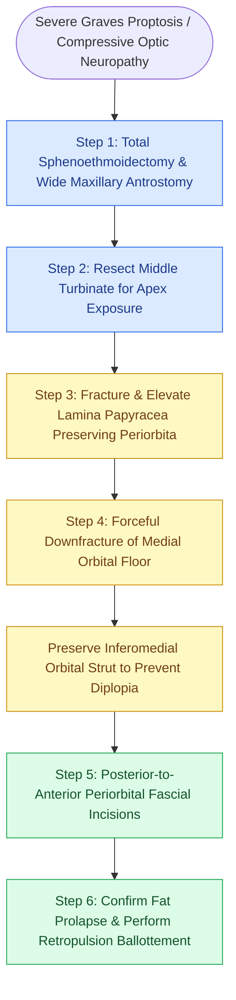

# Balanced endoscopic orbital decompression removes the lamina papyracea and medial floor while sparing the inferomedial strut to prevent diplopia

## Active Recall

> [!question]- Why is preservation of the inferomedial orbital bone strut critical during medial and floor orbital decompression?
> *Answer / Clinical Rationale*: The inferomedial orbital bone strut (the bony junction between the lamina papyracea and the orbital floor along the maxillary sinus roof) acts as a physical sling supporting the globe and the inferior rectus / medial rectus muscle vectors. Resecting this strut allows the globe and extraocular muscle cone to inferomedially displace (hypoglobus), resulting in new-onset or exacerbated postoperative diplopia in up to 30% to 50% of patients. Preserving the strut provides reliable 3 to 4 mm proptosis reduction while dramatically slashing diplopia rates.
>
> [!question]- What surgical sequence must be followed before incising the periorbita during endoscopic orbital decompression?
> *Answer / Clinical Rationale*: Complete sphenoethmoidectomy, wide maxillary antrostomy, partial or complete middle turbinectomy, comprehensive skeletonization and removal of the lamina papyracea and medial floor bone, and meticulous absolute hemostasis with bipolar cautery must all be achieved BEFORE opening the periorbita. Once the periorbita is incised, orbital fat herniates rapidly into the nasal cavity, permanently obscuring surgical visibility and making further bony resection or skull base instrumentation hazardous.

## Core Clinical & Mechanistic Principles

Thyroid Eye Disease (TED / Graves orbitopathy) results from autoimmune activation of orbital fibroblasts by thyroid-stimulating hormone receptor (TSH-R) and IGF-1 receptor autoantibodies, driving glycosaminoglycan deposition, muscular hypertrophy, and intense adipogenesis. Within the rigid, non-yielding bony orbit, volumetric expansion elevates intraorbital pressure, resulting in progressive proptosis, exposure keratopathy, refractory retrobulbar pain, and compressive optic neuropathy at the orbital apex. Surgical decompression expands the orbital boundaries into adjacent pneumatic sinonasal cavities to permanently reduce intraorbital pressure and restore tissue perfusion.

While open transantral (Walsh-Ogura) approaches provided inferior decompression at the expense of external/gingivobuccal incisions, facial hypesthesia, and high rates of strabismus, endonasal endoscopic decompression provides superior visualization of the orbital apex and skull base. Bony removal encompasses the [[Entering the ethmoid bulla inferomedially avoids orbital and skull base penetration|ethmoid bulla]] and lamina papyracea from the maxillary line anteriorly to the sphenoethmoidal angle posteriorly, combined with downfracture of the medial orbital floor up to the infraorbital nerve canal. 

For severe proptosis, the gold-standard protocol is a **balanced three-wall decompression**, which pairs endoscopic medial and floor decompression with an external [[Retrobulbar hematoma requires emergent bedside lateral canthotomy and cantholysis|lateral canthotomy]] and lateral wall decompression. Crucially, preserving the inferomedial orbital bone strut (modified Walsh-Ogura principle) stabilizes extraocular muscle vectors and mitigates vector-shift diplopia while achieving an average of 3.5 to 5.5 mm globe recession.

### Step-by-Step Surgical Execution

1. **Preoperative Optimization & Anesthesia**: The patient is positioned supine with eyes exposed and prepped within the sterile field. Anesthesia is cautioned to avoid aggressive postextubation bag-mask positive-pressure ventilation, which can force air through the dehiscent orbit and produce tension orbital emphysema.
2. **Sinus Cleansing & Middle Turbinectomy**: Total sphenoethmoidectomy and a wide maxillary antrostomy extending to the posterior wall are completed. Resection of the middle turbinate is performed to provide direct linear visualization of the medial orbital wall and orbital apex and facilitate post-decompression surveillance.
3. **Medial Orbital Wall Skeletonization**: A spoon curette fractures the lamina papyracea in a controlled planar fashion. Straight and angled Blakesley forceps peel away bone fragments superiorly toward the skull base (leaving a 1–2 mm bone ledge at the fovea ethmoidalis to prevent CSF leak and frontal recess occlusion), inferiorly to the floor, anteriorly to the maxillary line, and posteriorly to the sphenoid face.
4. **Orbital Floor Downfracture**: A double-ball probe elevates the periorbita off the medial orbital floor. A spoon curette forcefully downfractures the bone medial to the infraorbital canal. Angled through-cutting forceps remove floor bone while deliberately sparing the inferomedial bone strut.
5. **Periorbital Incisions**: Under 30-degree endoscopic visualization, an arachnoid knife, sickle knife, or carpal tunnel release blade incises the periorbita from posterior to anterior. Initial incisions are placed posteriorly at the sphenoid face and advanced forward. Multiple parallel linear incisions are made along the medial and inferior vectors, releasing interlobular fibrous septa with a ball-tip probe.
6. **Confirmation of Prolapse & Retropulsion**: Gentle external ballottement of the globe confirms free herniation of extraconal orbital fat into the ethmoid and maxillary cavities. Ocular recession is measured (average 3.5 mm endonasal alone, up to 5.5–6.0 mm with lateral decompression).
7. **Hemostasis and Postoperative Regimen**: Packing is strictly contraindicated, as intranasal packing compresses the prolapsed orbital fat and reverses decompression, risking optic nerve ischemia. Bipolar cautery is used exclusively. Oral antistaphylococcal antibiotics and steroid tapers are initiated.

### Danger Zones & Complication Avoidance

- **Extraocular Muscle Transection**: Deep plunging of knives during periorbital release can directly lacerate the medial rectus or inferior rectus muscle bellies, causing permanent severe strabismus. Only the superficial fascial layer is nicked with the tip of the sickle blade.
- **Optic Nerve Injury at Orbital Apex**: Incising periorbita posterior to the sphenoethmoidal angle risks transecting the optic nerve as it enters the optic canal. All periorbital incising must terminate anterior to the annulus of Zinn.
- **Thermal Injury from Monopolar Cautery**: Monopolar electrocautery is strictly prohibited on the orbit; electrical current conducts directly through retrobulbar fat to the optic nerve and ophthalmic vessels, causing immediate irreversible blindness.

## Connected Concepts & Graph Traversal
- **Anatomical Landmark**: [[Lamina papyracea dehiscence predisposes to orbital fat herniation and medial rectus injury|Lamina Papyracea Anatomy]]
- **Skull Base Boundary**: [[The CLOSE checklist systematically evaluates critical radiological danger zones|Sphenoethmoid Angle & Ethmoidal Arteries]]
- **Complication Avoidance**: [[Middle turbinate lateralization causes secondary ostiomeatal obstruction and frontal sinus stenosis|Middle Turbinectomy & Frontal Drainage]]
- **🔗 Volume Restoration (FPRS)**: [[Orbital floor blowout fractures with muscle entrapment or significant enophthalmos mandate reconstruction|Orbital Floor Biomechanics & Strut]]
- **Surgical Approach**: [[Endoscopic transorbital approaches provide multi-portal access to the lateral skull base and orbit|Multi-Portal Orbital Decompression]]
