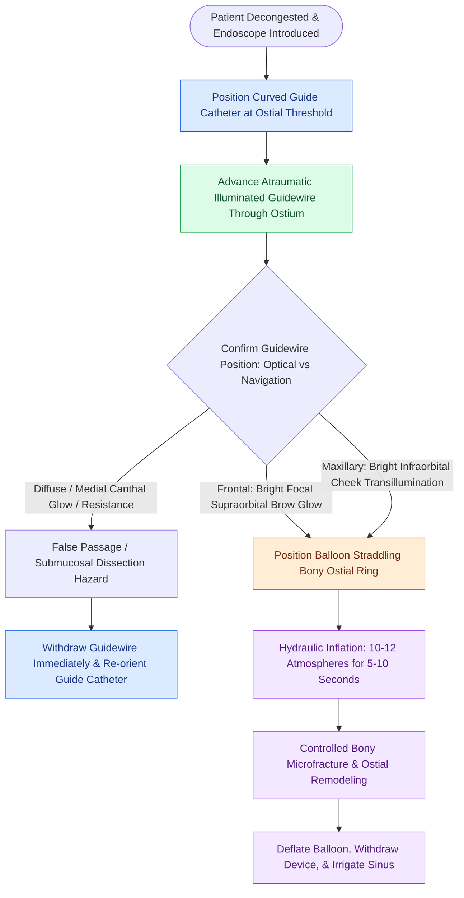

# Balloon catheter sinus dilatation widens paranasal ostia via high-pressure microfracture remodeling while requiring transillumination or image guidance to prevent false passage

## Active Recall

> [!question]- What physical mechanism and inflation pressure achieve durable paranasal ostial enlargement during balloon catheter sinus dilatation?
> *Answer / Clinical Rationale*: Balloon sinus ostial dilatation utilizes high-pressure hydraulic inflation (typically 10 to 12 atmospheres of water pressure) to cause controlled microfractures of the surrounding bony ostial ring, permanently restructuring the outflow tract while preserving intact mucosal lining.

> [!question]- How does transillumination with an illuminated guidewire verify accurate frontal sinus cannulation versus false passage into an anterior ethmoid cell?
> *Answer / Clinical Rationale*: Accurate frontal sinus intraluminal positioning produces a bright, sharp, well-circumscribed focal glow across the medial supraorbital brow that moves synchronously with guidewire advancement. Cannulation of an anterior ethmoid cell produces faint, diffuse, non-translating transillumination or localized medial canthal glow.

> [!question]- Why is balloon catheter dilatation contraindicated as an isolated standalone procedure in patients with ethmoid sinusitis or extensive nasal polyposis?
> *Answer / Clinical Rationale*: The ethmoid sinuses consist of multiple discrete bony septations and microscopic drainage ostia rather than a single dilatable ostium. Furthermore, balloon inflation does not resect mucosal polyps or osteitic bone partitions, which require microdebrider resection and marsupialization.

## Core Clinical & Mechanistic Principles
Balloon sinus ostial dilatation (BSOD) provides a tissue-preserving, mucosa-sparing alternative or adjunct to traditional cutting functional endoscopic sinus surgery. Rather than cutting tissue as in [[Controlled middle meatal antrostomy enlargement preserves the anterior inferior fontanelle]] or clearing cells in a [[Draf I frontal sinusotomy clears obstructing ethmoid cells without instrumenting the ostium]], balloon dilation widens the natural ostium through controlled hydraulic microfracture of the supporting thin bone partitions.

When indicated, balloon technology can be deployed as a standalone procedure for uncomplicated recurrent acute rhinosinusitis or as a **hybrid procedure**, where traditional functional endoscopic sinus surgery (uncinectomy, ethmoidectomy) with [[Powered microdebrider blade selection and suction irrigation maintain clean surgical optics]] is combined with balloon dilation of difficult-to-reach frontal or sphenoid ostia.

### Technical Execution and Verification Protocols
1. **Instrument Assembly and Selection**:
   - System consists of a rigid guiding catheter with sinus-specific angles ($70^\circ$ for frontal, $90^\circ$ or $110^\circ$ for maxillary, $0^\circ$ or $30^\circ$ for sphenoid), a flexible illuminated or navigation-tracked guidewire, a high-pressure balloon catheter, and a dedicated hydraulic inflation syringe with pressure gauge.
2. **Guidewire Advancement & Confirmation**:
   - The guide catheter is directed into the middle meatus or sphenoethmoidal recess.
   - The illuminated guidewire is advanced gently through the ostium. *Tactile Rule*: Advance with smooth, light pressure; tactile resistance signals bony impaction or submucosal dissection.
   - *Confirmation Signatures*:
     - **Frontal Sinus**: A distinct, focused point of light traversing the medial brow and forehead.
     - **Maxillary Sinus**: Bright light illuminating the anterior cheek and soft tissues of the midface inferior to the infraorbital rim.
     - **Sphenoid Sinus**: Guided by electromagnetic image navigation or direct endoscopic visualization medial to the superior turbinate.
3. **Balloon Inflation Dynamics**:
   - The balloon is advanced over the seated wire until its radiopaque/visual markers straddle the ostium.
   - Inflate with sterile saline to **$10\text{ to }12\text{ atmospheres}$** for approximately **$5\text{ to }10\text{ seconds}$**.
   - Deflate and withdraw under direct endoscopic control. Verify ostial patency, absence of mucosal tearing, and wash out retained mucus with a dedicated sinus irrigation catheter.
4. **Absolute Contraindications**:
   - Isolated ethmoid sinus inflammatory disease (requires traditional endoscopic ethmoidectomy).
   - Severe diffuse sinonasal polyposis.
   - Extensive neo-osteogenesis or dense osteitis of the nasofrontal beak.
   - Suspected sinonasal neoplasms or fibro-osseous lesions.

## Connected Concepts & Graph Traversal
- **Natural Sphenoid Landmark**: [[The sphenoid sinus ostium lies medial to the superior turbinate above the choana|Sphenoid Natural Ostium]]
- **Frontal Outflow Pathway**: [[The uncinate process superior attachment dictates the frontal sinus drainage pathway|Frontal Sinus Outflow Tract]]
- **Open Surgical Antrostomy Comparison**: [[Complete uncinectomy and posterior fontanelle resection unify the natural maxillary ostium with fontanelle defects to prevent mucus recirculation loops|Maxillary Antrostomy Unification]]
- **Inflammatory Barrier to Balloon Alone**: [[Type 2 CRS exhibits eosinophilic inflammation responsive to targeted biologics|Type 2 CRS Inflammation]]
- **Topical Drug Elution Adjunct**: [[Steroid-eluting sinus implants deliver localized anti-inflammatory therapy to prevent restenosis|Steroid-Eluting Sinus Implants]]
