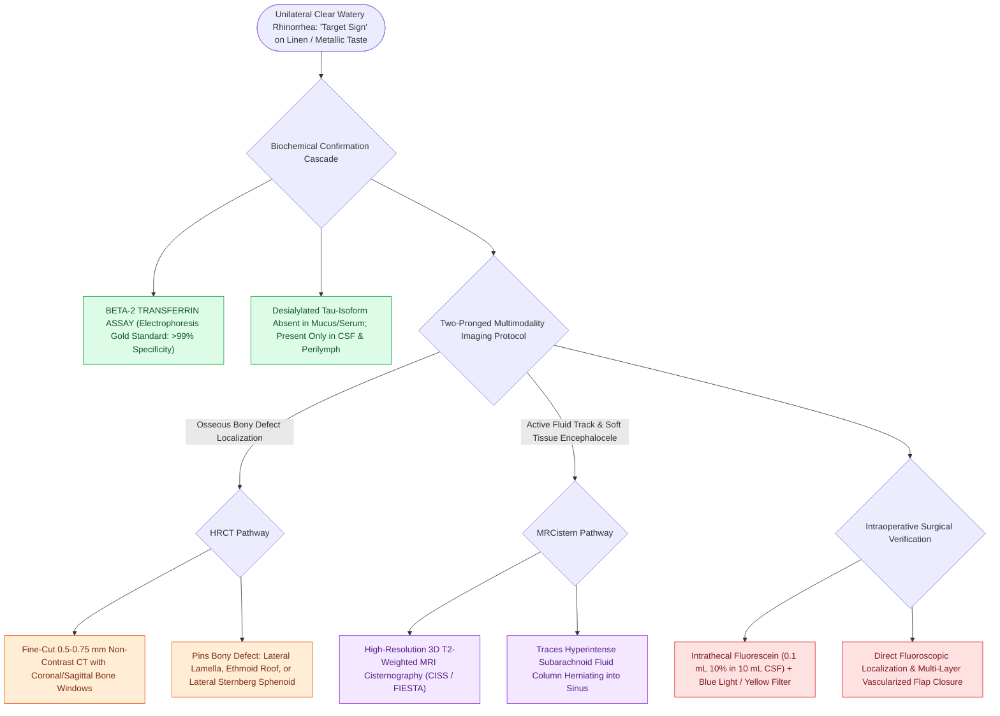

# Beta-2 transferrin and high-resolution CT localize sinonasal CSF fistulas

## Active Recall

> [!question]- Why is Beta-2 transferrin the definitive biochemical gold standard for confirming sinonasal CSF rhinorrhea?
> *Answer / Clinical Rationale*: Beta-2 transferrin is present **only in CSF, perilymph, and ocular fluid**. It is completely absent in peripheral blood, tears, saliva, and nasal mucus, providing near-100% specificity for CSF fistula.

> [!question]- What distinct roles do high-resolution CT and T2-weighted MR cisternography play in CSF leak localization?
> *Answer / Clinical Rationale*: **CT** localizes the precise **bony defect** in the skull base, while **MR cisternography** confirms the **active fluid column / dural herniation** and distinguishes encephaloceles from inflammatory mucosal thickening.

## Core Clinical & Mechanistic Principles
Surgical repair of sinonasal cerebrospinal fluid (CSF) leaks requires definitive **biochemical confirmation** followed by precise **three-dimensional radiological localization**.

### Biochemical Markers
1. **Beta-2 Transferrin ($\tau$-transferrin)**:
   - Gold-standard assay (immunofixation electrophoresis).
   - Produced by neuraminidase activity in the brain; found **exclusively in CSF**, perilymph, and aqueous humor.
   - **Completely absent** in normal nasal mucus, tears, saliva, or serum. Highly sensitive ($>99\%$) and specific ($>99\%$).
2. **Beta-Trace Protein (Prostaglandin D2 Synthase)**:
   - Rapid quantitative immunonephelometric assay; concentration in CSF is $>30\text{ fold}$ higher than in serum.

### High-Resolution Imaging Modalities
- **Thin-Cut High-Resolution CT ($0.5\text{–}0.75\text{ mm}$)**: Identifies the precise osseous margin of bone loss ([[The Keros classification stages olfactory fossa depth and lateral lamella vulnerability|lateral lamella]] of cribriform, fovea ethmoidalis, lateral sphenoid wall / Sternberg’s canal).
- **High-Resolution T2 MRI Cisternography (CISS / FIESTA)**: Demonstrates a hyperintense CSF "track" extending from the subarachnoid space through the skull base defect.

## Connected Concepts & Graph Traversal
- **Defect Preparation**: [[CSF leak defect preparation requires circumferential bone de-mucosalization|Defect Preparation]]
- **Multi-Layer Repair**: [[Multi-layer skull base reconstruction combines underlay, inlay, and overlay barriers|Reconstruction Hierarchy]]
- **Flap Closure**: [[The Hadad-Bassagasteguy nasoseptal flap is pedicled on the posterior septal artery|Nasoseptal Flap]]
- **Intraoperative Dye**: [[Intrathecal fluorescein enables visual localization of occult dural defects|Intrathecal Fluorescein]]
- **Anatomical Foundation**: [[Spontaneous CSF leaks are strongly associated with idiopathic intracranial hypertension and elevated BMI|Spontaneous CSF Leaks & IIH]]
- **Critical Safety / Complication**: [[Esthesioneuroblastoma Kadish and Hyams staging determines craniofacial resection and adjuvant therapy|Esthesioneuroblastoma (ENB)]]
- **Diagnostic Evaluation**: [[Multi-layer underlay and overlay CSF leak closure employs a bath-plug technique with autologous fat and fascia lata to resist intracranial pressure pulsations|Bath-Plug CSF Closure]]
- **Systematic Confirmation & Repair Sequence**: [[Endoscopic repair of cerebrospinal fluid rhinorrhea employs systematic biochemical confirmation, intrathecal fluorescein localization, and multilayer underlay dural reconstruction to achieve primary closure|Endoscopic CSF Rhinorrhea Repair]]
