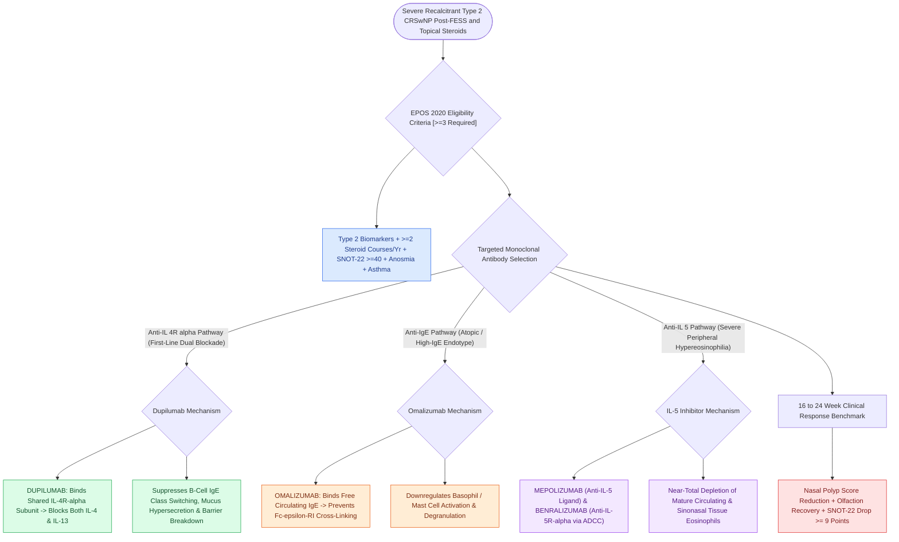

# Biologic therapeutics in chronic rhinosinusitis target IgE, IL-4, IL-5, and IL-13 inflammatory pathways

## Active Recall

> [!question]- Which molecular signaling pathways are simultaneously blocked by the monoclonal antibody Dupilumab?
> *Answer / Clinical Rationale*: **Interleukin-4 (IL-4)** and **Interleukin-13 (IL-13)** signaling (via binding to the shared IL-4R$\alpha$ receptor).

> [!question]- What are the European criteria (EPOS 2020) for initiating biologic therapy in chronic rhinosinusitis with nasal polyps?
> *Answer / Clinical Rationale*: Presence of **Type 2 inflammation** with at least two previous steroid courses, severe quality of life impairment ($\text{SNOT-22} \ge 40$), anosmia, or comorbid asthma.

## Core Clinical & Mechanistic Principles
**Biologic Therapeutics (Monoclonal Antibodies)** have revolutionized the management of [[AERD manifests with asthma, nasal polyps, and severe aspirin-induced respiratory reactions|severe]], recalcitrant **Type 2 Chronic Rhinosinusitis with Nasal Polyposis (CRSwNP)** failing standard topical steroids and functional endoscopic sinus surgery (FESS):
- **The Core Molecular Targets & Mechanisms**:
  1. **Dupilumab (Anti-IL-4R$\alpha$)**:
     - Monoclonal antibody binding the shared **IL-4 receptor alpha (IL-4R$\alpha$) subunit**, simultaneously blocking both **IL-4 and IL-13** downstream signaling.
     - Suppresses Th2 cell differentiation, B-cell class switching to IgE, and barrier dysfunction; achieves the largest reduction in polyp score (NPS) and SNOT-22 scores in clinical trials.
  2. **Omalizumab (Anti-IgE)**:
     - Binds free circulating **IgE**, preventing it from binding to high-affinity Fc$\varepsilon$RI receptors on mast cells and basophils; reduces mast cell degranulation and local mucosal inflammation.
  3. **Mepolizumab & Benralizumab (Anti-IL-5 / IL-5R$\alpha$)**:
     - *Mepolizumab*: Binds free **IL-5**, preventing eosinophil maturation and survival.
     - *Benralizumab*: Binds **IL-5R$\alpha$** on eosinophils, inducing antibody-dependent cell-mediated cytotoxicity (ADCC) for near-total eosinophil depletion.
- **EPOS 2020 / EUFOREA Indication Criteria (At least 3 required)**:
  1. Evidence of Type 2 inflammation (tissue eosinophils $\ge 10/\text{HPF}$ or blood eosinophils $\ge 150/\mu\text{L}$ or total IgE $\ge 100\text{ kU/L}$).
  2. Need for $\ge 2$ courses of systemic corticosteroids in the past year.
  3. Significantly impaired quality of life ($\text{SNOT-22} \ge 40$).
  4. Significant loss of smell (anosmia/hyposmia).
  5. Diagnosis of comorbid asthma.

### Surgical Technique & Critical Safety Checks
- **Monitoring Response**: Assessed at **$16\text{ to }24\text{ weeks}$**; positive response defined by reduced nasal polyp size, improved smell, reduced SNOT-22 score, and reduced need for systemic steroids or revision surgery.

## Connected Concepts & Graph Traversal
- **T2 Endotype Driver**: [[Non-Type 2 CRS features neutrophilic inflammation associated with cystic fibrosis and ciliopathies|Type 2 vs Non-Type 2 CRS]]
- **AERD Comorbidity**: [[AERD manifests with asthma, nasal polyps, and severe aspirin-induced respiratory reactions|AERD Triad]]
- **AFRS Eosinophilic Mucin**: [[Allergic fungal rhinosinusitis presents with eosinophilic mucin and Charcot-Leyden crystals|AFRS Criteria]]
- **Systemic Vasculitis Differential**: [[Eosinophilic granulomatosis with polyangiitis causes asthma, peripheral eosinophilia, and necrotizing vasculitis|EGPA Vasculitis]]
- **Allergic Sensitization Workup**: [[Intradermal dilutional testing IDT and modified quantitative testing MQT quantify allergic sensitization to guide safe immunotherapy escalation|IDT & MQT Allergy Testing]]
