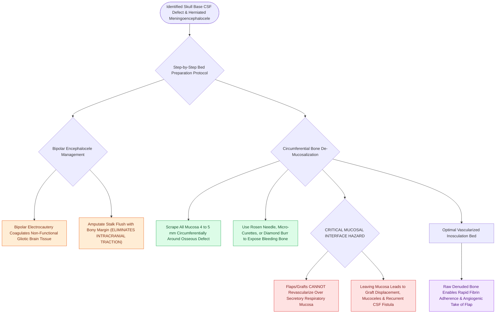

# CSF leak defect preparation requires circumferential bone de-mucosalization

## Active Recall

> [!question]- Why must the skull base bone surrounding a CSF leak defect be de-mucosalized for 4 to 5 mm prior to flap placement?
> *Answer / Clinical Rationale*: Vascularized flaps and mucosal grafts **cannot adhere or revascularize over respiratory epithelium**. Leaving mucosa in place leads to graft displacement, persistent CSF fistula, and entrapment mucoceles.

> [!question]- How is a herniated meningoencephalocele managed during endoscopic skull base defect preparation?
> *Answer / Clinical Rationale*: The non-functional gliotic tissue is **cauterized and reduced with bipolar electrocautery** back to the osseous defect level, preventing intracranial traction before reconstructive layering.

## Core Clinical & Mechanistic Principles
The single most common cause of failure in endoscopic skull base reconstruction and CSF leak repair is **placing a graft or flap over intact respiratory mucosa**.

Grafts and vascularized flaps **cannot adhere or revascularize over [[Respiratory epithelium drives mucociliary clearance toward natural ostia|respiratory epithelium]]**. Placing a reconstructive flap over mucosa creates a secretomotor epithelial interface that produces mucus, prevents fibrous biological seal, and results in **iatrogenic mucocele formation** and recurrent CSF fistula.

### Step-by-Step Defect Preparation
1. **Encephalocele Management**:
   - Herniated brain tissue in meningoencephaloceles is non-functional, gliotic, and dysplastic.
   - Use bipolar electrocautery to coagulate and amputate the stalk flush with the bony defect, eliminating intracranial traction.
2. **$4\text{–}5\text{ mm}$ Circumferential De-Mucosalization**:
   - Using micro-curettes, round knives, or diamond burrs, meticulously scrape and elevate all respiratory mucosa for **$4\text{–}5\text{ mm}$ circumferentially** around the bony defect.
   - The exposed raw bone provides the vascular bed necessary for graft inosculation, fibrin adherence, and revascularization.

## Connected Concepts & Graph Traversal
- **Diagnostic Step**: [[Beta-2 transferrin and high-resolution CT localize sinonasal CSF fistulas|CSF Diagnostics]]
- **Multi-Layering**: [[Multi-layer skull base reconstruction combines underlay, inlay, and overlay barriers|Multi-Layer Reconstruction]]
- **Vascularized Flap**: [[The Hadad-Bassagasteguy nasoseptal flap is pedicled on the posterior septal artery|Nasoseptal Flap (NSF)]]
- **Complication Matrix**: [[High-stakes sinonasal complications require proactive landmarking and emergency rescue protocols|High-Stakes Sinonasal Complications]]
- **Surgical Craft**: [[Powered microdebrider blade selection and suction irrigation maintain clean surgical optics|Powered Microdebrider Craft]]
- **Anatomical Foundation**: [[Spontaneous CSF leaks are strongly associated with idiopathic intracranial hypertension and elevated BMI|Spontaneous CSF Leaks & IIH]]
- **Diagnostic Assessment**: [[Entering the ethmoid bulla inferomedially avoids orbital and skull base penetration|Anterior Ethmoidectomy Technique]]
- **Critical Safety / Complication**: [[Esthesioneuroblastoma Kadish and Hyams staging determines craniofacial resection and adjuvant therapy|Esthesioneuroblastoma (ENB)]]
