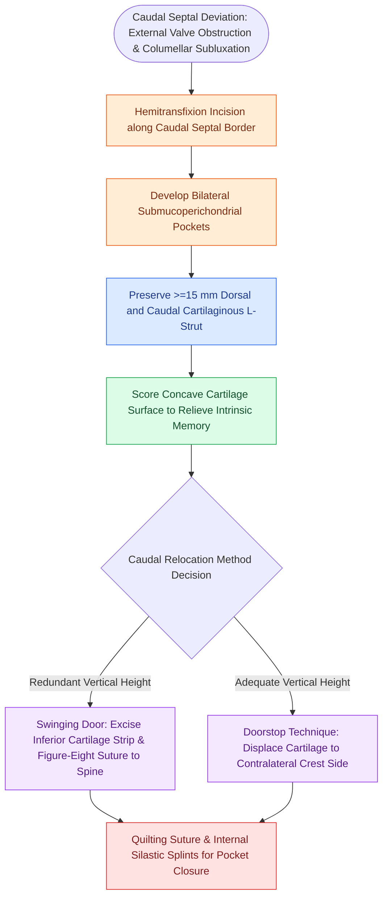

# Caudal septoplasty corrects caudal subluxation and external valve collapse through swinging-door relocation and L-strut preservation

## Active Recall

> [!question]- What is the minimum recommended dimension for the dorsal and caudal L-strut during septoplasty, and what structural deformities develop if this threshold is violated?
> *Answer / Clinical Rationale*: A continuous cartilage strut of at least 15 mm must be maintained along both dorsal and caudal margins. Resection beyond this boundary destabilizes the cartilaginous nasal vault, leading to tip ptosis, loss of tip projection, retracted columella, and saddle nose deformity.

> [!question]- How does the swinging-door technique biomechanically differ from the doorstop method in resolving caudal septal dislocation?
> *Answer / Clinical Rationale*: The swinging-door technique excises a vertical strip of redundant cartilage resting in the maxillary crest groove and sutures the freely swinging caudal margin to the anterior nasal spine with a 3-0 Vicryl figure-eight suture, whereas the doorstop technique transposes the full-height cartilage to the contralateral side of the nasal spine without cartilage excision.

## Core Clinical & Mechanistic Principles
The nasal septum establishes the critical medial pillar for both the internal nasal valve and the external nasal valve. Septal deformities occur in 77% to 90% of the population, and even minor deflections along the caudal margin markedly disrupt laminar airflow, elevate nasal airway resistance, and induce [[Rhinogenic contact point headache arises from mucosal contact between the nasal septum and turbinates|contact point headaches]].

### The L-Strut Structural Standard
The quadrangular cartilage articulates posterosuperiorly with the perpendicular plate of the ethmoid, posteroinferiorly with the vomer, and inferiorly with the maxillary and palatine crests. At the osteocartilaginous junction, perichondrium and periosteum are not continuous; dense decussating collagen fibers require sharp dissection to avoid flap tearing. 

To maintain nasal tip support and dorsal height, surgeons must preserve an **L-strut of at least 15 mm** along both the dorsal and caudal borders. Overaggressive resection of the caudal margin destabilizes the medial crural footplates, causing severe columellar retraction, tip ptosis, and [[Saddle nose deformity requires multi-tier dorsal and caudal structural reconstruction|saddle nose collapse]].

### Operative Mechanics for Caudal Deformities
1. **Initial Access & Flap Elevation**:
   - A **hemitransfixion incision** is placed at the caudal border of the quadrangular cartilage from the anterior septal angle to the posterior septal angle. For deflections localized strictly to the mid- or posterior septum, a modified Killian incision located 1 cm posterior to the caudal border may be employed.
   - Bilateral submucoperichondrial flaps are elevated sharply over the anterior maxillary spine and crest. Identifying the pearly-white, gritty subperichondrial plane is essential to ensure a bloodless dissection and eliminate bilateral opposing mucosal perforations.
2. **Releasing Cartilage Memory**:
   - Cartilaginous memory is released by scoring the cartilage on the **concave side** along the axis of deflection with a No. 15 blade, taking care not to penetrate the contralateral perichondrium.
3. **Swinging Door Technique**:
   - The caudal cartilage is freed from its fibrous adherence within the maxillary crest groove.
   - An inferior strip of cartilage (1 to 3 mm) resting in the crest groove is excised. The freed cartilage, anchored solely along its dorsal border, swings freely into the anatomical midline.
   - The relocated caudal strut is secured to the periosteum of the anterior nasal spine using a figure-eight suture of 3-0 polyglactin 910 (Vicryl).
4. **Doorstop Technique**:
   - In patients without vertical cartilage excess, the cartilage is elevated out of the bony groove and translocated to the opposite side of the maxillary crest without strip excision, using the bony ledge as a mechanical doorstop.
5. **Graft Buttressing & Extracorporeal Septoplasty**:
   - Severe caudal deviation or structural weakness can be reinforced with an autologous perpendicular plate ethmoid bone sandwich batten graft. For crushed or severely twisted caudal struts, extracorporeal septoplasty with complete cartilage resection, ex vivo reconstruction, and resorbable polydioxanone (PDS) foil augmentation is executed.
6. **Septal Pocket Closure**:
   - The mucosal pocket is reapproximated using a continuous running 4-0 plain gut quilting suture to prevent septal hematoma, followed by internal silastic splints secured with a 3-0 nylon mattress stitch.

## Connected Concepts & Graph Traversal
- **🔗 Internal Valve Reconstruction (FPRS)**: [[Spreader grafts restore internal nasal valve patency and prevent inverted-V deformity]]
- **🔗 Functional Airway Impact (Pediatrics)**: [[Nasal surgery alone improves CPAP compliance and subjective daytime somnolence without normalizing AHI]]
- **Hemostatic Packaging**: [[Topical hemostatic matrix agents and nasal packing mitigate postoperative epistaxis and synechiae]]
- **Anterior Septal Epistaxis**: [[Kiesselbach plexus anterior epistaxis is managed with cautery and anterior nasal packing]]
- **Endoscopic Spur Resection**: [[Endoscopic septoplasty enables targeted spur resection and improves middle meatal access while minimizing mucosal dissection]]
- **Objective Airflow Confirmation**: [[Acoustic rhinometry and rhinomanometry evaluate internal nasal valve geometry and dynamic airflow resistance through cross-sectional area and transnasal pressure measurements|Acoustic Rhinometry & Rhinomanometry]]
