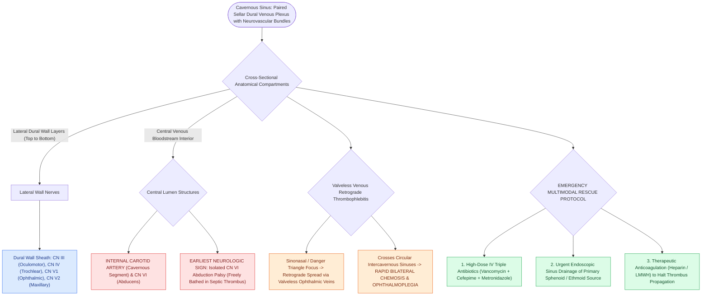

# Cavernous sinus thrombosis presents with chemosis, proptosis, and progressive ophthalmoplegia from CN III, IV, V1, V2, and VI involvement

## Active Recall

> [!question]- What is the precise anatomical relationship of cranial nerves III, IV, V1, V2, and VI to the cavernous sinus walls versus the central venous lumen?
> *Answer / Clinical Rationale*: - **Lateral Wall (Superior to Inferior)**: **CN III (Oculomotor)**, **CN IV (Trochlear)**, **CN $V_1$ (Ophthalmic)**, and **CN $V_2$ (Maxillary)** are embedded within the fibrous dural sheath of the lateral sinus wall. - **Internal Lumen**: **CN VI (Abducens)** and the **Internal Carotid Artery (ICA / Cavernous segment)** traverse freely *inside* the central venous bloodstream, anchored to the lateral aspect of the ICA by fibrous trabeculae. Consequently, **isolated CN VI palsy (abduction failure) is the earliest neurologic sign** of septic cavernous sinus thrombosis or expanding intracavernous aneurysms.

> [!question]- What are the four angiographic types of Carotid-Cavernous Fistulas (CCF) under the Barrow classification?
> *Answer / Clinical Rationale*: - **Type A (Direct / High-flow, $\sim 75\text{–}80\%$ of CCFs)**: Direct shunt between the internal carotid artery and the cavernous sinus (predominantly traumatic, skull base fracture). - **Type B (Indirect / Low-flow)**: Dural shunt between meningeal branches of the *intracavernous ICA* and the cavernous sinus. - **Type C (Indirect / Low-flow)**: Dural shunt between meningeal branches of the *external carotid artery (ECA)* and the cavernous sinus. - **Type D (Indirect / Low-flow)**: Dural shunt receiving arterial supply from *both* ICA and ECA meningeal branches.

> [!question]- How does septic cavernous sinus thrombosis spread from a primary sinonasal or midfacial focus to become bilateral?
> *Answer / Clinical Rationale*: Septic thrombophlebitis travels retrograde via the **valveless superior and inferior ophthalmic veins** (from ethmoid/sphenoid sinusitis or "danger triangle" facial furuncles) into the ipsilateral cavernous sinus. It then rapidly crosses the midline to the contralateral cavernous sinus via the **anterior and posterior circular (intercavernous) sinuses**, producing **rapidly progressive bilateral chemosis, proptosis, and ophthalmoplegia**.

## Core Clinical & Mechanistic Principles
The **Cavernous Sinus** is a paired dural venous plexus situated on either side of the sella turcica and sphenoid body, extending from the superior orbital fissure anteriorly to the petrous apex posteriorly:

### Diagnostic & Therapeutic Protocol for Septic CST
- **Contrast-Enhanced MRI / MRV**: Shows filling defects in the cavernous sinus, enlargement of the superior ophthalmic vein, and lateral bowing of the sinus wall.
- **Aggressive Multimodal Management**: High-dose IV broad-spectrum antibiotics (Vancomycin + Ceftriaxone/Cefepime + Metronidazole), urgent endoscopic surgical drainage of the source sphenoid/ethmoid sinuses (see [[Orbital complications of acute sinusitis staged by the Chandler classification dictate medical versus surgical drainage|Chandler Orbital Complications]]), and therapeutic anticoagulation (unfractionated heparin / LMWH) to arrest thrombus propagation.

## Connected Concepts & Graph Traversal
- **🔗 Cranial Nerve Anatomy (Otology)**: [[The twelve cranial nerves are evaluated by functional components, skull base exits, and clinical reflexes|12 Cranial Nerves Functional Anatomy]]
- **Sinonasal Complications**: [[Orbital complications of acute sinusitis staged by the Chandler classification dictate medical versus surgical drainage|Chandler Orbital Complications]]
- **Sphenoid Sinus Craft**: [[Beta-2 transferrin and high-resolution CT localize sinonasal CSF fistulas|Endoscopic Sphenoidotomy]]
- **🔗 Skull Base Foramina (Otology)**: [[Cranial nerve polyneuropathies of the skull base are localized by specific anatomical foramen involvement|Skull Base Neuropathies]]
- **Vascular Hemostasis**: [[Topical hemostatic matrix agents and nasal packing mitigate postoperative epistaxis and synechiae|Hemostatic Packing Matrix]]
