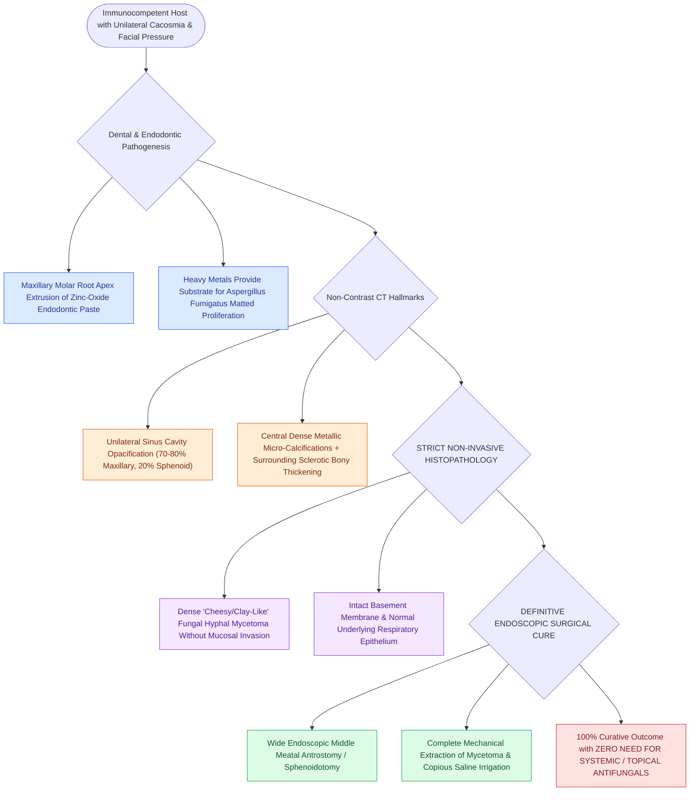

# Chronic non-invasive fungal ball presents with dense maxillary mycetoma without tissue invasion

## Active Recall

> [!question]- What classic finding on non-contrast CT indicates the presence of a sinonasal fungal ball?
> *Answer / Clinical Rationale*: Unilateral sinus opacification containing **central hyperattenuating / metallic calcified concretions** with surrounding bony osteosclerosis.

> [!question]- What common dental event predisposes patients to maxillary fungal ball formation?
> *Answer / Clinical Rationale*: **Over-instrumentation or extrusion of zinc oxide-containing endodontic filling paste** through the root apex of a maxillary premolar or molar into the sinus antrum.

## Core Clinical & Mechanistic Principles
A **Sinonasal Fungal Ball (Mycetoma)** is a dense, matted conglomeration of fungal hyphae residing within a single sinus cavity (most commonly the **maxillary sinus in $>70\text{–}80\%$**, followed by the sphenoid sinus) in an **immunocompetent host**.

It is completely **non-invasive**, with zero mucosal or vascular invasion.

### Treatment Simplicity vs Invasive Disease
- **Curative Surgery**: Wide endoscopic [[Maxillary antrostomy requires incorporating accessory fontanelle ostia to prevent recirculation|maxillary antrostomy]] or sphenoidotomy with thorough suction and saline irrigation to wash out the clay-like fungal debris.
- **No Antifungals**: Because there is no tissue invasion, topical or systemic antifungal therapy is completely unnecessary.

## Connected Concepts & Graph Traversal
- **Invasive Contrast**: [[Acute invasive fungal rhinosinusitis requires emergent surgical debridement and systemic amphotericin B|Acute Invasive Fungal Sinusitis]]
- **Allergic Form**: [[Allergic fungal rhinosinusitis presents with eosinophilic mucin and Charcot-Leyden crystals|Allergic Fungal Rhinosinusitis (AFRS)]]
- **Dental Link**: [[Odontogenic sinusitis arises from periapical maxillary dental pathology and oroantral fistulas|Odontogenic Sinusitis]]
- **High-Stakes Safety**: [[Separate inferior antrostomies cause recirculating mucus and recalcitrant sinusitis|Mucus Recirculation Phenomenon]]
- **Clinical Management**: [[Maxillary antrostomy requires incorporating accessory fontanelle ostia to prevent recirculation|Maxillary Antrostomy Technique]]
