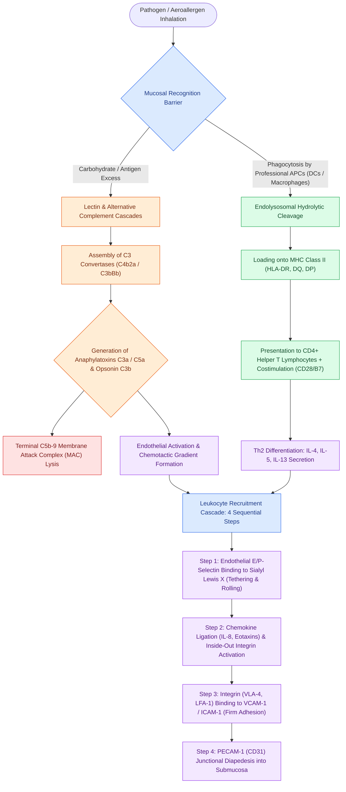

# Complement activation cascades, MHC antigen presentation, and leukocyte adhesion molecules orchestrate mucosal innate and adaptive immunity

## Active Recall

> [!question]- What molecular stimuli initiate the Classical, Lectin, and Alternative complement pathways, and at what pivotal enzymatic step do all three converge?
> *Answer / Clinical Rationale*: The **Classical pathway** is initiated by **antigen-antibody complexes (IgG, IgM)** binding C1qrs. The **Lectin pathway** is initiated by **mannose-binding lectin (MBL)** binding microbial carbohydrate mannan residues, activating MASP-1 and MASP-2. The **Alternative pathway** is initiated by spontaneous low-grade hydrolysis of C3 and direct microbial surface contact recruiting Factor B and Factor D. All three pathways converge at the generation of a **C3 convertase** (C4b2a in Classical/Lectin; C3bBb in Alternative), which cleaves C3 into the anaphylatoxin **C3a** and the opsonin **C3b**, subsequently forming C5 convertase and assembling the **C5b-9 membrane attack complex (MAC)**.
*(CummingsReview2017, Ch8, p.177, 179)*

> [!question]- What are the key structural, cellular, and functional differences between MHC Class I and MHC Class II antigen presentation?
> *Answer / Clinical Rationale*: **MHC Class I (HLA-A, HLA-B, HLA-C)** is expressed on **all nucleated cells**, binds endogenous/cytosolic antigens processed by the proteasome, and presents 8–10 amino acid peptides to **CD8+ cytotoxic T lymphocytes**. **MHC Class II (HLA-DR, HLA-DQ, HLA-DP)** is expressed exclusively on **professional antigen-presenting cells (dendritic cells, macrophages, B cells)**, binds exogenous antigens digested within endolysosomes, and presents 13–25 amino acid peptides to **CD4+ helper T lymphocytes**.
*(CummingsReview2017, Ch8, p.176–178)*

> [!question]- What four sequential molecular steps govern leukocyte extravasation into inflamed sinonasal mucosa?
> *Answer / Clinical Rationale*:
> 1. **Rolling**: Endothelial **E-selectin and P-selectin** (and leukocyte **L-selectin**) interact with carbohydrate ligands (sialyl Lewis X), slowing leukocytes.
> 2. **Activation**: Bound chemokines (e.g., **CXCL8/IL-8, eotaxins CCL11/24/26**) and lipid mediators (PAF, LTB4) bind leukocyte G-protein-coupled receptors, triggering conformational activation of leukocyte integrins.
> 3. **Firm Adhesion / Arrest & Flattening**: High-affinity leukocyte integrins (**VLA-4 / α4β1, LFA-1 / αLβ2, Mac-1**) bind endothelial adhesion molecules (**VCAM-1 and ICAM-1**).
> 4. **Transmigration / Diapedesis**: Leukocytes squeeze through endothelial cell junctions mediated by junctional molecules (**PECAM-1 / CD31** and CD99).
*(CummingsReview2017, Ch8, p.177, 183)*

## Core Clinical & Mechanistic Principles
The sinonasal tract represents the primary aerodigestive portal encountering inhaled microbial pathogens and airborne allergens. Protection of this mucosal barrier requires seamless integration between **innate immunity** (the mechanical ciliated pseudostratified columnar epithelium, antimicrobial peptides, pattern-recognition receptors, the complement cascade, and rapid leukocyte recruitment) and **adaptive immunity** (specialized antigen presentation via MHC molecules, antigen-specific immunoglobulins, and effector helper and cytotoxic T lymphocytes).

### Hematopoietic Immune Cell Lineages & Ontogeny
All immune effector cells originate from bone marrow **pluripotent hematopoietic stem cells** that branch into two primary progenitor pathways:
1. **Common Lymphoid Progenitor (CLP)**:
   - Differentiates into **T-cell progenitors** that migrate to the thymus for positive and negative selection, developing into mature CD4+ helper T cells (Th1, Th2, Th17, Treg) and CD8+ cytotoxic T cells expressing alpha/beta or gamma/delta T-cell receptors (TCR).
   - Generates **B-cell progenitors** maturing in the bone marrow into IgM/IgD-bearing naive B lymphocytes, which later undergo somatic hypermutation and class-switch recombination into antibody-secreting plasma cells.
   - Generates **Natural Killer (NK) cells** (large granular lymphocytes mediating innate cytotoxicity and ADCC).
2. **Common Myeloid Progenitor (CMP)**:
   - Differentiates into granulocyte-macrophage colony-forming units (**CFU-GM**), giving rise to promonocytes/monocytes (which enter tissue to become resident **macrophages** and **dendritic cells**) and myelocytes developing into mature **neutrophils**.
   - Differentiates into eosinophil colony-forming units (**CFU-Eo**), yielding mature **eosinophils** with bilobed nuclei and major basic protein granules.
   - Differentiates into basophil-mast cell progenitors (**CFU-BM**), producing circulating **basophils** and mucosal/connective tissue **mast cells**.
   - Gives rise to megakaryocyte/erythroid progenitors (**BFU-MEG** generating platelets and **BFU-E** generating mature erythrocytes).

### Immunoglobulin Domain Architecture & Functional Isotypes
Antibodies are glycoproteins composed of two identical **heavy (H) chains** and two identical **light (L) chains** (kappa or lambda) linked by disulfide bonds. Each chain possesses variable (V) domains that confer antigen-binding specificity and constant (C) domains that dictate effector functions:
- **Fab Fragment (Fragment Antigen-Binding)**: Composed of $V_H$, $V_L$, $C_H1$, and $C_L$. Harbors the hypervariable complementarity-determining regions (CDRs).
- **Fc Fragment (Fragment Crystallizable)**: Composed of constant domains ($C_H2$, $C_H3$, and in IgM/IgE an extra $C_H4$). Mediates binding to cellular Fc receptors and the C1q complement component.
- **The Five Immunoglobulin Classes**:
  1. **IgG (75% of serum Ig)**: Monomer ($150\text{ kDa}$). Four subclasses ($\text{IgG}_1\text{–}\text{IgG}_4$). $\text{IgG}_1$ and $\text{IgG}_3$ are potent complement activators and mediate ADCC; $\text{IgG}_4$ lacks complement-fixing ability and acts as the tolerogenic \"blocking antibody\" during immunotherapy. Sole isotype that crosses the placenta.
  2. **IgA (15% of serum Ig)**: Exists as a monomer in serum, but as a **dimer linked by a joining (J) chain and a secretory component** in mucosal secretions (saliva, tears, nasal mucus). Provides primary mucosal barrier immune exclusion without inducing destructive inflammation.
  3. **IgM (10% of serum Ig)**: Secreted as a **pentamer linked by a J chain** ($900\text{ kDa}$). First antibody class produced in the primary humoral immune response. Due to its decavalent binding and planar configuration, a single IgM pentamer bound to an antigen can bind C1q and trigger classical complement activation.
  4. **IgD (0.2% of serum Ig)**: Monomer co-expressed with IgM on the surface of naive, mature B cells; acts as a membrane B-cell receptor.
  5. **IgE (0.004% of serum Ig)**: Monomer harboring an extra constant heavy domain ($C\varepsilon4$). Binds with picomolar affinity ($K_d \approx 10^{-10}\text{ M}$) to **FcεRI** on mast cells and basophils, mediating Gell and Coombs Type I hypersensitivity and anti-helminth defense.

### Major Histocompatibility Complex (MHC) & Antigen Processing
Antigens cannot be recognized by T-cell receptors (TCRs) in their native conformation; they must be processed into linear peptide fragments and presented within the peptide-binding groove of cell-surface MHC molecules:
- **MHC Class I Pathway (Endogenous Antigens)**:
  - Encoded on chromosome 6 by the **HLA-A, HLA-B, and HLA-C** loci.
  - Consists of a polymorphic $\alpha$ heavy chain paired non-covalently with invariant **β2-microglobulin**.
  - Intracellular viral or neoplastic proteins are tagged with ubiquitin and degraded into 8–10 amino acid peptides by the **proteasome**.
  - Peptides are pumped into the endoplasmic reticulum lumen via the **transporter associated with antigen processing (TAP)**, loaded onto nascent MHC Class I molecules, and transported to the plasma membrane.
  - Recognized specifically by **CD8+ cytotoxic T lymphocytes** (CTLs), inducing perforin/granzyme-mediated lysis of the presenting cell.
- **MHC Class II Pathway (Exogenous Antigens)**:
  - Encoded by the **HLA-DP, HLA-DQ, and HLA-DR** loci.
  - Composed of two non-covalently associated transmembrane polymorphic chains ($\alpha$ and $\beta$).
  - Expressed exclusively on professional **antigen-presenting cells (APCs)**: dendritic cells (Langerhans cells), tissue macrophages, and mature B cells.
  - Extracellular allergens and bacteria are internalized via endocytosis or phagocytosis, enclosed in endosomes, and degraded into 13–25 amino acid fragments by hydrolytic lysosomal enzymes.
  - Nascent MHC II synthesized in the ER is protected by an **invariant chain (Ii)**, which is partially cleaved leaving a CLIP fragment in the binding groove. In the lysosome, **HLA-DM** removes CLIP, permitting antigenic peptides to bind.
  - The peptide-MHC II complex translocates to the cell surface where it is recognized by **CD4+ helper T lymphocytes**.
  - **Two-Signal Requirement**: T-cell activation mandates both TCR recognition of peptide-MHC (Signal 1) and costimulatory binding of **CD28** on the T cell to **B7-1 (CD80) or B7-2 (CD86)** on the APC (Signal 2). Presentation without costimulation induces anergy or clonal deletion.

### The Complement System: Activation Cascades & Effector Functions
The complement system comprises over 30 soluble plasma proteins and membrane-bound receptors operating in an enzymatic cascade that amplifies inflammatory and lytic responses:
1. **Classical Pathway**:
   - Triggered when the hexameric **C1 complex (C1q, C1r, C1s)** binds to the Fc regions of antigen-complexed **IgM or clustered IgG** ($\text{IgG}_3 > \text{IgG}_1 \gg \text{IgG}_2$).
   - Activated C1s cleaves **C4** into C4a and C4b, and **C2** into C2a and C2b.
   - C4b and C2a unite on the microbial surface to form **C4b2a (Classical C3 Convertase)**.
2. **Lectin Pathway**:
   - Initiated independently of antibodies when circulating **mannose-binding lectin (MBL)** or ficolins bind repetitive mannose, fucose, or N-acetylglucosamine arrays on bacterial or fungal walls.
   - MBL activates **MBL-associated serine proteases (MASP-1 and MASP-2)**, which cleave C4 and C2 to assemble the identical **C4b2a C3 convertase**.
3. **Alternative Pathway**:
   - Operates as a continuous, low-level surveillance mechanism via spontaneous non-enzymatic \"tickover\" hydrolysis of the internal thioester bond of C3 into $\text{C3(H}_2\text{O)}$.
   - $\text{C3(H}_2\text{O)}$ binds plasma **Factor B**, which is cleaved by **Factor D** into Ba and Bb.
   - The resulting complex cleaves native C3 into C3b. In the presence of foreign microbial surfaces lacking regulatory proteins (factor H, decay-accelerating factor / DAF, CD59), surface-deposited C3b binds Factor B to form **C3bBb (Alternative C3 Convertase)**, stabilized by properdin (Factor P).
4. **Convergence & The Terminal Lytic Pathway**:
   - Both C3 convertases (C4b2a and C3bBb) cleave C3 at high catalytic velocity into:
     - **C3a**: Small peptide released into fluid phase; acts as an **anaphylatoxin**, stimulating mast cell degranulation, smooth muscle contraction, and increased vascular permeability.
     - **C3b**: Large fragment covalently opsinizing foreign membranes; recognized by phagocyte **CR1 receptors** to drive phagocytosis.
   - C3b deposits onto existing C3 convertases to generate **C5 convertase** (C4b2a3b in classical/lectin; $\text{C3b}_2\text{Bb}$ in alternative).
   - C5 convertase cleaves C5 into:
     - **C5a**: Extremely potent **anaphylatoxin and chemoattractant**; activates neutrophils, basophils, and macrophages, upregulating adhesion molecules.
     - **C5b**: Hydrophobic core that sequentially recruits **C6, C7, and C8**, inserting into the microbial lipid bilayer.
   - Up to 10–16 molecules of **C9** polymerize around the C5b-8 anchor, assembling the donut-shaped **C5b-9 Membrane Attack Complex (MAC)**. The MAC creates a $10\text{ nm}$ transmembrane pore, dissipating osmotic gradients and causing target cell lysis.

### Cellular Adhesion & Leukocyte Recruitment Cascade
Extravasation of circulating leukocytes (neutrophils, eosinophils, monocytes, and T cells) from the postcapillary venules into the nasal submucosa follows a coordinated four-step adhesion cascade:
1. **Step 1: Tethering & Rolling**:
   - Inflammatory cytokines (TNF-α, IL-1) and mast cell histamine upregulate endothelial **P-selectin** (translocated from Weibel-Palade bodies within minutes) and **E-selectin** (synthesized over 2–4 hours).
   - Circulating leukocytes express **L-selectin** and carbohydrate ligands containing **sialyl Lewis X ($\text{sLe}^x$)**.
   - Low-affinity, high off-rate selectin-carbohydrate bonds form and break under hemodynamic shear forces, causing leukocytes to roll along the venular lumen.
2. **Step 2: Chemokine Activation & Integrin Triggering**:
   - Endothelial cells present immobilized chemokines on luminal glycosaminoglycans:
     - **CXCL8 (IL-8)**: Activates CXCR1/CXCR2 on neutrophils.
     - **CCL11 (Eotaxin-1), CCL24 (Eotaxin-2), CCL26 (Eotaxin-3)**: Activate CCR3 on eosinophils and basophils.
     - **CCL2 (MCP-1)**: Activates CCR2 on monocytes.
   - Chemokine binding to leukocyte GPCRs triggers rapid \"inside-out\" intracellular signaling, converting leukocyte integrins from a bent, low-affinity state into an extended, high-affinity conformation.
3. **Step 3: Firm Adhesion, Arrest & Flattening**:
   - Activated leukocyte integrins bind firmly to endothelial immunoglobulin superfamily adhesion molecules:
     - **VLA-4 ($\alpha_4\beta_1$ integrin / CD49d/CD29)** on eosinophils, basophils, monocytes, and lymphocytes binds **VCAM-1 (CD106)**. (Note: Neutrophils lack VLA-4, explaining why allergic inflammation selectively recruits eosinophils rather than neutrophils).
     - **LFA-1 ($\alpha_L\beta_2$ integrin / CD11a/CD18)** binds **ICAM-1 (CD54)** and **ICAM-2**.
     - **Mac-1 ($\alpha_M\beta_2$ integrin / CD11b/CD18)** binds ICAM-1 and fibrinogen.
   - These strong interactions overcome fluid shear stress, arresting leukocyte motion and inducing cell flattening across the endothelial surface.
4. **Step 4: Transmigration (Diapedesis)**:
   - Leukocytes migrate toward endothelial cell-cell junctions and penetrate the basement membrane.
   - Mediated by homotypic interactions of **PECAM-1 (CD31)**, **CD99**, and junctional adhesion molecules (JAMs).
   - Extravasated leukocytes follow directional chemotactic gradients into the subepithelial matrix, releasing granules and cytokines that perpetuate chronic sinonasal mucosal disease.

Comprehensive physiological and surgical principles connect these findings directly to [[Allergen immunotherapy induces regulatory T cells and IgG4 blocking antibodies to modulate allergic rhinitis and prevent asthma progression|allergen immunotherapy]].

## Connected Concepts & Graph Traversal
- **Eosinophilic Effector Networks**: [[Type 2 CRS exhibits eosinophilic inflammation responsive to targeted biologics|Type 2 Eosinophilic CRS]]
- **Targeted Monoclonal Therapeutics**: [[Biologic therapeutics in chronic rhinosinusitis target IgE, IL-4, IL-5, and IL-13 inflammatory pathways|Biologics in Rhinology]]
- **Mucociliary Defense Barrier**: [[Respiratory epithelium drives mucociliary clearance toward natural ostia|Mucociliary Epithelial Clearance]]
- **Innate Sinonasal Gas Defense**: [[Nitric oxide produced in the paranasal sinuses provides host defense and ciliary stimulation|Nitric Oxide Host Defense]]
- **Neutrophilic Non-Type 2 Pathways**: [[Non-Type 2 CRS features neutrophilic inflammation associated with cystic fibrosis and ciliopathies|Non-Type 2 CRS]]
- **Regulatory T Cell / IgG4 Tolerance Induction**: [[Allergen immunotherapy via subcutaneous injections or sublingual dosing induces regulatory T cells and allergen-specific IgG4 blocking antibodies to restore immune tolerance|SCIT vs SLIT Immunotherapy]]
