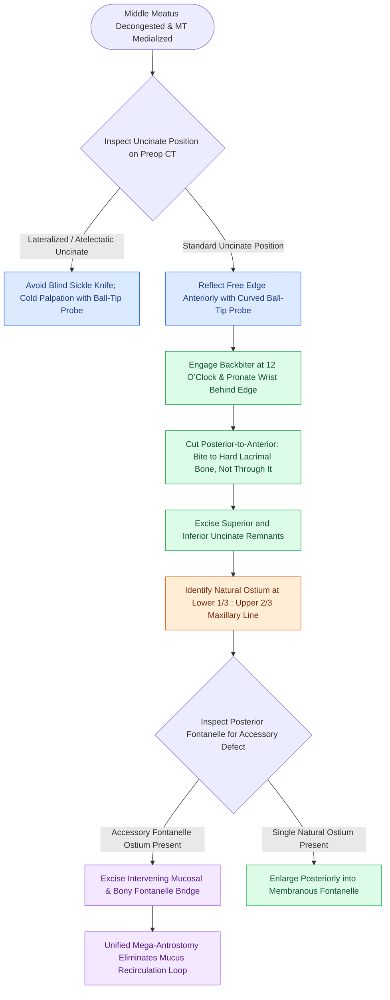

# Complete uncinectomy and posterior fontanelle resection unify the natural maxillary ostium with fontanelle defects to prevent mucus recirculation loops

## Active Recall

> [!question]- At what specific anatomical coordinate along the maxillary line is the natural ostium of the maxillary sinus located?
> *Answer / Clinical Rationale*: The natural maxillary ostium is consistently located at the junction of the lower one-third and upper two-thirds of the maxillary line (the bony attachment of the uncinate process to the lacrimal bone).

> [!question]- What surgical rule governs bone removal along the anterior attachment of the uncinate process, and what structure does it protect?
> *Answer / Clinical Rationale*: The rule is "bite to the hard bone, not through the hard bone." The uncinate process consists of paper-thin bone; biting anteriorly until dense resistance is felt reaches the lacrimal bone. Biting through this hard bone risks transecting or crushing the nasolacrimal duct and lacrimal sac.

> [!question]- What pathophysiological mechanism causes chronic recalcitrant sinusitis if an accessory fontanelle ostium is not unified with the natural antrostomy?
> *Answer / Clinical Rationale*: The mucus recirculation phenomenon: mucociliary clearance continues to sweep mucus out through the natural ostium into the middle meatus, where negative inspiratory pressures and close proximity direct it back into the maxillary sinus through the separate accessory fontanelle defect in an endless circular loop.

## Core Clinical & Mechanistic Principles
Maxillary antrostomy represents the foundational initial step of primary functional endoscopic sinus surgery. Clinical success requires that [[Maxillary antrostomy requires incorporating accessory fontanelle ostia to prevent recirculation]], because any residual tissue partition between the natural ostium and a posterior fontanelle defect creates a circular pathway for mucus re-entry.

Enlargement must proceed in a controlled vector, as outlined in [[Controlled middle meatal antrostomy enlargement preserves the anterior inferior fontanelle]], avoiding destabilization of the inferior turbinate. Failure to recognize the distinction between separate openings leads to the same recalcitrant pathology seen when [[Separate inferior antrostomies cause recirculating mucus and recalcitrant sinusitis]]. 

Furthermore, during preoperative computed tomography analysis, the surgeon must evaluate for an atelectatic uncinate process lateralized against the orbital wall, characteristic of [[Silent sinus syndrome presents with spontaneous enophthalmos and maxillary sinus atelectasis]], which places the orbit at high risk for inadvertent penetration during initial knife or microdebrider passes.

### Operative Step-by-Step Execution
1. **Middle Turbinate Mobilization and Decongestion**:
   - Infiltrate local anesthetic (1% lidocaine with 1:100,000 epinephrine) at the axilla of the middle turbinate and the anterior head.
   - Gently medialize the middle turbinate with a Freer elevator. If required, a vertical relaxing incision at the junction of the vertical and horizontal basal lamella aids medialization without skull base fracture.
2. **Uncinectomy Execution**:
   - Using an angled ball-tip probe, palpate and reflect the uncinate free edge anteriorly.
   - Introduce a backbiting forceps open at the 12 o'clock position, pronate the wrist behind the uncinate edge, and cut from posterior to anterior.
   - *Lacrimal Preservation Rule*: "Bite to the hard bone, not through the hard bone." Stop anterior cuts when the dense resistance of the lacrimal bone is felt.
   - Take down the superior uncinate with upbiting through-cutters and the inferior attachment with a downbiter down to the level of the inferior turbinate.
3. **Locating the Natural Ostium**:
   - Switch to a $30^\circ$ endoscope.
   - The natural ostium lies hidden behind the maxillary line at the junction of its upper two-thirds and lower one-third.
   - Introduce a curved ball-tip probe lateral to the lacrimal ridge; the probe slides smoothly into the maxillary sinus antrum at a $45^\circ$ inferolateral trajectory.
4. **Fontanelle Bridge Resection**:
   - Inspect the posterior fontanelle. If a congenital or iatrogenic accessory ostium is present, excise the intervening tissue bridge using a straight through-cutting forceps or microdebrider.
   - Ensure complete removal of all uncinate remnants anteriorly and along the floor to prevent mucosal synechiae and recirculation loops.

## Connected Concepts & Graph Traversal
- **Surgical Incision Craft**: [[Incisive uncinectomy exposes the ethmoid infundibulum while protecting the nasolacrimal duct|Incisive Uncinectomy]]
- **Anatomic Obstruction Variant**: [[Infraorbital Haller cells narrow the ethmoid infundibulum and maxillary ostium|Infraorbital Haller Cells]]
- **Ethmoid Partition Boundary**: [[The basal lamella of the middle turbinate divides anterior from posterior ethmoid cells|Basal Lamella Division]]
- **Secondary Complication Hazard**: [[Middle turbinate lateralization causes secondary ostiomeatal obstruction and frontal sinus stenosis|Middle Turbinate Lateralization]]
- **Physiological Clearance Driver**: [[Respiratory epithelium drives mucociliary clearance toward natural ostia|Mucociliary Clearance Mechanism]]
- **Accessory Ostium Pathology**: [[Antrochoanal polyps originate in the posterior maxillary sinus and extend through the accessory ostium into the choana requiring endoscopic surgical removal|Antrochoanal Polyps]]
