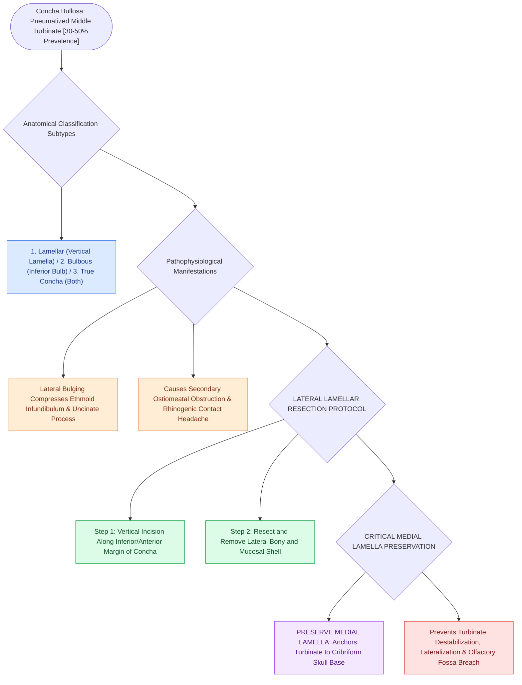

# Concha bullosa pneumatization of the middle turbinate can obstruct the ostiomeatal complex

## Active Recall

> [!question]- Why is the medial lamella of a concha bullosa preserved during surgical resection?
> *Answer / Clinical Rationale*: To preserve the **structural attachment of the middle turbinate to the cribriform plate** and maintain the medial anatomical barrier, preventing lateralization and olfactory fossa entry.

> [!question]- Can a concha bullosa develop independent acute or chronic rhinosinusitis?
> *Answer / Clinical Rationale*: **YES**. Because a concha bullosa is lined with [[Respiratory epithelium drives mucociliary clearance toward natural ostia|respiratory epithelium]] and drains into the middle meatus or frontal recess, ostial blockage can lead to internal empyema, mucocele, or polypoid disease.

## Core Clinical & Mechanistic Principles
A **Concha Bullosa** is an anatomical variant characterized by **pneumatization of the middle turbinate** by anterior or posterior ethmoidal air cells, occurring in up to **$30\text{–}50\%$ of the population**.

### Surgical Technique: Lateral Lamellar Resection
- When a concha bullosa causes ostiomeatal obstruction or persistent [[Rhinogenic contact point headache arises from mucosal contact between the nasal septum and turbinates|mucosal contact headache]] (Sluder's syndrome), surgical management requires **lateral partial turbinectomy (lateral lamellar resection)**.
- **Craft Rule**: The lateral half of the concha bullosa is incised vertically and excised, while the **medial lamella is preserved** to maintain the anatomical boundary with the olfactory fossa and prevent middle turbinate destabilization.

## Connected Concepts & Graph Traversal
- **Basal Lamella**: [[The basal lamella of the middle turbinate divides anterior from posterior ethmoid cells|Basal Lamella Architecture]]
- **Drainage Pathway**: [[The hiatus semilunaris and infundibulum form the primary drainage channel of the ostiomeatal complex|Ostiomeatal Complex]]
- **Uncinate Relation**: [[The uncinate process superior attachment dictates the frontal sinus drainage pathway|Uncinate Attachments]]
- **Anatomical Foundation**: [[Paradoxical middle turbinate curvature alters middle meatal airflow and surgical access|Paradoxical Middle Turbinate]]
- **High-Stakes Safety**: [[Middle turbinate lateralization causes secondary ostiomeatal obstruction and frontal sinus stenosis|Middle Turbinate Lateralization]]
- **Structural / Flap Alternative**: [[Temporoparietal fascia free and pedicled flaps provide vascularized tissue when nasoseptal flaps fail|Temporoparietal Fascia Flap (TPFF)]]
- **Disease Mechanism**: [[Concha bullosa resection requires lateral lamella excision to preserve medial cribriform attachment and middle turbinate stability|Concha Bullosa Resection]]
