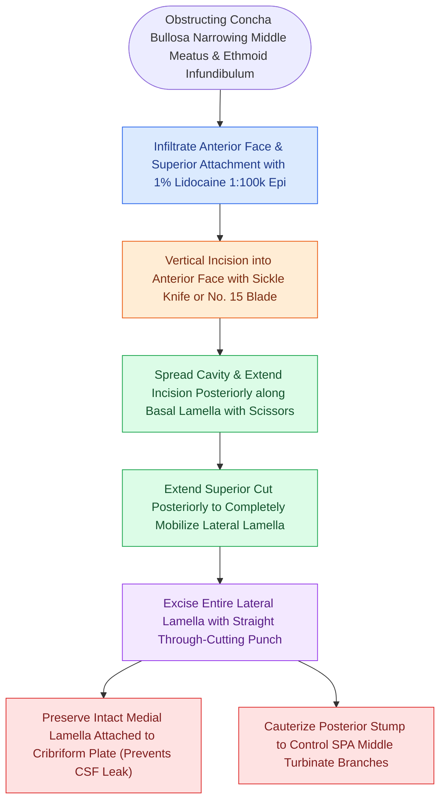

# Concha bullosa resection requires lateral lamella excision to preserve medial cribriform attachment and middle turbinate stability

## Active Recall

> [!question]- Why must surgical resection of a concha bullosa strictly excise the lateral lamella while preserving the medial lamella?
> *Answer / Clinical Rationale*: The medial lamella maintains the primary superior attachment of the middle turbinate to the cribriform plate of the ethmoid bone; resecting or destabilizing the medial lamella risks skull base fracture, CSF rhinorrhea, avulsion of olfactory filia, and destabilization of the middle turbinate leading to lateralization and ostiomeatal obstruction.

> [!question]- Why is mechanical crushing alone considered an ineffective surgical treatment for concha bullosa?
> *Answer / Clinical Rationale*: Crushing merely compresses the bony walls temporarily without removing the pneumatized mucus-secreting respiratory epithelium, leading to a high rate of concha re-expansion, mucocele formation, and recurrent ostiomeatal complex obstruction.

## Core Clinical & Mechanistic Principles
A concha bullosa represents an air-filled ethmoid sinus cell that pneumatizes the middle turbinate bone, occurring in up to 35% to 53% of the population. As documented in [[Concha bullosa pneumatization of the middle turbinate can obstruct the ostiomeatal complex|conchal obstruction pathophysiology]], extensive pneumatization impinges laterally upon the uncinate process, infundibulum, and ethmoid bulla, directly impairing mucociliary clearance and precipitating recurrent rhinosinusitis.

Crucially, a concha bullosa is a functioning paranasal sinus cell lined by mucociliary respiratory epithelium with its own draining ostium (typically opening into the frontal recess or retrobullar space). Surgical management must follow functional principles of drainage and mucosal preservation.

### Surgical Technique: Systematic Lateral Lamella Excision
1. **Endoscopic Exposure and Infiltration**:
   - Under 0-degree endoscope visualization, the anterior bulbous head of the concha bullosa and its superior insertion near the agger nasi are infiltrated with 1% lidocaine with 1:100,000 epinephrine.
2. **Anterior Face Incision**:
   - A vertical incision is made along the anterior midline face of the concha bullosa using a sickle knife or No. 15 blade, ensuring full penetration into the internal air cavity. Mucus or retained secretions within the cell are evacuated.
3. **Lamellar Division**:
   - Straight or curved endoscopic scissors are introduced into the lumen to spread the walls apart.
   - The inferior cut is extended posteriorly along the inferior margin of the turbinate toward [[The basal lamella of the middle turbinate divides anterior from posterior ethmoid cells|the basal lamella of the middle turbinate]].
   - The superior cut is extended posteriorly just below the skull base junction, joining the posterior margin of the pneumatized cell.
4. **Resection and Hemostasis**:
   - The entire lateral lamella is excised using through-cutting forceps or microdebrider, leaving a wide, open medial mucosal shell.
   - The posterior mucosal margin of the resected bed transmits branches of the sphenopalatine artery; bipolar electrocautery is applied to prevent postoperative arterial epistaxis.
5. **Preservation of the Medial Lamella**:
   - The remaining medial lamella maintains its physiological attachment to the cribriform plate superiorly and the perpendicular plate of the palatine bone posteriorly. This preserves its function as the principal anatomical boundary separating the olfactory cleft from the ethmoid sinuses.

## Connected Concepts & Graph Traversal
- **Middle Meatal Curvature**: [[Paradoxical middle turbinate curvature alters middle meatal airflow and surgical access]]
- **Ethmoidal Lamellar Landmarks**: [[The four parallel ethmoidal lamellae guide systematic anterior-to-posterior endoscopic orientation]]
- **Frontal Recess Topography**: [[The frontal recess is bounded by the agger nasi, middle turbinate, and skull base]]
- **Iatrogenic Complications**: [[Middle turbinate lateralization causes secondary ostiomeatal obstruction and frontal sinus stenosis]]
- **Medialization Maneuvers**: [[Middle turbinate suture medialization prevents lateralization and iatrogenic frontal sinus ostial obstruction following ethmoidectomy]]
