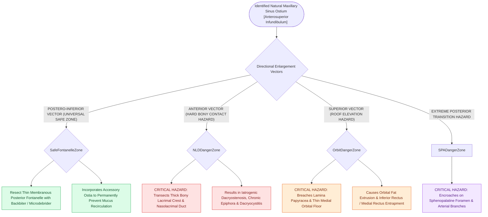

# Controlled middle meatal antrostomy enlargement preserves the anterior inferior fontanelle

## Active Recall

> [!question]- In which two directions should a maxillary antrostomy be safely enlarged, and why?
> *Answer / Clinical Rationale*: **Posteriorly and inferiorly**, because the fontanelle bone is thin and non-critical, whereas anterior extension risks transecting the **nasolacrimal duct** and superior extension enters the **orbital floor**.

> [!question]- What structure lies immediately anterior to the natural maxillary ostium?
> *Answer / Clinical Rationale*: The thick bone of the **lacrimal crest housing the nasolacrimal duct**.

## Core Clinical & Mechanistic Principles
During maxillary antrostomy, enlarging the natural ostium must follow precise anatomical vectors to ensure wide cavity aeration while preventing injury to the **nasolacrimal duct (anteriorly)** and the **sphenopalatine neurovascular bundle (posteriorly)**.

### The Postero-Inferior Enlargement Rule
- The natural ostium is located in the anterior-superior aspect of the [[Incisive uncinectomy exposes the ethmoid infundibulum while protecting the nasolacrimal duct|ethmoid infundibulum]] immediately posterior to the hard lacrimal bone and nasolacrimal duct.
- Instruments (backbiting forceps, through-cutting punches, [[Powered microdebrider blade selection and suction irrigation maintain clean surgical optics|microdebrider]]) must enlarge the natural ostium **posteriorly and inferiorly through the posterior fontanelle** (incorporating any accessory ostia to prevent [[Separate inferior antrostomies cause recirculating mucus and recalcitrant sinusitis|mucus recirculation]]), while strictly avoiding anterior dissection into the **anterior fontanelle and lacrimal bone** to protect the nasolacrimal duct.

## Connected Concepts & Graph Traversal
- **Step-by-Step Craft**: [[Maxillary antrostomy requires incorporating accessory fontanelle ostia to prevent recirculation|Maxillary Antrostomy & Recirculation]]
- **Uncinectomy Step**: [[Incisive uncinectomy exposes the ethmoid infundibulum while protecting the nasolacrimal duct|Incisive Uncinectomy]]
- **Physiology**: [[Separate inferior antrostomies cause recirculating mucus and recalcitrant sinusitis|Mucus Recirculation Phenomenon]]
- **Vascular Boundary**: [[The crista ethmoidalis guides endoscopic sphenopalatine artery ligation|Sphenopalatine Foramen Posterior Limit]]
- **Lacrimal Anatomy**: [[Endoscopic dacryocystorhinostomy achieves lacrimal sac marsupialization via axillary osteotomy and bivalve mucosal flaps apposed to the agger nasi|Nasolacrimal Duct & Lacrimal Sac Anatomy]]
- **Diagnostic Evaluation**: [[Jones primary and secondary dye tests differentiate canalicular from nasolacrimal duct obstruction|Jones Dye Testing at the Valve of Hasner]]
- **Pediatric Conservative Escalation**: [[Pediatric endoscopic sinus surgery employs a stepwise escalation algorithm following adenoidectomy and preserves midfacial growth centers through conservative mucosal sparing dissection|Pediatric ESS Escalation]]
