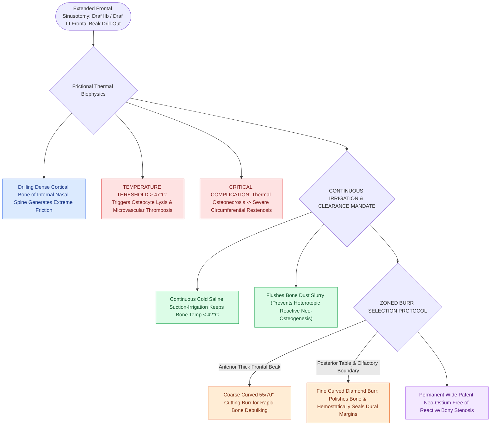

# Curved diamond and cutting burrs with continuous irrigation prevent frontal beak thermal osteonecrosis

## Active Recall

> [!question]- What critical temperature threshold causes thermal osteonecrosis during frontal sinus bone drilling?
> *Answer / Clinical Rationale*: Temperatures exceeding **$47^\circ\text{C}$**, which trigger osteocyte death, delayed healing, and reactive osteoneogenesis.

> [!question]- Why is a diamond burr preferred over a cutting burr when working adjacent to the posterior table of the frontal sinus?
> *Answer / Clinical Rationale*: A **diamond burr** provides controlled, precise bone smoothing without grabbing soft tissue, and coagulates microvascular bone bleeding while protecting underlying dura.

## Core Clinical & Mechanistic Principles
Drilling the dense cortical bone of the **internal nasal spine (frontal beak)** during extended frontal sinusotomies ([[Draf IIb frontal sinusotomy extends from lamina papyracea to the nasal septum|Draf IIb]] and Draf III) generates substantial frictional heat. Without continuous cold fluid irrigation, bone temperatures rapidly exceed **$47^\circ\text{C}$**, inducing **thermal osteonecrosis, chronic osteitis, and circumferential neo-ostium stenosis**.

### Bone Dust Clearance Mandate
- Bone dust left in the frontal cavity acts as a nidus for **heterotopic osteogenesis and scarring**. Copious suction-irrigation is mandatory throughout drilling.

## Connected Concepts & Graph Traversal
- **Draf III Procedure**: [[Draf III modified Lothrop unites both frontal sinuses into a common cavity|Draf III Lothrop]]
- **Restenosis Prevention**: [[Nasal beak drill-out and mucosal grafting prevent neo-ostium restenosis in Draf III|Restenosis & Mucosal Grafting]]
- **Posterior Limit**: [[First olfactory filum marks the posterior limit of frontal drill-out to avoid CSF leak|Olfactory Filum Limit]]
- **Clinical Management**: [[Frontal sinus osteomas require endoscopic Draf or open osteoplastic resection when obstructing outflow|Frontal Sinus Osteoma]]
- **Anatomical Foundation**: [[Osteoplastic flap elevation utilizes a six-foot Caldwell radiographic template and beveled osteotomies for complete frontal sinus fat obliteration|Osteoplastic Flap with 6-Foot Caldwell Radiographic Template and Fat Obliteration]]
