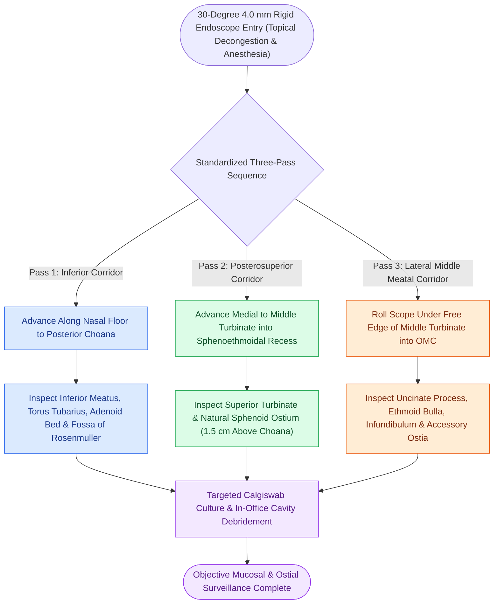

# Diagnostic rigid nasal endoscopy utilizes a standardized three-pass examination sequence

## Active Recall

> [!question]- What specific anatomical landmarks and compartments are evaluated during each pass of the standardized three-pass diagnostic rigid nasal endoscopy?
> *Answer / Clinical Rationale*: (1) **First Pass (Inferior Corridor / Nasal Floor)**: Scope advances along the nasal floor into the nasopharynx to inspect the inferior turbinate, [[Kiesselbach plexus anterior epistaxis is managed with cautery and anterior nasal packing|inferior meatus]] (Hasner valve/nasolacrimal duct opening), posterior choana, Eustachian tube orifice (torus tubarius), and fossa of Rosenmüller; (2) **Second Pass (Sphenoethmoidal Recess)**: Scope passes medial to the middle turbinate advancing posteriorly to inspect the superior turbinate, superior meatus, and the sphenoid sinus ostium within the sphenoethmoidal recess; (3) **Third Pass (Middle Meatus / Ostiomeatal Complex)**: As the scope is slowly withdrawn, it is angled laterally under the middle turbinate into the middle meatus to inspect the [[The hiatus semilunaris and infundibulum form the primary drainage channel of the ostiomeatal complex|ethmoid infundibulum]], hiatus semilunaris, uncinate process, [[Entering the ethmoid bulla inferomedially avoids orbital and skull base penetration|bulla ethmoidalis]], and natural/accessory maxillary sinus ostia.

> [!question]- Why is objective endoscopic surveillance superior to patient-reported symptom scores in postoperative chronic rhinosinusitis management?
> *Answer / Clinical Rationale*: Asymptomatic persistent mucosal inflammation, subclinical polyp recurrence, crusting, and early middle meatal synechiae frequently precede subjective symptom onset by weeks to months. Serial endoscopic examinations allow early in-office debridement, topical steroid optimization, and targeted middle meatal cultures (via Calgiswab) before irreversible ostial scarring or symptomatic flare-ups occur.

## Core Clinical & Mechanistic Principles
Diagnostic nasal endoscopy using a **30° 4.0-mm (or 2.7-mm) rigid endoscope** provides superior illumination and magnification compared to anterior rhinoscopy, allowing complete visualization of the ostiomeatal complex (OMC) and [[The sphenoid sinus ostium lies medial to the superior turbinate above the choana|sphenoethmoidal recess]]. Systematic examination follows a **standardized three-pass technique** under topical decongestion and local anesthesia to evaluate for mucosal disease, [[Concha bullosa pneumatization of the middle turbinate can obstruct the ostiomeatal complex|middle turbinate anatomical variants]], and sinonasal polyposis.

### Step-by-Step Anatomy of the Three Passes
1. **First Pass (Nasal Floor & Nasopharynx)**:
   - Evaluates mucosal condition, septal deflections/spurs, inferior turbinate hypertrophy, and inferior meatus secretions.
   - Reaches the posterior choana; 360° rotation evaluates the adenoid bed, Eustachian tube cushion, and fossa of Rosenmüller (evaluating for skull base or nasopharyngeal carcinoma lesions).
2. **Second Pass (Medial to Middle Turbinate into Sphenoethmoidal Recess)**:
   - Advances between the nasal septum and the medial surface of the middle turbinate.
   - Evaluates the superior meatus and identifies the sphenoid sinus ostium (located approximately 1.5 cm superior to the posterior choana arch, medial to the superior turbinate).
3. **Third Pass (Middle Meatus & Ostiomeatal Complex)**:
   - Performed as the telescope is withdrawn and rotated laterally under the free edge of the middle turbinate.
   - Identifies mucosal edema, purulence originating from the infundibulum, concha bullosa distortion, accessory maxillary ostia, and uncinate process anatomy.

## Connected Concepts & Graph Traversal
- **Anatomical Target**: [[The hiatus semilunaris and infundibulum form the primary drainage channel of the ostiomeatal complex|Ethmoid Infundibulum & Hiatus Semilunaris]]
- **Sphenoid Landmark**: [[The sphenoid sinus ostium lies medial to the superior turbinate above the choana|Sphenoid Ostium Identification]]
- **Anterior Boundary**: [[Agger nasi cells form the anterior boundary of the frontal recess|Agger Nasi Endoscopic Anatomy]]
- **Postoperative Craft**: [[Topical hemostatic matrix agents and nasal packing mitigate postoperative epistaxis and synechiae|Postoperative Healing & Packing]]
- **🔗 Pediatric Correlative (Pediatrics)**: [[Drug-induced sleep endoscopy DISE evaluates dynamic multi-level upper airway collapse under sedation|Pediatric Dynamic DISE]]
