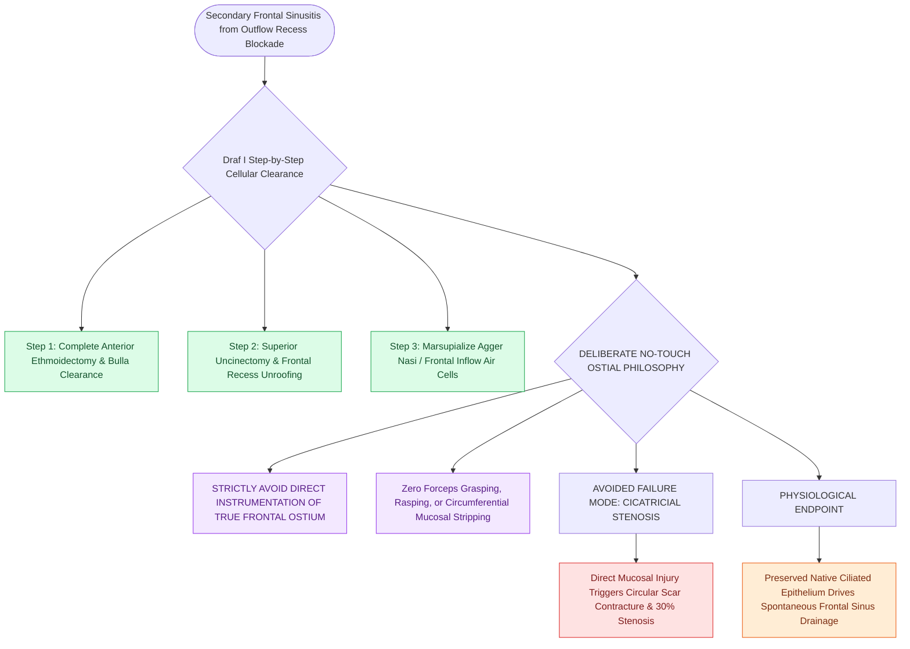

# Draf I frontal sinusotomy clears obstructing ethmoid cells without instrumenting the ostium

## Active Recall

> [!question]- Why does a Draf I procedure deliberately avoid direct instrumentation of the frontal sinus ostium?
> *Answer / Clinical Rationale*: Direct instrumentation or mucosal stripping of the narrow frontal ostium incites circumferential osteoneogenesis and cicatricial scarring. Draf I restores drainage purely by unroofing surrounding obstructing ethmoid cells while leaving the delicate ostial mucosa intact.

> [!question]- What anatomical cells are removed during a Draf I procedure?
> *Answer / Clinical Rationale*: The **superior uncinate process remnant**, the **agger nasi cell**, and any anterior ethmoid/suprabullar cells encroaching on the frontal recess.

## Core Clinical & Mechanistic Principles
A **Draf I frontal sinusotomy (Simple Drainage)** is a conservative, indirect approach to frontal sinus ventilation. It consists of performing a complete [[Entering the ethmoid bulla inferomedially avoids orbital and skull base penetration|anterior ethmoidectomy]], resecting the superior [[Incisive uncinectomy exposes the ethmoid infundibulum while protecting the nasolacrimal duct|uncinate process]], and uncapping the **agger nasi cell** to clear the frontal recess **WITHOUT directly instrumenting, dilating, or stripping the frontal sinus ostium itself**.

### Clinical Indications & Rationale
1. **Uncomplicated Frontal Rhinosinusitis**: Where frontal opacification is purely secondary to outflow obstruction by diseased anterior ethmoid/agger nasi cells.
2. **Preventing Iatrogenic Ostial Stenosis**: Direct mucosal instrumentation or circumferential mucosal stripping of the narrow frontal ostium stimulates aggressive circular scar contracture (stenosis in up to 30% of cases). Draf I preserves native mucosal margins.

## Connected Concepts & Graph Traversal
- **Extended Approach**: [[Draf IIa frontal sinusotomy resects the sinus floor between middle turbinate and lamina|Draf IIa Procedure]]
- **Anatomy**: [[The frontal recess is bounded by the agger nasi, middle turbinate, and skull base|Frontal Recess 3D Space]]
- **Agger Nasi**: [[Agger nasi cells form the anterior boundary of the frontal recess|Agger Nasi Marsupialization]]
- **Anatomical Foundation**: [[Draf IIb frontal sinusotomy extends from lamina papyracea to the nasal septum|Draf IIb Frontal Sinusotomy]]
- **Clinical Management**: [[Incisive uncinectomy exposes the ethmoid infundibulum while protecting the nasolacrimal duct|Incisive Uncinectomy Technique]]
