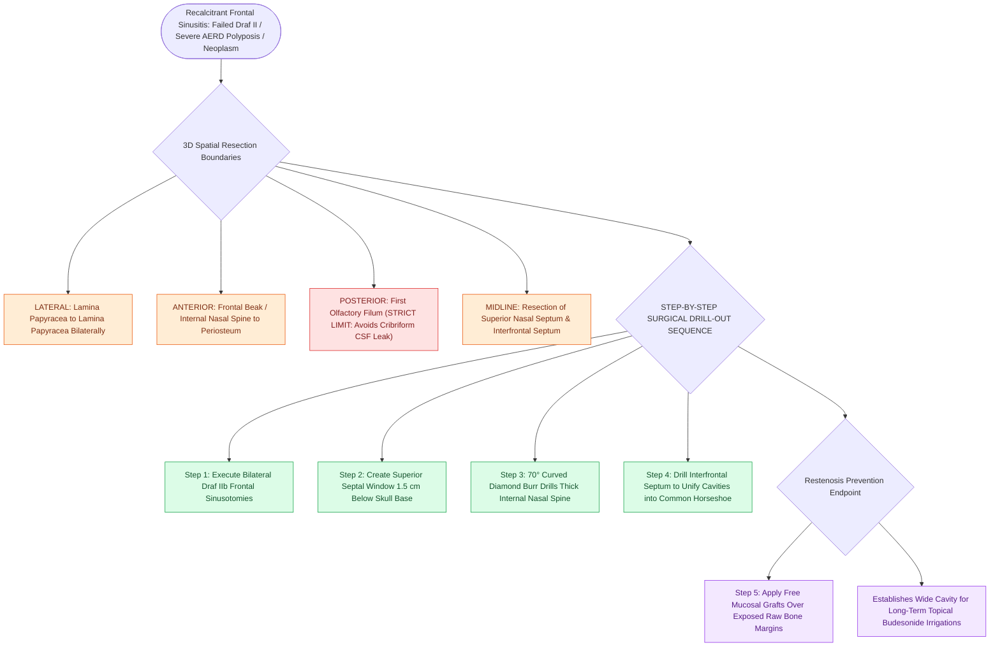

# Draf III modified Lothrop unites both frontal sinuses into a common cavity

## Active Recall

> [!question]- What are the complete anatomical resection boundaries of a Draf III (Modified Lothrop) procedure?
> *Answer / Clinical Rationale*: From **[[Lamina papyracea dehiscence predisposes to orbital fat herniation and medial rectus injury|lamina papyracea]] to lamina papyracea laterally**, from the **periosteum of the frontal beak anteriorly** to the **first olfactory filum / cribriform plate posteriorly**, including the interfrontal septum and superior nasal septum.

> [!question]- Why is a Draf III highly favored in patients with Aspirin-Exacerbated Respiratory Disease (AERD)?
> *Answer / Clinical Rationale*: AERD is driven by severe eosinophilic mucosal edema that rapidly occludes narrow unilateral ostia. The massive common cavity created by a Draf III allows high-volume topical steroid irrigation (budesonide) and in-office surveillance.

## Core Clinical & Mechanistic Principles
A **Draf III procedure (Endoscopic Modified Lothrop)** is the definitive endonasal frontal sinus drainage procedure. It creates a single, large, unified **"horseshoe-shaped" frontal cavity** by resecting:
1. Bilateral frontal sinus floors (bilateral Draf IIb).
2. The **interfrontal septum**.
3. The **superior nasal septum** anterior to the olfactory fossa.
4. The dense bone of the **internal nasal spine (frontal beak)** down to the subcutaneous soft tissues.

### Clinical Indications
- Failed prior Draf II procedures with recalcitrant circular cicatricial stenosis.
- Severe recalcitrant [[Non-Type 2 CRS features neutrophilic inflammation associated with cystic fibrosis and ciliopathies|Type 2 CRS]] with nasal polyposis (especially **[[AERD manifests with asthma, nasal polyps, and severe aspirin-induced respiratory reactions|Aspirin-Exacerbated Respiratory Disease]] / AERD**).
- Frontal sinus osteomas, inverting papillomas, and frontoethmoidal encephaloceles.
- Expanded skull base access to the anterior cranial fossa.

## Step-by-Step Surgical Execution
1. **Bilateral Draf IIb**: Perform bilateral Draf IIb frontal sinusotomies with 70° endoscopes.
2. **Superior Septal Window**: Create a $1.5\text{ cm} \times 1.5\text{ cm}$ superior septal window $>1.5\text{ cm}$ below the skull base, preserving [[Olfactory neuroepithelium contains bipolar sensory neurons and basal stem cells|olfactory epithelium]].
3. **Nasal Beak Drill-Out**: Using a $70^\circ$ curved diamond burr, drill the dense bone of the frontal beak anteriorly until the subcutaneous periosteum is exposed.
4. **Interfrontal Septotomy**: Drill out the interfrontal septum, uniting both sinuses into one.
5. **Mucosal Grafting**: Place free mucosal grafts over exposed bone edges to prevent osteoneogenesis (see [[Nasal beak drill-out and mucosal grafting prevent neo-ostium restenosis in Draf III|Mucosal Grafting & Restenosis Prevention]]).

## Connected Concepts & Graph Traversal
- **Restenosis Prevention**: [[Nasal beak drill-out and mucosal grafting prevent neo-ostium restenosis in Draf III|Nasal Beak & Mucosal Grafts]]
- **Posterior Limit**: [[First olfactory filum marks the posterior limit of frontal drill-out to avoid CSF leak|Olfactory Filum Safety Landmark]]
- **Disease Driver**: [[AERD manifests with asthma, nasal polyps, and severe aspirin-induced respiratory reactions|AERD Pathophysiology]]
- **Unilateral Steps**: [[Draf IIb frontal sinusotomy extends from lamina papyracea to the nasal septum|Draf IIb]]
- **Diagnostic Evaluation**: [[Draf I frontal sinusotomy clears obstructing ethmoid cells without instrumenting the ostium|Draf I Frontal Sinusotomy]]
- **Critical Safety / Complication**: [[Esthesioneuroblastoma Kadish and Hyams staging determines craniofacial resection and adjuvant therapy|Esthesioneuroblastoma (ENB)]]
- **Surgical Technique**: [[Draf IIb versus Draf III modified Lothrop procedures differentiate unilateral middle turbinate resection from bilateral interfrontal septectomy and sinus floor drill-out|Draf IIb vs Draf III]]
- **Anatomical Foundation**: [[The outside-in Draf III modified endoscopic Lothrop procedure establishes anterior septal and olfactory boundaries before drilling the nasofrontal beak|Outside-In Draf III]]
