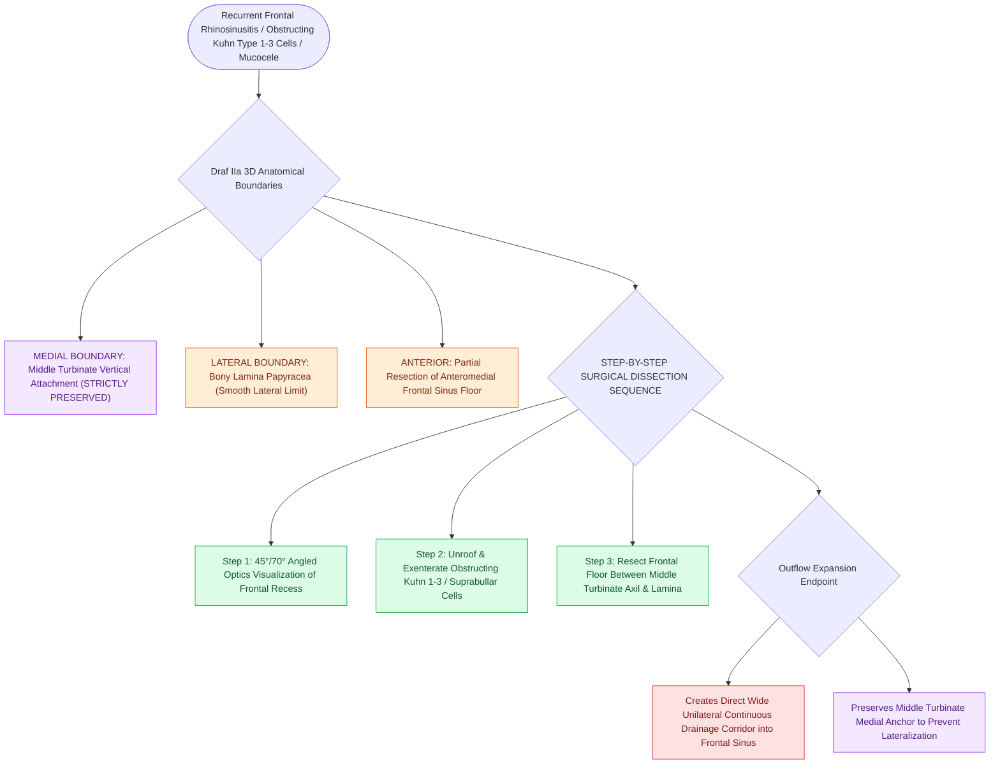

# Draf IIa frontal sinusotomy resects the sinus floor between middle turbinate and lamina

## Active Recall

> [!question]- What are the medial and lateral anatomical limits of a Draf IIa frontal sinusotomy?
> *Answer / Clinical Rationale*: Medially by the **vertical lamella of the middle turbinate** (which is preserved), and laterally by the **lamina papyracea**.

> [!question]- What clinical pathologies warrant progression from a Draf I to a Draf IIa procedure?
> *Answer / Clinical Rationale*: Recurrent frontal CRS, obstructing Kuhn Type 1–3 frontoethmoidal cells, simple frontal sinus mucoceles, or persistent frontal polyposis.

## Core Clinical & Mechanistic Principles
A **Draf IIa frontal sinusotomy (Extended Unilateral Drainage)** involves resecting the **anterior ethmoid cells within the frontal recess** and unroofing the **floor of the frontal sinus** between the **middle turbinate medially** and the **[[Lamina papyracea dehiscence predisposes to orbital fat herniation and medial rectus injury|lamina papyracea]] laterally**. The anterior attachment of the middle turbinate is preserved.

### Step-by-Step Surgical Execution
1. **Visualization**: Utilize a $45^\circ$ or $70^\circ$ endoscope and curved frontal instruments (curettes, through-cutting punches, curved suction debriders, or 70° diamond burrs).
2. **Resection of Frontoethmoidal Cells**: Completely uncapp all Kuhn Type 1, 2, or 3 cells encroaching on the outflow tract.
3. **Sinus Floor Resection**: Enlarge the frontal ostium anteriorly by removing the anterior-medial frontal sinus floor, opening a direct continuous channel into the frontal sinus cavity.

## Connected Concepts & Graph Traversal
- **Conservative Precursor**: [[Draf I frontal sinusotomy clears obstructing ethmoid cells without instrumenting the ostium|Draf I Procedure]]
- **Total Unilateral Step**: [[Draf IIb frontal sinusotomy extends from lamina papyracea to the nasal septum|Draf IIb Procedure]]
- **Classification**: [[The Kuhn classification stages frontal recess and frontal sinus air cells|Kuhn Frontal Cells]]
- **Surgical Craft**: [[Entering the ethmoid bulla inferomedially avoids orbital and skull base penetration|Anterior Ethmoidectomy Technique]]
- **Structural / Flap Alternative**: [[Temporoparietal fascia free and pedicled flaps provide vascularized tissue when nasoseptal flaps fail|Temporoparietal Fascia Flap (TPFF)]]
