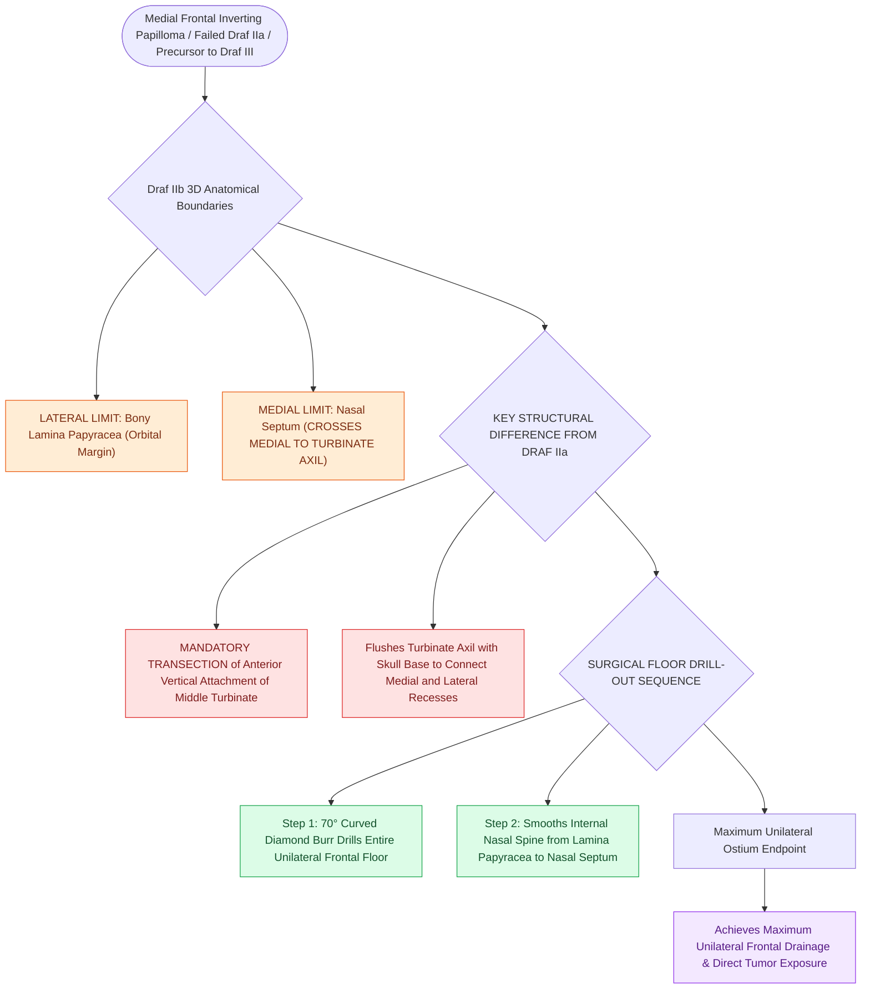

# Draf IIb frontal sinusotomy extends from lamina papyracea to the nasal septum

## Active Recall

> [!question]- What major structural difference distinguishes a Draf IIb from a Draf IIa frontal sinusotomy?
> *Answer / Clinical Rationale*: In a **Draf IIb**, the resection extends medially past the middle turbinate to the **nasal septum**, requiring **resection of the anterior attachment of the middle turbinate**, whereas a Draf IIa preserves the middle turbinate attachment.

> [!question]- What tumor pathology commonly mandates a Draf IIb or Draf III approach?
> *Answer / Clinical Rationale*: **Sinonasal inverting papilloma** involving the frontal sinus, which requires wide visualization for subperiosteal excision and underlying hyperostotic [[Curved diamond and cutting burrs with continuous irrigation prevent frontal beak thermal osteonecrosis|bone drill-out]].

## Core Clinical & Mechanistic Principles
A **Draf IIb frontal sinusotomy (Total Unilateral Drainage)** expands the frontal outflow tract by resecting the entire **unilateral frontal sinus floor** from the **[[Lamina papyracea dehiscence predisposes to orbital fat herniation and medial rectus injury|lamina papyracea]] laterally** all the way to the **nasal septum medially**. This requires resecting the **anterior attachment of the middle turbinate**.

### Surgical Indications & Key Nuances
1. **Indications**:
   - Extensive frontal sinus polyposis or [[Sinonasal exophytic and oncocytic papillomas differ from inverting papilloma in malignant potential|inverted papilloma]] extending into the medial frontal sinus.
   - Revision frontal stenosis following failed Draf IIa.
   - Step 1 of a bilateral **Draf III ([[Nasal beak drill-out and mucosal grafting prevent neo-ostium restenosis in Draf III|Modified Lothrop]])** procedure.
2. **Technique**:
   - The anterior vertical lamella of the middle turbinate is transected flush with the skull base.
   - A $70^\circ$ curved diamond burr or Kerrison punch drills away the bone of the frontal floor between the olfactory fossa medially and the lamina laterally.

## Connected Concepts & Graph Traversal
- **Bilateral Expansion**: [[Draf III modified Lothrop unites both frontal sinuses into a common cavity|Draf III Modified Lothrop]]
- **Unilateral Precursor**: [[Draf IIa frontal sinusotomy resects the sinus floor between middle turbinate and lamina|Draf IIa Procedure]]
- **Tumor Resection**: [[Sinonasal inverting papilloma requires subperiosteal excision and hyperostotic bone drill-out|Inverting Papilloma]]
- **Diagnostic Evaluation**: [[Draf I frontal sinusotomy clears obstructing ethmoid cells without instrumenting the ostium|Draf I Frontal Sinusotomy]]
- **Surgical Craft**: [[Entering the ethmoid bulla inferomedially avoids orbital and skull base penetration|Anterior Ethmoidectomy Technique]]
- **Surgical Technique**: [[Draf IIb versus Draf III modified Lothrop procedures differentiate unilateral middle turbinate resection from bilateral interfrontal septectomy and sinus floor drill-out|Draf IIb vs Draf III]]
- **Precipitating Condition**: [[The frontal sinus rescue procedure utilizes a medially based middle turbinate mucosal flap to resurface denuded bone and prevent Draf IIb ostial restenosis|Frontal Sinus Rescue Flap]]
