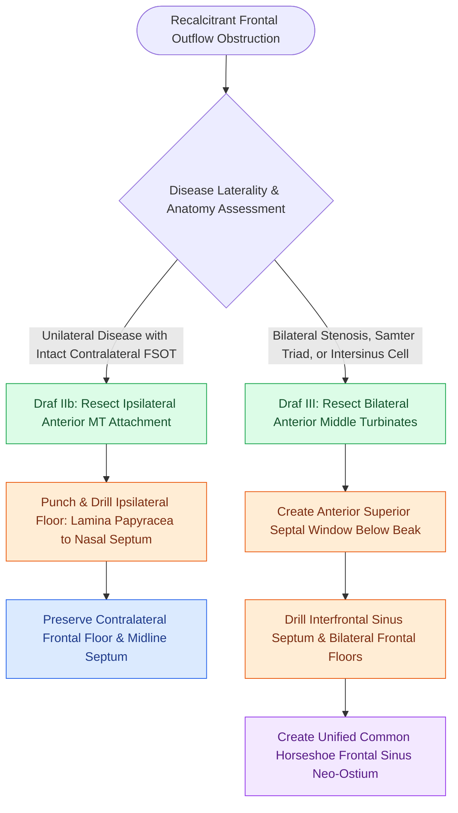

# Draf IIb versus Draf III modified Lothrop procedures differentiate unilateral middle turbinate resection from bilateral interfrontal septectomy and sinus floor drill-out

## Active Recall

> [!question]- What anatomical boundaries differentiate an extended unilateral Draf IIb frontal sinusotomy from a common cavity Draf III modified endoscopic Lothrop procedure?
> *Answer / Clinical Rationale*: A Draf IIb resects the ipsilateral frontal sinus floor from the lamina papyracea laterally to the nasal septum medially, resecting the anterior-superior middle turbinate attachment. A Draf III is a bilateral procedure that resects both frontal sinus floors from lamina to lamina, the anterior superior nasal septum, and the interfrontal septum, creating a single common neo-ostium.

> [!question]- Why must the posterior horizontal lamella of the middle turbinate be preserved during the anterior middle turbinate resection of a Draf IIb?
> *Answer / Clinical Rationale*: Preserving the posterior and inferior horizontal lamella maintains structural anchorage to the skull base and lateral nasal wall, preventing postoperative posterior middle turbinate destabilization, lateralization, and skull base torque that could provoke a cerebrospinal fluid leak.

> [!question]- What minimum anterior-posterior (A-P) diameter is required to safely perform high-speed burr bone removal during nasofrontal beak drill-out?
> *Answer / Clinical Rationale*: While classical teaching cites a minimum A-P dimension of $10\text{ mm}$, functionally there must be adequate clearance ($>5\text{ mm}$ between posterior table and anterior skin) to seat the drill burr without the posterior aspect of the rotating burr striking or penetrating the anterior cranial fossa cribriform plate.

## Core Clinical & Mechanistic Principles
Extended endoscopic frontal sinusotomies escalate beyond basic conservative procedures when recalcitrant chronic rhinosinusitis, severe neo-osteogenesis, inverted papillomas, or lateralized turbinate scarring obstruct the frontal recess. The surgical decision between a unilateral [[Draf IIb frontal sinusotomy extends from lamina papyracea to the nasal septum]] and a bilateral [[Draf III modified Lothrop unites both frontal sinuses into a common cavity]] hinges on disease laterality, interfrontal septal involvement, and previous surgical failures.

### Anatomic Boundaries and Surgical Dissection Margins
1. **Draf IIb (Extended Unilateral Sinusotomy)**:
   - *Lateral Limit*: Ipsilateral [[Lamina papyracea dehiscence predisposes to orbital fat herniation and medial rectus injury|lamina papyracea]] and orbital roof.
   - *Medial Limit*: Nasal septum and midline perpendicular plate of ethmoid.
   - *Superior/Anterior Limit*: Ipsilateral nasofrontal beak, thinned with a $70^\circ$ diamond burr.
   - *Middle Turbinate Modification*: Curved scissors make a superior cut beneath the skull base attachment toward the anterior ethmoid artery, meeting an inferior angled cut. The anterior-superior quadrant of the middle turbinate is resected while its posterior basal lamella remains anchored.
2. **Draf III / Modified Endoscopic Lothrop Procedure (MELP)**:
   - *Lateral Limits*: Bilateral lamina papyracea from orbit to orbit.
   - *Anterior Limit*: Glabellar cutaneous soft-tissue periosteum overlying the anterior frontal bone table.
   - *Posterior Limit*: Anterior margin of the olfactory fossa on both sides, marked by the first olfactory filum.
   - *Resection Components*: Unites bilateral Draf IIb dissections by removing the superior $1.5\text{ to }2\text{ cm}$ of the nasal septum, completely excising the interfrontal septum, and burring the bilateral nasofrontal beaks into a smooth, common inverted U-shaped neo-ostium.
3. **Restenosis Mitigation & Thermal Protection**:
   - Continuous chilled irrigation with [[Curved diamond and cutting burrs with continuous irrigation prevent frontal beak thermal osteonecrosis]] prevents thermal osteonecrosis and subsequent neo-osteogenesis.
   - Mucosal graft resurfacing or vascularized flaps minimize circular contraction along the newly formed bony perimeter, protecting against [[Nasal beak drill-out and mucosal grafting prevent neo-ostium restenosis in Draf III|neo-ostium restenosis]].

## Connected Concepts & Graph Traversal
- **Baseline Procedural Comparison**: [[Draf IIa frontal sinusotomy resects the sinus floor between middle turbinate and lamina|Draf IIa Frontal Sinusotomy]]
- **Posterior Skull Base Boundary**: [[First olfactory filum marks the posterior limit of frontal drill-out to avoid CSF leak|First Olfactory Filum Boundary]]
- **Salvage Mucosal Reconstruction**: [[The frontal sinus rescue procedure utilizes a medially based middle turbinate mucosal flap to resurface denuded bone and prevent Draf IIb ostial restenosis|Frontal Sinus Rescue Flap]]
- **Common Cavity Technique**: [[The outside-in Draf III modified endoscopic Lothrop procedure establishes anterior septal and olfactory boundaries before drilling the nasofrontal beak|Outside-In Draf III Procedure]]
- **Turbinate Destabilization Hazard**: [[Middle turbinate lateralization causes secondary ostiomeatal obstruction and frontal sinus stenosis|Middle Turbinate Lateralization]]
