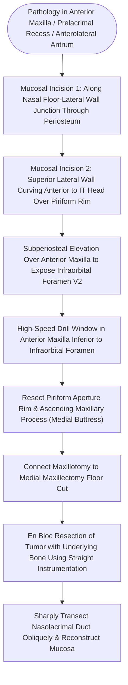

# Endoscopic Denker approach removes the piriform aperture and ascending maxillary process to expose the anterior antral wall and infratemporal fossa

## Active Recall

> [!question]- How does the Endoscopic Denker approach (TEAMM) overcome the line-of-sight limitations of standard medial maxillectomy without requiring a sublabial incision?
> *Answer / Clinical Rationale*: By resecting the anterior bony medial buttress—specifically the **ascending frontal process of the maxilla and the lateral bony margin of the piriform aperture**—the pivot point of instrumentation is shifted anteriorly outside the nasal sill. This converts a restricted, acute-angled trajectory into a direct collinear corridor parallel to the facial plane, allowing rigid 0° endoscopes and straight instruments to reach the anterior antral wall, prelacrimal recess, and lateral maxillary wall without a sublabial gingivobuccal incision.

> [!question]- According to quantitative anatomical studies (Prosser et al.), how much additional rotational exposure does an endoscopic Denker approach provide over a standard medial maxillectomy?
> *Answer / Clinical Rationale*: Medial maxillectomy increases angular exposure by **18.5°** over standard antrostomy, whereas a 1-cm endoscopic Denker maxillotomy provides an additional **33.5° of reach**, securing complete visual and instrument access to the entire posterolateral maxillary wall in **54% of cases**. An equivalent angular corridor can be matched contralaterally only via a transseptal window placed **1.56 cm posterior to the columella**.

## Core Clinical & Mechanistic Principles
The **Endoscopic Denker Approach**, also termed the **Total Endoscopic Anterior Medial Maxillectomy (TEAMM)**, is an expanded endonasal skull base corridor designed to provide unhindered, straight-line access to tumors situated within the anterior, inferior, prelacrimal, and anterolateral recesses of the maxillary sinus, as well as the adjacent infratemporal and pterygopalatine fossae. Historically, Alfred Denker (1906) described an open transfacial anterior maxillectomy performed via a sublabial gingivobuccal incision extending to the frenulum. In 1908, Sturmann and Canfield described an endonasal approach through an intranasal vestibular incision with subperiosteal elevation over the piriform aperture. The modern endoscopic Denker technique synthesizes these concepts under 0° endoscopic visualization, completely eliminating external facial incisions, sublabial entry, and oral flora contamination while avoiding the risk of oroantral fistulae.

### Surgical Limitations of Preceding Corridors
Standard middle meatal antrostomies, modified endoscopic medial maxillectomies (MEMM), and even [[Endoscopic medial maxillectomy resects the lateral nasal wall flush with the nasal floor while preserving a mucosal flap to cover denuded bone|endoscopic medial maxillectomy]] leave a significant anterior visual and mechanical dead space. The anterior antral wall and the prelacrimal recess cannot be reached with straight instruments because the rigid bony piriform aperture and ascending process of the maxilla act as a fulcrum that deflects instruments posteriorly. While transseptal "cross-court" corridors can address anterolateral disease, they require cartilage resection and maneuverability with angled scopes. The endoscopic Denker approach achieves direct, collinear access using straight burs, curettes, and bipolar forceps.

### Operative Technique & Neural Protection
1. **Intranasal Mucosal Cuts**: A unipolar electrocautery with a guarded needle tip executes two incisions under 0° endoscopic visualization:
   - *Inferior incision*: Placed along the junction of the nasal floor and lateral nasal wall, carried deeply through the periosteum.
   - *Superior incision*: Initiated along the lateral nasal wall superiorly and carried anteroinferiorly immediately anterior to the anterior head of the inferior turbinate, draping over the bony edge of the piriform aperture.
2. **Subperiosteal Dissection**: A suction Freer elevator enters the subperiosteal plane over the anterior face of the maxilla. The soft tissues of the cheek are mobilized laterally, skeletonizing the canine fossa, anterior maxillary wall, and the **infraorbital neurovascular bundle (V2)** issuing from the infraorbital foramen. Dissection must strictly respect this foramen to prevent permanent midfacial hypoesthesia.
3. **Bony Maxillotomy & Buttress Resection**: A high-speed drill or Kerrison rongeur creates an anterior maxillotomy window strictly inferior to the infraorbital nerve. The anterior bony rim of the piriform aperture and ascending frontal process of the maxilla are completely drilled away. This window is interconnected with the inferior cut of the medial maxillectomy along the nasal floor.
4. **En Bloc Tumor Eradication**: With the anterior fulcrum removed, straight instruments operate parallel to the lateral nasal wall, allowing subperiosteal tumor mobilization, circumferential margin clearance, and diamond bur drill-out of bony pedicles. The anterior exposure simultaneously uncovers the posterior antral wall, providing a broad corridor for a four-handed, two-surgeon approach to [[Pterygopalatine fossa dissection requires internal maxillary artery ligation and posterior antral wall resection to access the lateral sphenoid recess|infratemporal fossae]] lesions.
5. **Complication Avoidance**:
   - *Alar Collapse*: Radical resection of the inferior piriform aperture rim can destabilize the lateral crus of the lower lateral cartilage, leading to dynamic external valve collapse. When possible, preserving a 2-mm ledge of the caudal piriform sill prevents nasal valve compromise.
   - *Epiphora*: The nasolacrimal duct is skeletonized within the lateral wall and transected sharply at an oblique angle or marsupialized into the nasal cavity.
   - *Facial Edema*: Extensive subperiosteal cheek mobilization produces self-limiting cheek edema and transient facial dysesthesias, avoiding the facial scarring of [[Midface degloving, lateral rhinotomy, and Weber-Fergusson approaches provide graded open exposure for sinonasal and skull base malignancies|lateral rhinotomy or midface degloving]].

## Connected Concepts & Graph Traversal
- **Primary Pathology**: [[Sinonasal inverting papilloma requires subperiosteal excision and hyperostotic bone drill-out|Anterior Antral Inverting Papilloma]]
- **Lacrimal Preservation**: [[Endoscopic dacryocystorhinostomy bypasses nasolacrimal duct obstruction via lacrimal sac marsupialization into the middle meatus|Nasolacrimal Duct Preservation]]
- **Expanded Skull Base Corridors**: [[Transpterygoid EEA exposes juvenile nasopharyngeal angiofibromas and lateral sphenoid defects|Transpterygoid Corridors]]
- **Oncologic Topography**: [[Ohngren line divides the maxillary sinus into anteroinferior and posterosuperior prognostic compartments|Maxillary Topography & Prognosis]]
- **Stepwise Surgical Hierarchy**: [[Maxillary antrostomy requires incorporating accessory fontanelle ostia to prevent recirculation|Antrostomy Escalation Ladder]]
