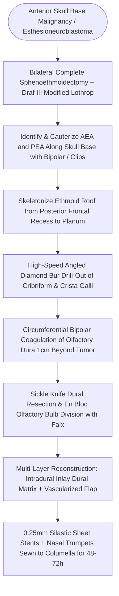

# Endoscopic craniofacial olfactory cleft resection achieves clear margins for anterior skull base malignancies while avoiding open craniotomy morbidity

## Active Recall

> [!question]- Why does modern oncologic evidence demonstrate equivalent survival outcomes between piecemeal endoscopic craniofacial resection and traditional en bloc open resection?
> *Answer / Clinical Rationale*: Extensive multicenter trials in endoscopic skull base surgery and transoral oncology have proven that the single prognostic determinant of survival and disease-free control is achieving **histopathologically negative surgical margins (R0 resection)**. The classic dogma that piecemeal debulking causes mandatory lymphovascular seeding and regional dissemination has been disproven; high-magnification endoscopic visualization allows superior margin mapping in deep cranial base crevices compared to open line-of-sight views.

> [!question]- How does the routine placement of bilateral nasal trumpets sewn across the columella for 48 to 72 hours postoperatively protect the skull base reconstruction after endoscopic craniofacial resection?
> *Answer / Clinical Rationale*: Nasal trumpets bridge the anterior nares and bypass nasal packing, maintaining a continuous low-resistance airway that diverts inspiratory and expiratory airflow away from the reconstructed anterior cranial fossa dural defect. This prevents the generation of positive intrantral pressures during sniffing, swallowing, or attempted sneezing, protecting against catastrophic **tension pneumocephalus** and flap displacement.

## Core Clinical & Mechanistic Principles
Endoscopic Craniofacial Resection (CFR) has revolutionized the treatment of anterior skull base malignancies, most notably [[Esthesioneuroblastoma Kadish and Hyams staging determines craniofacial resection and adjuvant therapy|esthesioneuroblastoma]] (olfactory neuroblastoma), sinonasal adenocarcinoma, and olfactory groove malignancies. Credit for the original craniofacial approach belongs to Ketcham (1963), who combined a transcranial frontal craniotomy with a transfacial approach via [[Midface degloving, lateral rhinotomy, and Weber-Fergusson approaches provide graded open exposure for sinonasal and skull base malignancies|traditional open craniofacial resection]] (lateral rhinotomy or midface degloving). However, open CFR carried profound morbidity, with international collaborative studies (Ganly et al.) reporting a 36.3% complication rate, 4.7% operative mortality, a 20% CSF leak rate, and paradoxically a 30% incidence of positive margins due to restricted vision deep beneath the frontal lobes.

The modern endoscopic [[Transcribriform EEA provides access to olfactory groove meningiomas and esthesioneuroblastomas|transcribriform endoscopic approach]] avoids facial incisions, frontal bone osteotomies, and brain retraction. Comparative series demonstrate identical disease-specific survival and distant metastatic rates between endoscopic and open cohorts, accompanied by significantly reduced hospital stays, superior cosmesis, and fewer wound complications. Furthermore, in unilateral tumors originating from the [[Olfactory neuroepithelium contains bipolar sensory neurons and basal stem cells|olfactory epithelium]] that spare the contralateral nasal vault, unilateral endoscopic CFR permits complete oncologic clearance while successfully preserving contralateral olfaction (Tajudeen/Adappa).

### Operative Technique
1. **Patient Preparation**: The patient is positioned supine, fixed in a Mayfield head clamp, and placed in a 20° reverse Trendelenburg position to promote cranial venous drainage and improve surgical field clarity. The abdomen and lateral thigh are prepped for autologous fat and fascia lata harvesting if required.
2. **Sinonasal Clearance & Modified Lothrop**: The tumor is systematically debulked to the skull base using microdébriders and through-cutting instruments. Complete bilateral total ethmoidectomies, wide sphenoidotomies, and a modified Lothrop (Draf III) frontal sinusotomy are performed, along with resection of the middle and superior turbinates, widely unroofing the entire anterior skull base from orbit to orbit.
3. **Early Vascular Control**: Before entering the skull base bone, the [[The 24-12-6 rule governs anterior and posterior ethmoidal artery surgical localization|anterior and posterior ethmoidal arteries]] are identified as they traverse the ethmoid roof. They are bipolared and divided (or clipped) bilaterally to halt arterial inflow to the tumor and cribriform dura.
4. **Circumferential Bony Drill-Out**: Using a high-speed angled 4-mm diamond bur, the bony anterior skull base is resected, initiating 1 cm anterior and posterior to the tumor attachment. Bone removal spans from the posterior wall of the frontal recess back to the planum sphenoidale, and from the medial periorbita of one side to the other. The crista galli is carefully thinned and removed.
5. **Dural Margin & En Bloc Olfactory Resection**: The dura is bipolared circumferentially around the tumor attachment with wide negative margins. Using a sickle knife or endoscopic dural scissors, the dura is incised. The anterior falx cerebri is divided, and the olfactory bulbs and tracts are sharply transected and mobilized into the nasal cavity.
6. **Multi-Layer Reconstruction**: The resulting high-flow anterior cranial fossa defect is closed in multiple layers:
   - *Intradural / Extradural Inlay*: Synthetic collagen dural matrix or autologous fascia lata tucked under the bony skull base shelf.
   - *Vascularized Overlay*: If the nasal septum is uninvolved, a contralateral Hadad-Bassagasteguy flap is mobilized; if the septum is resected, an overlay fascia lata graft, free mucosal graft, or transfrontal pericranial flap is positioned over the denuded bone.
7. **Pneumocephalus Prevention Protocol**: Rolled 0.25-mm Silastic stents are placed over the reconstruction to prevent graft displacement. Bilateral soft nasal trumpets are passed through the nasal vestibule beneath the stents and sutured across the columella for 48 to 72 hours. These trumpets divert airway pressures away from the healing repair, preventing catastrophic tension pneumocephalus. Postoperative lumbar drain protocols and strict avoidance of positive-pressure mask ventilation are maintained.

## Connected Concepts & Graph Traversal
- **Anatomical Vulnerability**: [[The Keros classification stages olfactory fossa depth and lateral lamella vulnerability|Olfactory Fossa Vulnerability]]
- **Vascularized Flap Closure**: [[The Hadad-Bassagasteguy nasoseptal flap is pedicled on the posterior septal artery|Vascularized Skull Base Coverage]]
- **Reconstruction Mechanics**: [[Multi-layer skull base reconstruction combines underlay, inlay, and overlay barriers|Multi-Layer Dural Closure]]
- **Alternative Skull Base Coverage**: [[The endoscopic pericranial flap transposed through the nasion repairs large anterior skull base defects|Anterior Defect Salvage]]
- **High-Grade Malignancy Differentiation**: [[Sinonasal undifferentiated carcinoma exhibits aggressive neuroendocrine features requiring multimodal therapy|Aggressive Anterior Skull Base Malignancies]]
- **Anterior Resection Boundaries**: [[First olfactory filum marks the posterior limit of frontal drill-out to avoid CSF leak|Olfactory Boundary Landmarks]]
