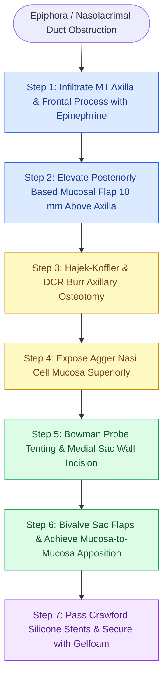

# Endoscopic dacryocystorhinostomy achieves lacrimal sac marsupialization via axillary osteotomy and bivalve mucosal flaps apposed to the agger nasi

## Active Recall

> [!question]- Why must the osteotomy in endoscopic DCR extend at least 10 mm superior to the middle turbinate axilla?
> *Answer / Clinical Rationale*: The lacrimal sac extends approximately 10 mm above the insertion of the middle turbinate axilla, and the common canaliculus enters high on the posterolateral wall of the sac. If bone removal is restricted to the level of the axilla, the superior fundus of the sac and the common internal punctum remain incarcerated behind thick frontal process bone, causing persistent stenosis and surgical failure.
>
> [!question]- What is the mechanistic rationale for marsupializing the lacrimal sac into bivalve flaps and opening the agger nasi cell?
> *Answer / Clinical Rationale*: Bivalving the medial wall of the lacrimal sac into anterior and posterior mucosal flaps allows the sac to lie completely flat against the lateral nasal wall. Opening the adjacent agger nasi cell allows the posterior-superior flap of the sac to directly appose the mucosal lining of the opened agger cell. This achieves primary intention mucosa-to-mucosa healing, preventing exposed bone granulation and cicatricial restenosis of the neo-ostium.

## Core Clinical & Mechanistic Principles

Endoscopic dacryocystorhinostomy (DCR) is the definitive surgical bypass for post-saccal or intrasaccal nasolacrimal duct obstruction presenting with refractory epiphora, chronic dacryocystitis, or dacryoceles. The fundamental biomechanical objective of endonasal DCR is to convert the pressurized lacrimal sac into an open, low-resistance diverticulum of the lateral nasal wall, promoting passive gravity and capillary tear transit while eliminating cutaneous facial scarring and medial canthal disruption.

The lacrimal sac sits within the lacrimal fossa, bounded anteriorly by the thick frontal process of the maxilla and posteriorly by the fragile [[Incisive uncinectomy exposes the ethmoid infundibulum while protecting the nasolacrimal duct|lacrimal bone]]. Crucially, the fundus of the lacrimal sac extends 8 to 10 mm superior to the axilla of the middle turbinate, and the common canaliculus (formed by the union of the superior and inferior canaliculi) enters into the posterior-superior quadrant of the lateral sac wall. Complete osteotomy of the overlying frontal process and lacrimal bone is mandatory to expose this common canalicular entry.

To guarantee permanent patency, the medial sac wall is opened and marsupialized into matching anterior and posterior mucosal flaps. By opening the overlying [[Agger nasi cells form the anterior boundary of the frontal recess|agger nasi cell]], the posterior lacrimal flap meets the respiratory mucosa of the agger nasi in direct primary apposition. Crawford silicone elastomer stents are passed through the puncta and secured loosely within the nasal cavity to maintain canalicular caliber and direct postoperative tear flow during the initial 4-week healing phase.

### Step-by-Step Surgical Execution

1. **Anesthesia and Preparation**: Under general endotracheal anesthesia, 2 mL of 1% lidocaine with 1:100,000 epinephrine is infiltrated subperiosteally into the middle turbinate axilla and frontal process of the maxilla. Three neurosurgical cottonoids soaked in 1:3,000 epinephrine provide intense vasoconstriction. If a septal deflection restricts instrument angles, a targeted contralateral-incision septoplasty is performed.
2. **Elevation of the Mucosal Flap**: Using a 30-degree rigid endoscope and a No. 11 or Beaver blade, a superior horizontal incision is made 10 mm above the middle turbinate axilla, extending 10 mm anteriorly onto the frontal process. A vertical incision descends to the inferior turbinate insertion, and an inferior horizontal incision connects back to the uncinate. A suction Freer elevator raises this mucosal flap posteriorly, staying strictly subperiosteal.
3. **Bone Removal (Axillary Osteotomy)**: A round knife flakes off the paper-thin lacrimal bone covering the posteromedial sac. A Hajek-Koffler punch or 2-mm upbiting Kerrison rongeur bites the dense bone of the frontal process of the maxilla. The jaws are released after every bite to verify that soft tissue is not caught. Once the rongeur cannot bite the thicker anterior bone, a high-speed diamond DCR burr polishes bone down to flush margins.
4. **Agger Nasi Cell Exposure**: The anterior agger nasi cell is opened widely immediately superior-posterior to the lacrimal sac.
5. **Probing and Marsupialization**: A size 00 Bowman lacrimal probe is introduced through the inferior punctum to tent the medial sac wall endonasally. Under direct 30-degree vision, a DCR spear knife punctures the sac wall directly over the tented probe as far posteriorly as possible. Bellucci micro ear scissors create superior and inferior relaxing cuts in the posterior flap, while a DCR sickle knife releases the anterior flap.
6. **Mucosal Apposition and Stenting**: The trimmed nasal mucosal flap is positioned to appose the anterior sac flap, while the posterior flap is laid against the agger nasi mucosa. Crawford bicanalicular silicone stents are passed, retrieved endonasally, and tied loosely or secured with a vascular clip. A pledget of absorbable gelatin sponge (Gelfoam) is slid along the stents to hold the mucosal flaps in apposition.

### Danger Zones & Complication Avoidance

- **Retrolacrimal Lamina Penetration**: Bone removal must stop at the uncinate process insertion. The retrolacrimal lamina papyracea posterior to the uncinate is paper-thin; violating it enters the extraconal orbital fat and medial rectus muscle.
- **Canalicular False Passage**: Lacrimal probes must follow the anatomical 90-degree bend (2 mm vertical, then medial) with gentle stretching of the eyelid to avoid creating a false tract through the prelacrimal soft tissue.
- **Common Internal Punctum Stenosis**: Incising the medial sac without visualizing the tenting probe risks transecting the common internal punctum on the lateral wall, causing irreversible lacrimal failure.
- **Revision Safeguards**: In failed DCR with osteotomy cicatrization, mucosal incisions are placed directly onto scarred bone, bone is enlarged superiorly, and adjunctive topical mitomycin C (0.4 mg/mL for 3–5 minutes) is applied to suppress fibroblast proliferation.

## Connected Concepts & Graph Traversal
- **Anatomical Boundary**: [[The uncinate process superior attachment dictates the frontal sinus drainage pathway|Uncinate Process Lacrimal Insertion]]
- **Diagnostic Evaluation**: [[Diagnostic rigid nasal endoscopy utilizes a standardized three-pass examination sequence|Endoscopic Endonasal Examination]]
- **Surgical Protection**: [[Lamina papyracea dehiscence predisposes to orbital fat herniation and medial rectus injury|Retrolacrimal Lamina Papyracea]]
- **Hemostatic Technique**: [[TIVA and greater palatine canal blocks optimize surgical field visibility in FESS|Surgical Hemostasis & Field Visibility]]
- **Revision Optimization**: [[Topical hemostatic matrix agents and nasal packing mitigate postoperative epistaxis and synechiae|Stenting and Synechiae Prevention]]
