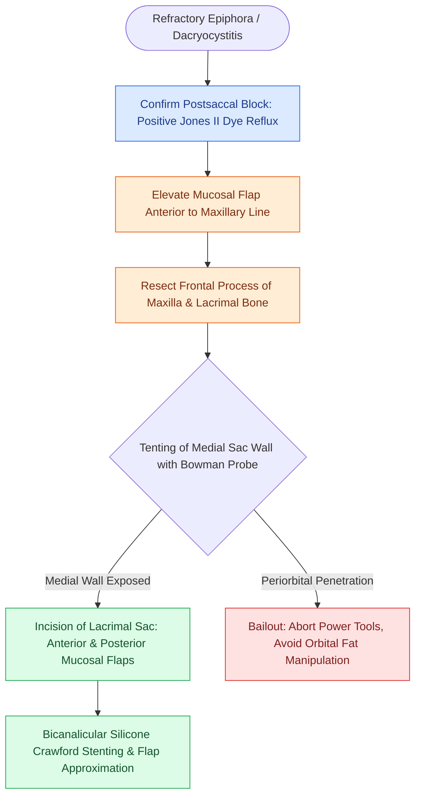

# Endoscopic dacryocystorhinostomy bypasses nasolacrimal duct obstruction via lacrimal sac marsupialization into the middle meatus

## Active Recall

> [!question]- What intranasal anatomical landmarks define the superior and inferior boundaries of the lacrimal sac during endoscopic DCR?
> *Answer / Clinical Rationale*: The **axilla of the middle turbinate** demarcates the superior one-third of the lacrimal sac (projecting just superior to the anterior insertion of the middle turbinate), while the **maxillary line** (the mucosal ridge representing the uncinate-maxilla junction intranasally and the lacrimomaxillary suture extranasally) marks the vertical course of the inferior two-thirds of the sac.
*(CummingsReview2017, Ch4, p.74)*

> [!question]- What is the most common cause of endoscopic DCR surgical failure, and what technical step mitigates it?
> *Answer / Clinical Rationale*: **Synechiae and cicatricial stenosis** between the neocicatricial ostium and the middle turbinate (or uncinate remnant). This is mitigated by **wide bone removal over the thick frontal process of the maxilla and thin lacrimal bone**, fashioning mucosal flaps that cover exposed raw bone, medializing or partially trimming a lateralized middle turbinate, and placing **bicanalicular silicone Crawford stents** for several weeks to months.
*(CummingsReview2017, Ch4, p.74)*

> [!question]- How do surgical success rates compare between anatomical versus functional lacrimal drainage failure in endoscopic DCR?
> *Answer / Clinical Rationale*: Complete anatomical obstructions achieve a **$>95\%$ surgical success rate** with endoscopic DCR, whereas functional obstructions (impaired lacrimal pump mechanism or canalicular dysmotility without discrete physical blockage) achieve only approximately an **$80\%$ success rate**.
*(CummingsReview2017, Ch4, p.73–74)*

## Core Clinical & Mechanistic Principles
**Endoscopic dacryocystorhinostomy (endoscopic DCR)** is the primary endonasal surgical intervention for refractory epiphora and recurrent dacryocystitis caused by postsaccal [[Incisive uncinectomy exposes the ethmoid infundibulum while protecting the nasolacrimal duct|nasolacrimal duct]] obstruction. By creating a direct, low-resistance neo-ostium between the lacrimal sac and the nasal cavity superior to the inferior turbinate, endoscopic DCR bypasses the obstructed nasolacrimal duct while preserving the orbicularis oculi lacrimal pump mechanism and avoiding external facial incisions.

### Lacrimal Outflow Anatomy & Pathophysiology
Tears drain from the superior and inferior puncta across $2\text{ mm}$ vertical ampullae into $8\text{ mm}$ horizontal canaliculi, uniting in $>90\%$ of individuals as a **common canaliculus** entering the lacrimal sac through the valve of Rosenmüller. The lacrimal sac sits within the lacrimal fossa, bounded anteriorly by the anterior lacrimal crest (**frontal process of the maxilla**) and posteriorly by the posterior lacrimal crest (**lacrimal bone**). In children, congenital nasolacrimal duct obstruction typically results from an **imperforate valve of Hasner** at the inferior meatus (amenable to office probing). In young adults, canalicular stenosis predominates, whereas middle-aged individuals frequently harbor **dacryoliths**, and elderly patients present with involutional nasolacrimal duct stenosis (both exquisitely responsive to DCR).

### Endoscopic Landmarks for Lacrimal Sac Localization
1. **Axilla of the Middle Turbinate**: Marks the upper one-third of the lacrimal sac, which projects superior to the root of the anterior attachment of the middle turbinate.
2. **Maxillary Line**: An identifiable mucosal ridge traversing from the anterior insertion of the middle turbinate inferiorly toward the anterior border of the uncinate process; marks the underlying **lacrimomaxillary suture**. The inferior two-thirds of the sac lies directly beneath this ridge.
3. **Common Internal Punctum**: The most proximal portion of the lacrimal system that can be successfully reconstructed by DCR; opening must be explicitly visualized within the marsupialized sac.

### Surgical Technique, Anatomical Pitfalls & Craft Nuance
1. **Mucosal Flap Elevation**: A rectangular mucosal flap is incised $8\text{–}10\text{ mm}$ superior to the middle turbinate axilla, extended anteriorly onto the frontal process of the maxilla, and carried inferiorly past the uncinate attachment.
2. **Bony Rhinostomy**: The thin lacrimal bone posteriorly is fractured easily with a Freer elevator. The thick frontal process of the maxilla anteriorly requires a heavy 45-degree Kerrison rongeur or a continuous-irrigation diamond burr. Adequate bone removal ($>10\text{–}15\text{ mm}$ window) must completely uncover the anterior and superior limits of the sac.
3. **Sac Incision & Marsupialization**: A 00 Bowman probe is passed through the inferior canaliculus to tent the medial sac wall intranasally. Under direct $0^\circ$ or $30^\circ$ endoscopic visualization, a sickle knife or Beaver blade makes a longitudinal incision from superior fundus to inferior duct, with relaxing cuts to fashion anterior and posterior flaps that are laid flat against adjacent nasal mucosa to prevent granulation.
4. **Intubation & Stenting**: Bicanalicular silicone Crawford tubes are retrieved from the middle meatus, tied securely with multiple square knots, and left in situ for 4 to 12 weeks.
5. **Complication Profile ($5\%$)**: Epistaxis, periorbital ecchymosis, orbital fat exposure from excessive posterior bone resection through the lamina papyracea, [[Retrobulbar hematoma requires emergent bedside lateral canthotomy and cantholysis|retrobulbar hematoma]], and synechiae closure.

## Connected Concepts & Graph Traversal
- **Diagnostic Differentiation**: [[Jones primary and secondary dye tests differentiate canalicular from nasolacrimal duct obstruction|Jones Dye Testing Algorithm]]
- **Anatomical Boundary Anchor**: [[The uncinate process superior attachment dictates the frontal sinus drainage pathway|Uncinate Process Attachments]]
- **Turbinate Lateralization Pitfall**: [[Middle turbinate lateralization causes secondary ostiomeatal obstruction and frontal sinus stenosis|Middle Turbinate Synechiae]]
- **Medial Orbital Danger**: [[Lamina papyracea dehiscence predisposes to orbital fat herniation and medial rectus injury|Lamina Papyracea Dehiscence]]
- **Anterior Fontanelle Preservation**: [[Controlled middle meatal antrostomy enlargement preserves the anterior inferior fontanelle|Fontanelle & Lacrimal Margin]]
- **Preoperative CT Checklist**: [[The CLOSE checklist systematically evaluates critical radiological danger zones|CLOSE Radiologic Danger Zones]]
- **Surgical Craft**: [[Endoscopic dacryocystorhinostomy achieves lacrimal sac marsupialization via axillary osteotomy and bivalve mucosal flaps apposed to the agger nasi|Endoscopic DCR Technique]]
