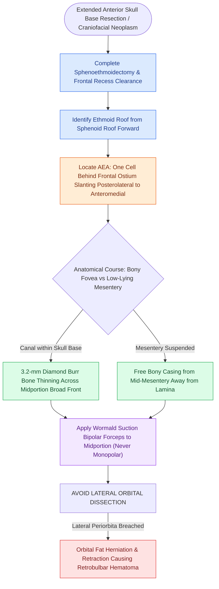

# Endoscopic endonasal anterior ethmoidal artery ligation requires skull base skeletonization to prevent orbital fat prolapse and vessel retraction

## Active Recall

> [!question]- Why is direct endoscopic dissection of the anterior ethmoid artery at the lateral lamina papyracea junction explicitly avoided?
> *Answer / Clinical Rationale*: The periorbita is exceptionally thin and weak at the anterior ethmoid foramen; exposing the artery directly at the orbital wall breaches periorbita, allowing orbital fat to herniate into the surgical field (risking entrapment by powered microdebriders or medial rectus muscle laceration). Furthermore, transecting the vessel at this lateral junction causes immediate arterial retraction into the orbit, inducing an acute sight-threatening retrobulbar hematoma.

> [!question]- In what percentage of cases does the anterior ethmoid artery lie suspended on a bony mesentery below the skull base, and what anatomical feature dictates this configuration?
> *Answer / Clinical Rationale*: The AEA is suspended on a mesentery below the ethmoid roof in approximately 36% of individuals (and is dehiscent in 16%), dictated by extensive pneumatization of supraorbital ethmoid cells and a deep olfactory fossa (Keros Type II or III).

## Core Clinical & Mechanistic Principles
Elective endoscopic endonasal ligation of the anterior ethmoidal artery (AEA) and posterior ethmoidal artery (PEA) is an essential surgical milestone in anterior skull base resection (e.g., olfactory groove meningiomas, esthesioneuroblastomas, and sinonasal malignancies) and during [[Draf III modified Lothrop unites both frontal sinuses into a common cavity|Draf III modified Lothrop frontal drill-outs]]. 

The AEA arises from the ophthalmic artery, courses between the superior oblique and medial rectus muscles, exits the orbit through the anterior ethmoidal foramen, traverses the ethmoid sinus roof, and enters the olfactory fossa adjacent to the crista galli. As detailed in [[Supraorbital ethmoid cells suspend the anterior ethmoidal artery below the skull base|supraorbital cell aerations]], extensive pneumatization displaces the arterial canal up to several millimeters below the fovea ethmoidalis.

### Endoscopic Surgical Protocol
1. **Surgical Corridors & Skull Base Definition**:
   - Complete exposure requires uncinectomy, maxillary antrostomy, complete ethmoid bullectomy, posterior ethmoidectomy, and sphenoidotomy.
   - The definitive skull base is identified by first locating the roof of the sphenoid sinus, then following the fovea ethmoidalis systematically from posterior to anterior.
2. **Anterior Ethmoidal Artery Localization**:
   - The AEA is identified crossing between the second lamella (ethmoid bulla) and third lamella (middle turbinate basal lamella), typically located **one air cell posterior to the frontal sinus ostium**.
   - It courses with a characteristic **posterolateral-to-anteromedial slant** across the roof of the ethmoid sinus.
3. **Midportion Skeletonization (Diamond Burr Technique)**:
   - Even when suspended on a mesentery, the artery is encased in a thin bony sheath. Attempting to clip an un-skeletonized artery fractures bone and avulses the vessel.
   - A 3.2-mm diamond burr under continuous saline irrigation is used to thin the bony covering over the **midportion** of the artery across a broad front.
   - *Strict Safety Rule*: Dissection must never approach the lamina papyracea. Operating in the midportion of the fovea preserves a protective lateral bony cuff, preventing orbital fat herniation and safeguarding against lateral arterial retraction.
4. **Bipolar Coagulation**:
   - Once exposed in its midportion, the artery is cauterized with angled suction bipolar forceps (e.g., Wormald suction bipolar).
   - **Monopolar cautery is strictly contraindicated**: monopolar conduction through the skull base fractures the cribriform plate and lateral lamella, precipitating high-flow CSF rhinorrhea.
5. **Posterior Ethmoidal Artery Control**:
   - The PEA is identified at the junction of the posterior ethmoid roof and anterior sphenoid face (approximately 12 mm posterior to the AEA). The PEA is exposed with a diamond burr and coagulated in identical fashion.

## Connected Concepts & Graph Traversal
- **External Metric Localization**: [[The 24-12-6 rule governs anterior and posterior ethmoidal artery surgical localization]]
- **Skull Base Vulnerability**: [[The Keros classification stages olfactory fossa depth and lateral lamella vulnerability]]
- **Radiologic Safety Checklist**: [[The CLOSE checklist systematically evaluates critical radiological danger zones]]
- **Retrobulbar Emergency Management**: [[Retrobulbar hematoma requires emergent bedside lateral canthotomy and cantholysis]]
- **Ethmoidal Lamellar Anchors**: [[The ethmoid bulla serves as the principal anatomical anchor for anterior ethmoidectomy]]
