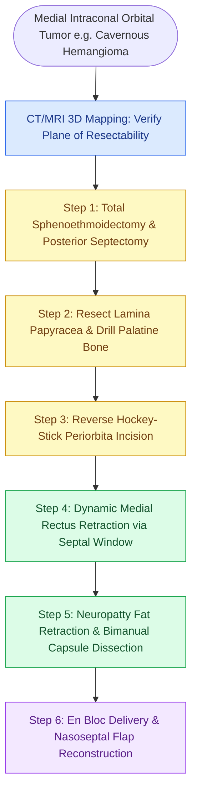

# Endoscopic medial intraconal orbital tumor resection utilizes binarial four-handed dissection and dynamic medial rectus retraction below the plane of resectability

## Active Recall

> [!question]- What defines the "plane of resectability" in endoscopic transnasal resection of orbital tumors?
> *Answer / Clinical Rationale*: The plane of resectability is an imaginary geometric plane drawn from the contralateral naris passing through the long axis of the ipsilateral optic nerve. Tumors or tumor components located medial and inferior to this plane can be safely reached and dissected endonasally without retracting or manipulating the optic nerve. Any tumor volume extending lateral to the optic nerve superior to this plane cannot be resected safely via an exclusive endonasal corridor and mandates an open or combined transorbital/craniotomy approach.
>
> [!question]- Why is dynamic, intermittent retraction of the medial rectus muscle favored over static retraction during intraconal dissection?
> *Answer / Clinical Rationale*: The neurovascular supply to the medial rectus muscle enters along its posterior third from the inferior division of the oculomotor nerve (cranial nerve III) and branches of the ophthalmic artery. Prolonged static retraction induces muscular ischemia, neuropraxia, and permanent postoperative diplopia. Dynamic, intermittent medial retraction with a blunt double-ball probe through a transseptal window displaces the muscle only during active dissection, preserving microvascular perfusion.

## Core Clinical & Mechanistic Principles

Primary neoplasms of the orbit, such as cavernous hemangiomas (cavernous venous malformations), solitary fibrous tumors, schwannomas, and neurofibromas, frequently arise within the intraconal compartment medial and inferior to the optic nerve. Historically, surgical resection required open lateral orbitotomy or transcranial approaches, demanding extensive globe retraction, lateral bone removal, and blind dissection through deep orbital fat. The transnasal [[Endoscopic transorbital approaches provide multi-portal access to the lateral skull base and orbit|endoscopic orbitotomy]] provides direct, unhindered access along the longitudinal axis of the lesion, offering superior illumination, optical magnification, and minimal globe disruption.

Surgical planning divides the medial intraconal space into three distinct anatomical zones based on relationship to the inferomedial muscular trunk of the ophthalmic artery:
- **Zone A (Anterior-Inferior)**: Located anterior to the muscular trunk and inferior to the mid-belly axis of the medial rectus. This is the most favorable surgical corridor, characterized by a relative paucity of neurovascular structures.
- **Zone B (Anterior-Superior)**: Located anterior to the muscular trunk but superior to the mid-belly axis. Dissection is technically demanding due to proximity to the ethmoidal neurovascular bundles.
- **Zone C (Posterior Apex)**: Located posterior to the muscular trunk near the annulus of Zinn. This is the most perilous compartment, with high vulnerability of the optic nerve, ophthalmic artery, and oculomotor branches.

Resection is executed via a binarial, four-handed technique. A generous posterior septectomy permits the assistant to hold the endoscope and provide dynamic medial rectus retraction while the primary surgeon dissects bimanually. Intraconal orbital fat is never resected or aggressively electrocauterized; instead, saline-soaked neurosurgical patties gently displace fat lobules, maintaining clear visualization of the tumor pseudocapsule. Large anterior-medial orbital defects are reconstructed with a vascularized [[The Hadad-Bassagasteguy nasoseptal flap is pedicled on the posterior septal artery|nasoseptal flap]] to prevent enophthalmos and muscle tethering.

### Step-by-Step Surgical Execution

1. **Preoperative 3D Volumetric Mapping**: Contrast MRI and fine-cut CT confirm tumor volume, relationship to the inferomedial muscular trunk of the ophthalmic artery, and confinement within the "plane of resectability."
2. **Corridor Preparation & Binarial Portal**: Complete ethmoidectomy, maxillary antrostomy, and sphenoidotomy are performed. A 2-cm posterior septectomy creates a binasal four-handed surgical corridor. A contralateral nasoseptal flap is harvested simultaneously if reconstruction of a large defect is anticipated.
3. **Bony Decompression**: The lamina papyracea is removed with a double-ball probe. Thick bone at the orbital process of the palatine bone and pterygoid wedge is drilled with an angled 4-mm diamond burr to access the posterior orbital apex.
4. **Reverse Hockey-Stick Periorbital Incision**: The periorbita is opened with a disposable sickle knife in a reverse "hockey stick" configuration. The anterior periorbita is preserved intact to prevent anterior fat herniation.
5. **Extraconal Fat Dissection & Medial Rectus Identification**: Extraconal fat is gently mobilized. The inferior border of the medial rectus muscle is identified. A double-ball probe placed through the septal window elevates the muscle superomedially.
6. **Intraconal Dissection**: Saline-soaked 1/2 x 3-inch neurosurgical patties are placed between fat lobules to retract fat and absorb blood. Intraconal fat is never excised or cauterized. Blunt dissection frees the tumor from surrounding connective tissue attachments.
7. **Tumor Delivery**: The lesion is mobilized anteriorly in a plane parallel to the optic nerve. Final lateral attachments are released, and the tumor is delivered intact using small cupped forceps.
8. **Reconstruction & Minimal Packing**: If an extensive defect risks muscle prolapse or enophthalmos, the nasoseptal flap is draped over the orbitotomy. High-volume irrigation is avoided for 2 weeks. Pressure packing is strictly avoided.

### Danger Zones & Complication Avoidance

- **Blind Intraconal Electrocautery**: Bipolar cautery is permissible only in the extraconal space. Intraconal cauterization destroys microscopic branches of the oculomotor nerve and central retinal circulation.
- **Optic Nerve Traction**: Dissecting lateral to the optic nerve without line-of-sight visual control risks traction neuropathy. Tumors extending beyond the plane of resectability require planned combined transcranial or orbitotomy corridors.
- **Medial Rectus Fibrosis and Entrapment**: Failure to reconstruct large orbital wall defects allows the medial rectus muscle to prolapse into the ethmoid cavity, scarring against bare bone and producing severe restrictive strabismus.

## Connected Concepts & Graph Traversal
- **Anatomical Substrate**: [[Lamina papyracea dehiscence predisposes to orbital fat herniation and medial rectus injury|Medial Rectus & Periorbita]]
- **Corridor Exposure**: [[Transpterygoid EEA exposes juvenile nasopharyngeal angiofibromas and lateral sphenoid defects|Orbital Apex Palatine & Sphenoid Corridors]]
- **Critical Neurovascular Boundary**: [[The lateral and medial opticocarotid recesses define critical anatomical corridors in endoscopic skull base surgery|Optic Nerve & Ophthalmic Artery Interface]]
- **Differential Pathology**: [[Sinonasal small round blue cell tumors are differentiated by immunohistochemistry into SNUC, olfactory neuroblastoma, melanoma, lymphoma, and rhabdomyosarcoma|Sinonasal & Orbital Neoplasms]]
- **Imaging Correlation**: [[MRI T1, T2, and contrast protocols differentiate sinonasal neoplasms from inspissated secretions|Orbital Apex MRI & Cavernous Hemangioma]]
