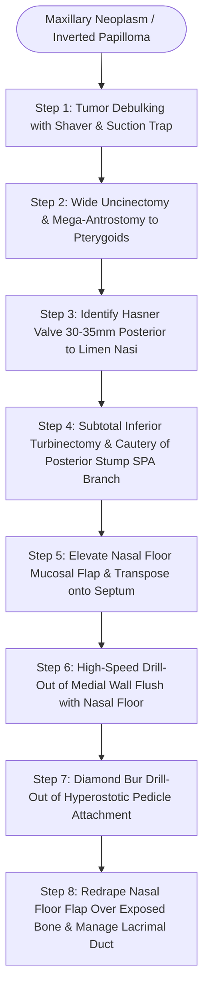

# Endoscopic medial maxillectomy resects the lateral nasal wall flush with the nasal floor while preserving a mucosal flap to cover denuded bone

## Active Recall

> [!question]- Why is the creation and temporary septal transposition of a vascularized nasal floor mucosal flap critical during endoscopic medial maxillectomy?
> *Answer / Clinical Rationale*: Elevating a mucosal flap along the nasal floor and lateral nasal wall prior to bony resection preserves an intact, vascularized tissue strip that is protected along the nasal septum during radical drilling. At the conclusion of the case, redraping this flap over the denuded bone of the inferior lateral nasal wall and nasal floor prevents prolonged osteitis, extensive crusting, delayed remucosalization, and cicatricial synechiae formation across the mega-antrostomy.

> [!question]- Where is the Hasner valve located in relation to the limen nasi, and how is the nasolacrimal apparatus managed when resecting tumors involving the anterior medial maxillary wall?
> *Answer / Clinical Rationale*: The Hasner valve (the distal terminus of the nasolacrimal duct) is located in the superior aspect of the inferior meatus, approximately **30 to 35 mm posterior to the limen nasi**. If tumor abuts or involves the nasolacrimal duct, the duct is cleanly transected at an oblique angle or marsupialized via an endoscopic dacryocystorhinostomy (DCR) to prevent postoperative epiphora and dacryocystitis.

## Core Clinical & Mechanistic Principles
Endoscopic Medial Maxillectomy (EMM) represents the definitive endonasal procedure for eradicating benign neoplasms, low-grade sinonasal malignancies, and recalcitrant inflammatory disease involving the medial maxillary sinus, lateral nasal wall, ethmoid labyrinth along the lamina papyracea, and lacrimal apparatus. Historically performed via open transfacial lateral rhinotomy, the endoscopic approach harnesses angled rod-lens optics (0°, 30°, and 70°) and high-definition illumination to achieve superior visualization of tumor attachment zones while avoiding facial incisions and external deformity. Its foremost oncologic application is in the treatment of [[Sinonasal inverting papilloma requires subperiosteal excision and hyperostotic bone drill-out|sinonasal inverting papilloma]], where complete subperiosteal resection and diamond bur drill-out of underlying hyperostotic bone are required to prevent recurrence.

### Surgical Anatomy of the Medial Maxillary Strut
The medial wall of the maxillary antrum is a complex osteomucosal boundary comprised of:
1. **The uncinate process** (mucosa and bone forming the infundibular boundary).
2. **The posterior fontanelle** (membranous mucosal diaphragm devoid of bony support).
3. **The inferior turbinate** (maxilloturbinal bone projecting from the medial maxilla).
4. **The perpendicular plate of the palatine bone** (posterior medial buttress).
5. **The lacrimal bone and nasolacrimal duct** (anterior medial boundary).

The natural maxillary ostium is consistently located within the inferior third of the medial maxillary line. The distal terminus of the nasolacrimal drainage system—the **valve of Hasner**—opens into the anterior superior vault of the inferior meatus, located precisely 30 to 35 mm posterior to the limen nasi. Preoperative infiltration of 1% lidocaine with 1:100,000 epinephrine into the lateral nasal wall, augmented by a transoral greater palatine canal block (25-gauge needle bent at 2.5 cm entered opposite the second maxillary molar) or sphenopalatine block at the [[The crista ethmoidalis guides endoscopic sphenopalatine artery ligation|crista ethmoidalis]] (25-gauge needle bent at 1 cm), provides profound regional hemostasis under hypotensive total intravenous anesthesia (TIVA).

### Stepwise Operative Sequence
1. **Tumor Debulking & Pedicle Identification**: The middle turbinate is medially reflected. Exophytic tumor is debulked using an angled microdébrider into an in-line suction trap for histopathologic confirmation, exposing normal mucosal boundaries and identifying the focal site of origin.
2. **Uncinectomy & Mega-Antrostomy**: Complete [[Incisive uncinectomy exposes the ethmoid infundibulum while protecting the nasolacrimal duct|uncinectomy]] is executed using backbiting punches. The natural ostium is identified with a 30° telescope and widened posteriorly through the posterior fontanelle flush to the posterior antral wall and medial pterygoid plate, and inferiorly to the inferior turbinate attachment, creating an extensive [[Maxillary antrostomy requires incorporating accessory fontanelle ostia to prevent recirculation|maxillary antrostomy]].
3. **Hasner Valve Localization**: The inferior turbinate is elevated to visualize the valve of Hasner in the inferior meatus. If tumor does not involve the anterior margin, bone removal is directed inferior to the valve to safeguard the tear duct. If tumor abuts the duct, it is sharply transected at an oblique angle, and an [[Endoscopic dacryocystorhinostomy bypasses nasolacrimal duct obstruction via lacrimal sac marsupialization into the middle meatus|endoscopic dacryocystorhinostomy]] is performed.
4. **Subtotal Inferior Turbinectomy**: A hemostat crushes the turbinate at the junction of its anterior one-third and posterior two-thirds. Endoscopic scissors divide along the crushed line into the antrostomy. Dissection is carried posteriorly to the posterior antral wall, excising the turbinate bulk. The posterior arterial stump (branch of the sphenopalatine artery) is coagulated with suction bipolar electrocautery.
5. **Vascularized Nasal Floor Flap Elevation**: Using a Beaver blade or ophthalmic keratome, a posterior transverse incision is placed at the posterior antral wall, an anterior transverse incision is placed just posterior to the Hasner valve, and a superior longitudinal incision is made below the maxilloturbinal remnant. A subperiosteal flap is elevated across the lateral nasal wall and nasal floor, then tucked and draped along the nasal septum.
6. **Medial Wall Resection Flush with Nasal Floor**: Using downbiting rongeurs and a high-speed continuous irrigating bur, the residual bony medial wall and inferior turbinate attachment are drilled down flush with the nasal cavity floor.
7. **Pedicle Drill-Out**: The focal attachment site identified by preoperative CT hyperostosis is drilled down with a 4-mm diamond bur to eradicate microscopic tumor nests within bone trabeculae.
8. **Reconstruction**: The preserved nasal floor mucosal flap is repositioned off the septum and draped into the maxillary defect over the denuded bone of the lateral wall and floor.

## Connected Concepts & Graph Traversal
- **Extended Antral Access**: [[Endoscopic Denker approach removes the piriform aperture and ascending maxillary process to expose the anterior antral wall and infratemporal fossa|Endoscopic Denker Approach]]
- **Antrostomy Principles**: [[Separate inferior antrostomies cause recirculating mucus and recalcitrant sinusitis|Mucus Recirculation Phenomenon]]
- **Anatomic Boundaries**: [[Ohngren line divides the maxillary sinus into anteroinferior and posterosuperior prognostic compartments|Maxillary Oncologic Planes]]
- **🔗 Open Surgical Approaches (Head_and_Neck)**: [[Midface degloving, lateral rhinotomy, and Weber-Fergusson approaches provide graded open exposure for sinonasal and skull base malignancies|Open Maxillectomy Approaches]]
- **🔗 Malignancy Staging & Resection (Head_and_Neck)**: [[Hard palate and upper alveolar carcinoma require partial or total maxillectomy|Maxillary Carcinoma Management]]
