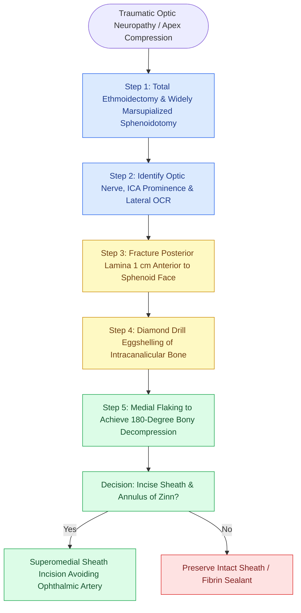

# Endoscopic optic nerve decompression achieves 180-degree intracanalicular bony release with superomedial sheath incision to avoid ophthalmic artery injury

## Active Recall

> [!question]- In which quadrant of the optic nerve sheath must a dural incision be placed, and why?
> *Answer / Clinical Rationale*: When optic nerve sheath fenestration is indicated, the incision must be placed strictly in the superomedial quadrant. The ophthalmic artery runs inferolateral to the optic nerve in 85% of cases and inferomedial in 15%, but virtually never superomedial. Incising the superomedial sheath avoids catastrophic arterial transection, pseudoaneurysm formation, or central retinal artery devascularization while successfully decompressing the perineural subarachnoid space and dividing the constricting annulus of Zinn.
>
> [!question]- How does the surgeon prevent thermal and mechanical injury to the intracanalicular optic nerve during high-speed diamond drilling?
> *Answer / Clinical Rationale*: Drilling must be performed with a 15-degree high-speed diamond burr running strictly parallel along the long axis of the nerve (never across it), accompanied by continuous high-volume cold saline suction-irrigation. The bone is meticulously "eggshelled" down to a translucent paper-thin layer without allowing the drill burr to chatter or touch the underlying periosteal sheath. The remaining thinned bone flakes are then elevated medially away from the nerve using a fine Freer elevator or ball-tip probe.

## Core Clinical & Mechanistic Principles

The intracanalicular segment of the optic nerve (cranial nerve II) measures approximately 9 mm in length and represents the most vulnerable anatomical segment of the visual pathway. Within the unyielding bony optic canal formed by the two struts of the lesser wing of the sphenoid, the nerve is encased in dura that splits into an outer layer (contributing to periorbita) and an inner layer fused to arachnoid. The **annulus of Zinn** (tendinous ring of origin for the rectus muscles) forms a dense, inextensible fibrous collar at the orbital apex. Edema or hematoma from traumatic optic neuropathy (TON), fibro-osseous lesions, graves optic neuropathy, or apex neoplasms rapidly induces circumferential compartment syndrome, strangulating the capillary pial nutrient plexus and precipitating axonal ischemia.

Endoscopic transnasal optic nerve decompression provides direct, minimally invasive access to the medial and inferior walls of the optic canal without brain retraction or facial incisions. The surgical corridor traverses a complete sphenoethmoidectomy to identify the optic canal impression and the [[Opticocarotid recesses on coronal CT demarcate the paraclinoid ICA and optic strut|optic strut]] within the lateral sphenoid wall. In the presence of an [[Onodi cells place the optic nerve and carotid artery at risk during posterior ethmoidectomy|Onodi cell]], the optic canal traverses the posterior ethmoid cavity directly above the sphenoid sinus.

The operative gold standard entails **180-degree circumferential bony decompression** of the medial and inferior canal walls from the orbital apex across the annulus of Zinn to the intracranial internal carotid/chiasmatic cistern. Bony removal is performed with diamond burrs and continuous cold irrigation to prevent conductive thermal necrosis. If sheath incision is required for intraneural hematoma or refractory intracranial hypertension, the incision is placed superomedially, avoiding the ophthalmic artery.

### Step-by-Step Surgical Execution

1. **Preoperative Ophthalmology Assessment & Imaging**: Complete baseline visual acuity, relative afferent pupillary defect (RAPD) assessment, color plates, and visual evoked potentials (VEP). Fine-cut triplanar CT (0.625 mm) evaluates canal fractures, bone impingement fragments, Onodi cells, and carotid dehiscence.
2. **Corridor Creation**: Total anterior/posterior ethmoidectomy and wide sphenoidotomy are performed. A middle turbinate swing or partial turbinectomy optimizes instrument trajectories. In challenging cases, a binasal four-handed approach via posterior septectomy is deployed.
3. **Landmark Triangulation**: The optic tubercle, lateral opticocarotid recess (OCR), medial OCR, and internal carotid artery prominence are verified using image-guided navigation.
4. **Posterior Lamina Removal**: The lamina papyracea is fractured 1 cm anterior to the sphenoid face with a J-curette and removed posteriorly until the optic strut is reached.
5. **Intracanalicular Bone Removal**: A 15-degree high-speed diamond burr (2.5–3.0 mm) with continuous high-volume irrigation thins the optic canal bone. Drilling is executed strictly parallel to the long axis of the nerve. The bone is plained to an eggshell thickness and elevated away from the underlying sheath with a fine Freer elevator, achieving a full 180-degree decompression spanning the annulus of Zinn to the optic chiasm.
6. **Optic Sheath Fenestration (Selective)**: In cases of intraneural hematoma or severe traumatic sheath distention, a sharp sickle or arachnoid knife incises the sheath and annulus of Zinn. The incision is strictly restricted to the superomedial quadrant.
7. **CSF Leak Management & Closure**: Egress of CSF confirms arachnoid decompression. A free mucosal graft or piece of Gelfoam with fibrin glue is placed loosely over the fenestration. Nasal packing is strictly avoided to prevent transmission of compressive force onto the decompressed nerve.

### Danger Zones & Complication Avoidance

- **Ophthalmic Artery Injury**: The ophthalmic artery courses inferolateral to the nerve in 85% of cases and inferomedial in 15%. An inferior or lateral incision through the optic sheath directly transects the vessel, provoking immediate blindness or torrential hemorrhage.
- **Thermal Conductive Neuropathy**: Drilling without continuous iced or cold saline irrigation rapidly transmits destructive heat across the thinned bone into unmyelinated axons. Irrigation must flow continuously over the burr tip.
- **Internal Carotid Artery Laceration**: The opticocarotid recess separates the optic nerve from the paraclinoid ICA. Drill trajectory must never stray posteroinferiorly into the carotid prominence.

## Connected Concepts & Graph Traversal
- **Anatomical Boundary**: [[The lateral and medial opticocarotid recesses define critical anatomical corridors in endoscopic skull base surgery|Opticocarotid Recesses]]
- **Critical Carotid Safety**: [[Intraoperative ICA injury requires two-surgeon suction and crushed muscle patch hemostasis|Internal Carotid Artery Proximity]]
- **Pneumatization Variation**: [[Sphenoid sinus pneumatization patterns dictate carotid and optic canal exposure|Optic Canal Bone Dehiscence]]
- **CSF Leak Protocol**: [[Iatrogenic skull base cribriform leaks require immediate intraoperative multi-layer graft repair|Dural Decompression & CSF Leak Management]]
- **🔗 Neuro-Ophthalmologic Syndrome (FPRS)**: [[Orbital apex syndrome and superior orbital fissure syndrome manifest with ophthalmoplegia and vision loss|Orbital Apex Compressive Neuropathy]]
