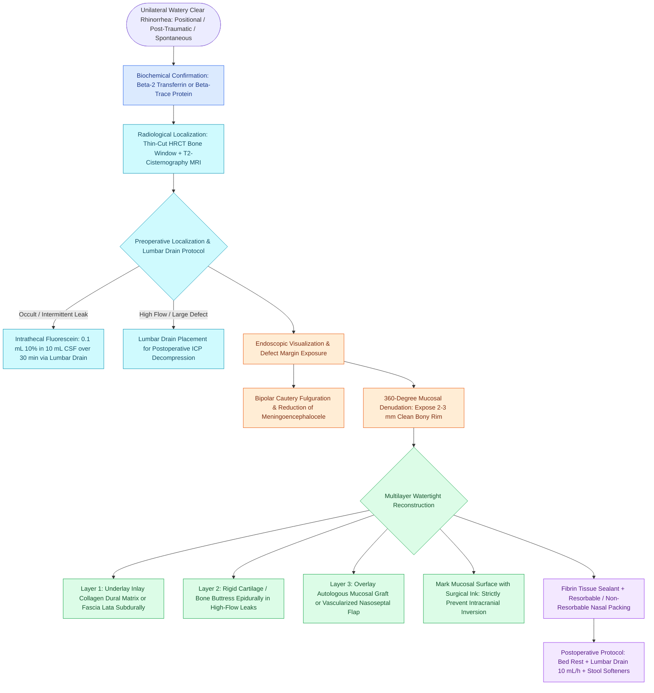

# Endoscopic repair of cerebrospinal fluid rhinorrhea employs systematic biochemical confirmation, intrathecal fluorescein localization, and multilayer underlay dural reconstruction to achieve primary closure

## Active Recall

> [!question]- Why is marking the mucosal surface of a free mucosal graft with surgical ink a mandatory technical craft pearl during endoscopic skull base CSF leak repair?
> *Answer / Clinical Rationale*: The free mucosal graft must be oriented so that its **deep raw submucosal surface directly contacts the denuded bone and underlying collagen matrix**, while its **epithelial surface faces outwards into the sinonasal cavity**. If a mucosal graft is inadvertently inverted with its epithelial surface facing intracranially, the surviving respiratory epithelium will continuously secrete mucus into a closed intracranial space, forming an **iatrogenic intracranial mucocele or cyst**.

> [!question]- What biochemical markers provide near 100% specificity for confirming cerebrospinal fluid in clear rhinorrhea?
> *Answer / Clinical Rationale*: **Beta-2 transferrin** (a desialylated transferrin isoform produced by cerebral neuraminidase, present exclusively in CSF, perilymph, and aqueous humor) and **Beta-trace protein** (prostaglandin D2 synthase). Standard glucose oxidase strips and the traditional halo sign have unacceptably high false-positive rates due to interference from lacrimal secretions and normal nasal mucus.

## Core Clinical & Mechanistic Principles
Cerebrospinal fluid (CSF) rhinorrhea occurs when a structural breach disrupts the skull base bone, dura mater, and overlying sinonasal mucosa, establishing direct communication between the subarachnoid space and the nasal cavity. Adult choroid plexuses generate CSF at $15–20\text{ mL/hour}$ ($500\text{ mL/day}$), maintaining a physiological intracranial pressure (ICP) of $70–180\text{ mm H}_2\text{O}$. Unrepaired fistulae carry a cumulative risk of life-threatening bacterial meningitis of $10\%\text{--}25\%$ per year.

Etiologies are broadly categorized into **traumatic** and **nontraumatic**:
- **Traumatic ($80\%$)**: Closed head injuries (especially anterior fossa and cribriform fractures) and iatrogenic surgical injuries (FESS along the fragile lateral lamella, septoplasty, transsphenoidal hypophysectomy). Traumatic leaks present acutely ($<48\text{ hours}$), and up to $90\%$ resolve spontaneously with bed rest, head elevation, and transient lumbar drainage.
- **Nontraumatic / Spontaneous ($20\%$)**: Strongly correlated with chronically elevated intracranial pressure, **benign intracranial hypertension (BIH / IIH)**, elevated BMI in middle-aged females, empty sella syndrome, and congenital arachnoid pits. Spontaneous leaks have high recurrence rates unless postoperative ICP is medically controlled (acetazolamide) or surgically shunted.

Endoscopic transnasal repair achieves a primary success rate exceeding $90\%\text{--}95\%$, drastically reducing the morbidity of traditional open frontal craniotomy. Accurate intraoperative visualization is optimized using **[[Intrathecal fluorescein enables visual localization of occult dural defects|intrathecal fluorescein]]**, followed by watertight **[[Multi-layer skull base reconstruction combines underlay, inlay, and overlay barriers|multilayer closure]]**.

### Diagnostic Confirmation & Localization
- **Beta-2 Transferrin ($\beta_2$-Transferrin)**: Gold standard biochemical marker. Transferrin in serum is sialylated; exposure to brain neuraminidase removes sialic acid residues, generating desialylated $\beta_2$-transferrin. Because it exists only in CSF, perilymph, and aqueous humor, identifying $\beta_2$-transferrin in nasal fluid provides $>99\%$ diagnostic specificity.
- **Beta-Trace Protein ($\beta$-Trace Protein)**: Prostaglandin D2 synthase synthesized by leptomeninges. Quantitative nephelometric testing provides immediate turnaround with sensitivity and specificity approximating $100\%$.
- **High-Resolution CT (HRCT) & MRI Cisternography**: Thin-cut ($0.625\text{ mm}$) bone-window CT pinpoints bony dehiscences along the cribriform plate, fovea ethmoidalis, and lateral sphenoid wall. Multiplanar T2-weighted MRI cisternography demonstrates high-signal CSF herniating through the defect and confirms meningoencephalocele.
- **Intrathecal Fluorescein**: When the defect site is occult, $0.1\text{ mL}$ of $10\%$ sterile intravenous fluorescein diluted in $10\text{ mL}$ autologous CSF is injected slowly over 30 minutes via a lumbar drain (Keerl protocol). Under endoscopic visualization with blue-light or white-light filters, bright fluorescent yellow-green fluid pinpoints the dural breach.

### Operative Multilayer Reconstruction Protocol
1. **Defect Preparation**:
   - Any herniating, non-functional meningoencephalocele is reduced and fulgurated with bipolar electrocautery flush with the bony skull base.
   - Sinonasal mucosa is completely denuded for $2–3\text{ mm}$ circumferential to the bony margins using a micro-curette or diamond burr. Leaving mucosa under the graft prevents vascular inosculation and causes graft failure.
2. **Underlay Reconstruction (Intradural / Subdural)**:
   - A collagen dural regeneration matrix (DuraGen, Durepair) or autologous fascia lata is tucked between the inner surface of the bone and the dura, establishing an underlay barrier that utilizes intracranial pressure to hold the graft against the defect.
3. **Rigid Intermediate Layer (Epidural)**:
   - In high-flow defects ($>5\text{ mm}$) or spontaneous leaks associated with elevated ICP, a shaped piece of autologous septal cartilage or perpendicular ethmoid bone is wedged epidurally to prevent meningoencephalocele recurrence.
4. **Overlay Reconstruction (Extracranial / Sinonasal)**:
   - An autologous free mucosal graft (harvested from the nasal septum or floor) or a vascularized pedicled nasoseptal flap is placed over the denuded bone.
   - *Critical Craft Pearl*: Before harvesting, the epithelial surface of the mucosal graft is **marked with sterile surgical marking ink**. This ensures the deep stromal surface is placed against the bone and the epithelial surface faces into the nasal cavity. Inverting the graft with mucosa facing intracranially leads to progressive epithelial secretion, creating an **iatrogenic intracranial mucocele**.
5. **Stabilization & Postoperative Decompression**:
   - The reconstruction is secured with fibrin sealant, absorbable gelatin sponge, and non-absorbable nasal packing.
   - Lumbar drainage ($10\text{ mL/hour}$) is maintained for 48–72 hours in spontaneous leaks or large resections to reduce hydrostatic pulsatile pressure during early biological take.

## Connected Concepts & Graph Traversal
- **Physiological Driver**: [[Spontaneous CSF leaks are strongly associated with idiopathic intracranial hypertension and elevated BMI|Idiopathic Intracranial Hypertension]]
- **Intracranial Pressure Control**: [[Lumbar drain placement and ICP management lower the risk of postoperative CSF fistula recurrence|Lumbar Drainage & ICP Titration]]
- **Lateral Sphenoid Conduit**: [[Sternberg's canal in the lateral sphenoid recess acts as a conduit for spontaneous CSF leaks|Sternberg's Canal]]
- **Vascularized Flap Reconstruction**: [[The Hadad-Bassagasteguy nasoseptal flap is pedicled on the posterior septal artery|Nasoseptal Flap Repair]]
- **Frontal Complication Contrast**: [[Pott's puffy tumor represents subperiosteal abscess and frontal bone osteomyelitis from sinusitis|Pott's Puffy Tumor]]
- **Alternative Tissue Source**: [[The inferior turbinate flap pedicled on the inferior turbinate artery repairs anterior floor defects|Inferior Turbinate Flap]]
