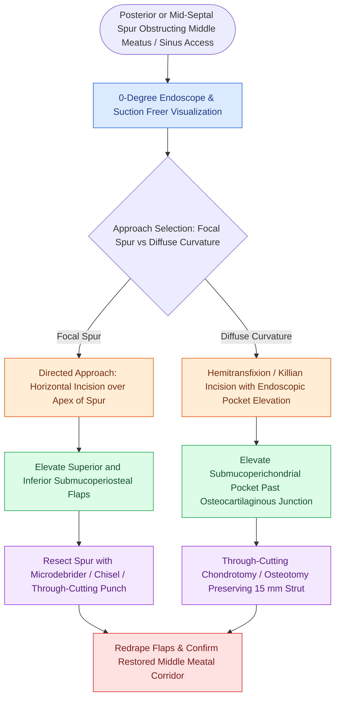

# Endoscopic septoplasty enables targeted spur resection and improves middle meatal access while minimizing mucosal dissection

## Active Recall

> [!question]- How does the incision design in directed endoscopic septoplasty minimize operative morbidity compared to traditional anterior headlight septoplasty?
> *Answer / Clinical Rationale*: Directed endoscopic septoplasty employs a targeted horizontal incision placed directly over the apex of the bony spur or focal deflection, elevating small superior and inferior flaps rather than mobilizing extensive anterior mucoperichondrial flaps from the caudal margin.

> [!question]- Why is creating a small inferior drainage fenestration in the mucosal flap recommended during endoscopic septoplasty closure if no accidental tear occurred?
> *Answer / Clinical Rationale*: In the absence of an inadvertent mucosal tear, creating an intentional small floor incision allows egress of accumulated postoperative blood and serum, preventing septal hematoma and secondary cartilaginous ischemic necrosis.

## Core Clinical & Mechanistic Principles
Endoscopic septoplasty integrates the superior illumination, magnified visualization, and angled optics of rigid nasal endoscopy into septal surgery. Rather than performing a wide, non-selective anterior dissection for a localized posterior or mid-septal deformity, the endoscopic approach isolates operative dissection exclusively to the offending pathology, safeguarding nasal tip support and mucosal physiology.

### Clinical Indications in Endoscopic Sinus and Skull Base Surgery
1. **Middle Meatus Corridor Clearance**: Marked posterior septal deflections frequently abut the uncinate process or middle turbinate, completely obstructing instrument passage into the ostiomeatal complex during functional endoscopic sinus surgery (FESS). Endoscopic resection clears the corridor without destabilizing the anterior L-strut.
2. **Sphenoid Rostrum Exposure**: Bilateral posterior vomerine spurs obstructing transnasal or [[Transseptal sphenoidotomy provides wide bilateral midline access to the sphenoid rostrum|transseptal sphenoidotomy corridors]] can be rapidly excised under 0-degree endoscope visualization.
3. **Nasoseptal Flap Protection**: When preparing for skull base reconstruction, directed spurs must be managed without lacerating the mucosal territory of the [[The Hadad-Bassagasteguy nasoseptal flap is pedicled on the posterior septal artery|Hadad-Bassagasteguy nasoseptal flap]].

### Directed Endoscopic Technique for Isolated Spurs
1. **Mucosal Decongestion & Infiltration**:
   - Topical oxymetazoline pledgets are placed for 10 minutes, followed by targeted submucosal injection of 1% lidocaine with 1:100,000 epinephrine directly into the base and apex of the spur under 0-degree endoscope control.
2. **Incision and Flap Elevation**:
   - A horizontal incision is made directly over the apex of the bony spur using a No. 15 blade or sharp sickle knife.
   - Using a suction Freer elevator, a superior mucoperiosteal flap is elevated upward off the bone, and an inferior flap is elevated downward toward the nasal floor. The contralateral septal mucosa is left completely undisturbed on the opposite side of the bone.
3. **Resection of Offending Bone and Cartilage**:
   - The exposed bony spur (typically derived from the maxillary crest or vomer) is removed cleanly using an endoscopic microdebrider, 1-mm or 2-mm Kerrison rongeur, or a small osteotome.
   - Because the contralateral mucoperiosteum is pristine and intact, through-cutting resection carries zero risk of bilateral opposing mucosal tears or septal perforation.
4. **Flap Redraping and Hemostasis**:
   - The superior and inferior mucosal flaps are redraped over the resected bed. Because tension across the spur has been eliminated, the edges lie in edge-to-edge anatomical approximation without requiring sutures.
   - If extensive elevation was required, an absorbable hemostatic spacer or silastic splint is placed to maintain flap coaptation.

## Connected Concepts & Graph Traversal
- **Caudal Structural Support**: [[Caudal septoplasty corrects caudal subluxation and external valve collapse through swinging-door relocation and L-strut preservation]]
- **Physiologic Nasal Resistance**: [[The nasal cycle provides alternating autonomic mucosal congestion and decongestion]]
- **Middle Meatal Stabilization**: [[Middle turbinate suture medialization prevents lateralization and iatrogenic frontal sinus ostial obstruction following ethmoidectomy]]
- **Hemostatic Dressings**: [[Topical hemostatic matrix agents and nasal packing mitigate postoperative epistaxis and synechiae]]
- **Rhinogenic Pain Syndromes**: [[Rhinogenic contact point headache arises from mucosal contact between the nasal septum and turbinates]]
- **Objective Airflow Confirmation**: [[Acoustic rhinometry and rhinomanometry evaluate internal nasal valve geometry and dynamic airflow resistance through cross-sectional area and transnasal pressure measurements|Acoustic Rhinometry & Rhinomanometry]]
