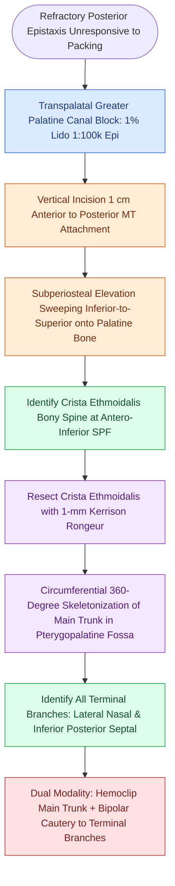

# Endoscopic sphenopalatine artery ligation requires crista ethmoidalis resection and systematic multi-branch control to prevent recurrent epistaxis

## Active Recall

> [!question]- Why does failure to identify and resect the crista ethmoidalis constitute the most common technical error in endoscopic sphenopalatine artery ligation?
> *Answer / Clinical Rationale*: In up to 42% of patients, the sphenopalatine artery branches proximal to the sphenopalatine foramen within the pterygopalatine fossa, exiting through multiple separate bony foramina. Resecting the crista ethmoidalis with a Kerrison rongeur exposes the pre-branching arterial trunk; omitting this step leaves inferior and posterior septal branches hidden behind bone, leading to recurrent hemorrhage.

> [!question]- What are the anatomical branching frequencies of the sphenopalatine artery immediately medial to the crista ethmoidalis?
> *Answer / Clinical Rationale*: At least 2 arterial branches are present in 97% of individuals, 3 or more branches in 67%, and 4 or more branches in 35% of individuals.

## Core Clinical & Mechanistic Principles
Endoscopic sphenopalatine artery (SPA) ligation represents the gold-standard definitive surgical therapy for refractory posterior epistaxis. Originating as the terminal division of the internal maxillary artery in the pterygomaxillary fossa, the SPA enters the nasal cavity through the sphenopalatine foramen (SPF) to supply >90% of the nasal mucosa. 

As established in foundational work on [[The crista ethmoidalis guides endoscopic sphenopalatine artery ligation|crista ethmoidalis surgical landmarks]] and [[Posterior epistaxis from sphenopalatine artery arborization requires endoscopic ligation or embolization|posterior epistaxis arterial arborization]], failure to control bleeding almost always stems from unrecognized anatomical variations and missed accessory branches.

### Anatomic Variations and Multi-Branch Arborization
1. **Pre-Foraminal Branching**:
   - The SPA branches prior to exiting the SPF in 42% of specimens, resulting in two or more independent bony exit canals.
   - An accessory foramen situated inferior or posterior-inferior to the primary SPF transmits the **posterior septal artery** (nasopalatine branch) in up to 30% to 50% of cases.
2. **Branching Frequency at the Crista**:
   - Simmen et al. demonstrated that 97% of individuals possess ≥2 branches, 67% possess ≥3 branches, and 35% possess ≥4 branches immediately medial to the crista ethmoidalis.
3. **Crista Ethmoidalis Topography**:
   - The crista ethmoidalis is located within 1 mm of the SPF in 95% of specimens, projecting sharply from the perpendicular plate of the palatine bone where the posterior attachment of the middle turbinate meets the medial orbital wall.

### Step-by-Step Surgical Execution
1. **Preoperative Optimization & Transpalatal Block**:
   - Profuse active hemorrhage obscures endoscopic visibility. In addition to topical oxymetazoline, a transpalatal block is performed by injecting 1.5 to 2.0 mL of 1% lidocaine with 1:100,000 epinephrine into the greater palatine canal via the hard palate. This vasoconstricts the internal maxillary arterial trunk upstream within the pterygopalatine fossa, dramatically reducing intraoperative bleeding.
2. **Incision and Mucoperiosteal Flap Elevation**:
   - Using a 0-degree endoscope, a vertical incision is made through mucosa and periosteum 1.0 cm anterior to the posterior attachment of the middle turbinate along the lateral nasal wall.
   - A mucoperiosteal flap is elevated posteriorly using a Cottle or suction Freer elevator sweeping directly on bone in an inferior-to-superior trajectory. If access is constricted, a partial uncinectomy or maxillary antrostomy is performed.
3. **Resection of the Crista Ethmoidalis**:
   - Palpating and visualizing the crista ethmoidalis confirms the location of the neurovascular pedicle immediately posterior and superior to the bony crest.
   - Using a 1-mm Kerrison rongeur, the crista ethmoidalis is resected down to the skull base/pterygopalatine transition. Bone removal exposes the main arterial trunk prior to its arborization and uncovers any inferior accessory foramina. Saraceni Neto et al. proved that routine crista resection significantly reduces rebleeding rates.
4. **Circumferential Dissection & Ligation**:
   - A ball-tip probe performs 360-degree circumferential dissection around the arterial trunk and each individual branch.
   - Titanium hemoclips are applied to the proximal trunk. Bipolar electrocautery is then applied to each terminal branch distally.
   - Sole reliance on hemoclips carries a risk of clip displacement during flap redraping; combining proximal clipping with distal bipolar electrocautery (or meticulous bipolar electrocautery alone) achieves >98% definitive hemostasis.
5. **Flap Redraping & Middle Turbinate Medialization**:
   - The mucoperiosteal flap is redraped laterally over the palatine bone. An absorbable hemostatic spacer is placed in the middle meatus to keep the flap flattened and to prevent lateralization synechiae.

## Connected Concepts & Graph Traversal
- **Nasoseptal Reconstructive Flap**: [[The Hadad-Bassagasteguy nasoseptal flap is pedicled on the posterior septal artery]]
- **Anterior Epistaxis Management**: [[Kiesselbach plexus anterior epistaxis is managed with cautery and anterior nasal packing]]
- **Pterygopalatine Ganglion Architecture**: [[The sphenopalatine ganglion serves as the primary parasympathetic relay for the sinonasal cavity]]
- **Anesthetic Field Optimization**: [[TIVA and greater palatine canal blocks optimize surgical field visibility in FESS]]
- **Sphenoid Ostium Identification**: [[The sphenoid sinus ostium lies medial to the superior turbinate above the choana]]
