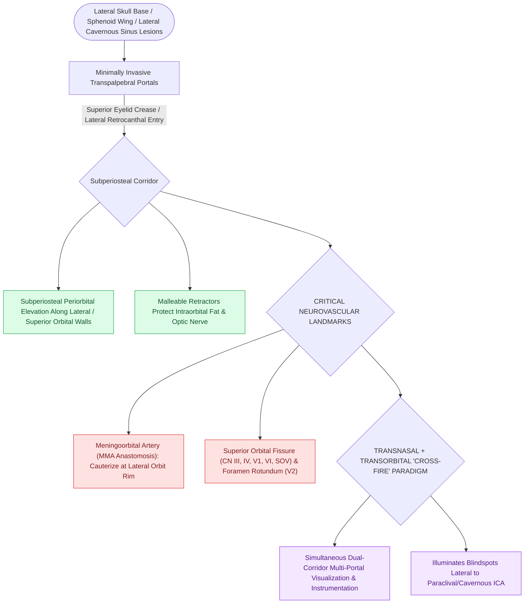

# Endoscopic transorbital approaches provide multi-portal access to the lateral skull base and orbit

## Active Recall

> [!question]- What is the primary advantage of combining a transorbital endoscopic approach with a standard transnasal EEA?
> *Answer / Clinical Rationale*: It provides a **multi-portal cross-fire trajectory**, allowing simultaneous visualization and instrumentation of lateral skull base lesions (e.g., middle fossa, lateral cavernous sinus) that are obscured around the internal carotid artery on pure transnasal views.

> [!question]- What vascular structure is encountered at the superior-lateral orbital margin during lateral transorbital dissection?
> *Answer / Clinical Rationale*: The **meningoorbital artery (lacrimal-middle meningeal anastomotic branch)**.

## Core Clinical & Mechanistic Principles
The **Endoscopic Transorbital Approach (ETOA / TOA)** is an evolving minimally invasive multi-portal paradigm (complementing [[Transpterygoid EEA exposes juvenile nasopharyngeal angiofibromas and lateral sphenoid defects|Transpterygoid EEA]]) that accesses the **anterior and middle cranial fossae, greater sphenoid wing, superior orbital fissure, and cavernous sinus** through small eyelid incisions (superior eyelid crease or lateral retrocanthal approaches).

### Key Anatomical Landmarks
- **Superior Orbital Fissure (SOF)**: Transmits CN III, IV, V1, VI, and superior ophthalmic vein.
- **Meningoorbital Artery**: Branch of MMA crossing the superior orbital fissure; must be cauterized during lateral orbital wall osteotomies.

## Connected Concepts & Graph Traversal
- **Corridors**: [[Transpterygoid EEA exposes juvenile nasopharyngeal angiofibromas and lateral sphenoid defects|Transpterygoid EEA]]
- **Anatomical Foundation**: [[Transsellar EEA provides direct access to pituitary adenomas and Rathke cleft cysts|Transsellar EEA]]
- **Diagnostic Evaluation**: [[Transcribriform EEA provides access to olfactory groove meningiomas and esthesioneuroblastomas|Transcribriform EEA Corridor]]
- **Surgical Craft**: [[Transplanum and transtuberculum EEA corridors expose suprasellar craniopharyngiomas|Transplanum EEA Corridor]]
- **Surgical Alternative**: [[Balanced endoscopic orbital decompression removes the lamina papyracea and medial floor while sparing the inferomedial strut to prevent diplopia|Balanced Orbital Decompression]]
- **Surgical Approach**: [[Endoscopic medial intraconal orbital tumor resection utilizes binarial four-handed dissection and dynamic medial rectus retraction below the plane of resectability|Intraconal Orbital Tumor Resection]]
- **Diagnostic Assessment**: [[Transcaruncular and Lynch external approaches provide direct access to the frontoethmoidal suture line for anterior ethmoidal artery ligation in refractory epistaxis|Transcaruncular/Lynch Approach]]
