# Endoscopic transplanum and transtuberculum approaches expose suprasellar lesions by decompressing the optic chiasm and preserving the superior hypophyseal arteries

## Active Recall

> [!question]- What anatomical structures define the lateral and anterior bony limits of a transplanum/transtuberculum craniectomy?
> *Answer / Clinical Rationale*: The lateral limits are formed by the **medial opticocarotid recesses (mOCR)** and the **optic canals** bilaterally; the anterior limit is the junction of the planum sphenoidale with the posterior ethmoid roof (sphenoethmoidal junction), just posterior to the posterior ethmoidal arteries.

> [!question]- Which critical arteries originate from the intradural ophthalmic or paraclinoid ICA to supply the optic chiasm and infundibulum?
> *Answer / Clinical Rationale*: The **superior hypophyseal arteries**, which course medially beneath the optic chiasm to perfuse the infundibulum (pituitary stalk) and optic apparatus; their injury causes visual field deterioration and hypothalamic-pituitary infarction.

> [!question]- What intraoperative CSF leak grading scale (Esposito/Kelly) dictates the reconstruction strategy during transsellar and transplanum surgery?
> *Answer / Clinical Rationale*: **Grade 0** (no leak; simple gelatin sponge), **Grade 1** (small weeping leak without visible diaphragmatic hole; collagen matrix or fat), **Grade 2** (moderate defect with distinct diaphragmatic tear; autologous fat/fascia underlay + rigid support), and **Grade 3** (large suprasellar dural defect into third ventricle/cistern; mandatory vascularized nasoseptal flap + multilayer underlay).

## Core Clinical & Mechanistic Principles
Lesions extending superior to the sella turcica—such as tuberculum sellae meningiomas, craniopharyngiomas, and giant invasive pituitary macroadenomas—cannot be safely accessed via a standard transsellar corridor without risking blind traction on the optic chiasm. The **transplanum and transtuberculum expanded endoscopic approach** provides a wide, direct inferomedial view into the suprasellar cistern, subchiasmatic space, and third ventricle. Sphenoid exposure must be carefully planned around [[Sphenoid sinus pneumatization patterns dictate carotid and optic canal exposure|conchal, presellar, and sellar sphenoid pneumatization]] and the course of any intersinus septations inserting on the [[Intersphenoid sinus septations frequently insert directly onto the internal carotid canal|carotid bony canal]].

### Operative Ergonomics & Two-Surgeon Four-Handed Craft
The procedure requires binostril access with two operating surgeons (otolaryngologist and neurosurgeon):
- An endoscope holder or dynamic dynamic holding by the otolaryngologist provides continuous angled visualization (0° and 30° scopes).
- Three dissecting instruments (suction-irrigator, curved ring curettes, bipolar electrocautery, or ultrasonic aspirators) are actively manipulated simultaneously through both nostrils without instrument clash.

```mermaid
%% Transplanum Transtuberculum Suprasellar Approach
flowchart TD
  N1(["Suprasellar Neoplasm: Craniopharyngioma / Tuberculum Meningioma / Giant Adenoma"]) --> N2["Wide Binostril Sphenoidotomies & Posterior Septectomy"]
  N2 --> N3["Harvest & Store Vascularized Nasoseptal Flap in Maxillary Antrum"]
  N3 --> N4["Bilateral Posterior Ethmoidectomies Unroofing Planum Sphenoidale"]
  N4 --> N5["High-Speed Diamond Burr Thins Planum Sphenoidale, Tuberculum & Sellar Face"]
  N5 --> N6["Delimit Lateral Borders at Medial Opticocarotid Recesses & Optic Canals"]
  N6 --> N7["Carefully Coagulate & Transect Superior Intercavernous Sinus"]
  N7 --> N8["Open Planum & Sellar Dura to Expose Suprasellar Arachnoid Cistern"]
  N8 --> N9["Identify & Decompress Optic Chiasm and A1/A2/ACom Complex"]
  N9 --> N10["Preserve Superior Hypophyseal Arteries & Pituitary Stalk (Infundibulum)"]
  N10 --> N11["Extracapsular Arachnoid Dissection & Complete Tumor Extirpation"]
  N11 --> N12["Mandatory Grade 3 High-Flow Reconstruction: Underlay Fascia + Nasoseptal Flap"]
  classDef blue fill:#dbeafe,stroke:#2563eb,color:#1e3a8a
  class N2,N3,N4 blue
  classDef cyan fill:#cffafe,stroke:#0891b2,color:#164e63
  class N5,N6 cyan
  classDef green fill:#dcfce7,stroke:#16a34a,color:#14532d
  class N9,N10,N11 green
  classDef orange fill:#ffedd5,stroke:#ea580c,color:#7c2d12
  class N7,N8 orange
  classDef purple fill:#f3e8ff,stroke:#9333ea,color:#581c87
  class N12 purple
```

### Neurovascular Boundaries of the Suprasellar Corridor
1. **Anterior**: Posterior ethmoid roof and planum sphenoidale; bounded rostrally by the posterior ethmoidal arteries.
2. **Posterior & Inferior**: Sellar face, pituitary gland, and dorsum sellae.
3. **Lateral**: Medial opticocarotid recesses (mOCR), optic canals, and paraclinoid internal carotid arteries.
4. **Intradural Vascular Complex**:
   - **Optic Apparatus**: Optic chiasm and optic nerves entering the falciform ligaments.
   - **Anterior Circulation**: Anterior cerebral artery (A1 segments), anterior communicating artery (ACom) complex, and recurrent arteries of Heubner.
   - **Hypothalamic-Pituitary Axis**: Pituitary stalk (infundibulum) and bilateral **superior hypophyseal arteries**.

### Dissection Technique & High-Flow Defect Reconstruction
- **Sharp Arachnoid Dissection**: Suprasellar meningiomas and craniopharyngiomas must be dissected along the visceral-parietal arachnoid plane. Blunt avulsion is strictly prohibited to avoid shearing perforators to the optic chiasm.
- **Watertight Multi-Layer Closure**: Transplanum approaches create high-flow intraoperative CSF leaks (Kelly Grade 3). Reconstruction mandates a collagen matrix or fascia lata subdural underlay, rigid autologous cartilage/bone buttress, and a vascularized Hadad-Bassagasteguy nasoseptal flap overlay anchored with tissue sealants and nasal balloon bolsters.

## Connected Concepts & Graph Traversal
- **Primary Corridor**: [[Transplanum and transtuberculum EEA corridors expose suprasellar craniopharyngiomas|Transplanum EEA Paradigm]]
- **Sellar Access**: [[Transsellar EEA provides direct access to pituitary adenomas and Rathke cleft cysts|Transsellar EEA Anatomy]]
- **Critical Skull Base Landmark**: [[The lateral and medial opticocarotid recesses define critical anatomical corridors in endoscopic skull base surgery|Opticocarotid Recesses]]
- **Flap Mucosa Preservation**: [[Preserving the superior septal mucosal strip prevents post-NSF anosmia|Olfactory Strip Preservation]]
- **Endocrine Crisis**: [[Pituitary apoplexy causes acute chiasmatic compression and life-threatening panhypopituitarism|Pituitary Apoplexy]]
- **Electrolyte Management**: [[Postoperative diabetes insipidus and SIADH require strict fluid balance and desmopressin titration|Postoperative DI and SIADH]]
