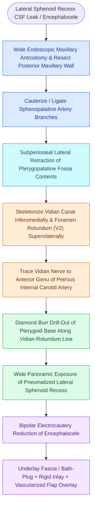

# Endoscopic transpterygoid repair of lateral sphenoid recess encephaloceles accesses Sternberg's canal by drilling the pterygoid base lateral to the vidian nerve

## Active Recall

> [!question]- What anatomical structure marks the medial limit of the transpterygoid corridor, and how does it guide the surgeon toward the internal carotid artery?
> *Answer / Clinical Rationale*: The **vidian canal and vidian nerve** mark the medial surgical limit; tracing the vidian nerve posteriorly leads directly to the **anterior genu of the petrous internal carotid artery (ICA)** at foramen lacerum, establishing a reliable vascular safety anchor.

> [!question]- What is the Vidian-Rotundum (VR) line, and what structure is drilled within this boundary to enter the lateral sphenoid recess?
> *Answer / Clinical Rationale*: The VR line connects the vidian canal inferomedially to foramen rotundum (containing V2) superolaterally; high-speed diamond drilling of the intervening **pterygoid base (process)** along this line unroofs the hyper-pneumatized lateral sphenoid recess without injuring V2 or the ICA.

> [!question]- Why are the vast majority of spontaneous lateral sphenoid encephaloceles located lateral to foramen rotundum rather than representing a true congenital Sternberg canal?
> *Answer / Clinical Rationale*: True Sternberg canals represent congenital nonfusion medial to foramen rotundum; over 90% of spontaneous lateral sphenoid leaks arise **lateral to foramen rotundum** due to hyper-pneumatization of the lateral recess and chronic bone thinning from idiopathic intracranial hypertension (IIH) with pulsatile arachnoid pits.

## Core Clinical & Mechanistic Principles
Spontaneous cerebrospinal fluid leaks and encephaloceles located in the far lateral recess of the sphenoid sinus cannot be visualized or manipulated through standard transnasal sphenoidotomy corridors due to the intervening bony pterygoid plates and pterygopalatine fossa soft tissues. Complete surgical access requires an **endoscopic transpterygoid approach**.

### Surgical Anatomy & Pathophysiologic Distinction
1. **Sternberg's Canal (Lateral Craniopharyngeal Canal)**: Arises from incomplete embryological fusion of the greater wing of the sphenoid (alisphenoid) with the presphenoid and basisphenoid, situated medial to the foramen rotundum.
2. **Hyperpneumatized Lateral Sphenoid Recess Pits**: The predominant cause (>90%) of spontaneous leaks, in which middle cranial fossa dura herniates through arachnoid granulation erosions lateral to the foramen rotundum into the greater sphenoid wing or pterygoid process under chronically elevated intracranial pressure associated with [[Spontaneous CSF leaks are strongly associated with idiopathic intracranial hypertension and elevated BMI|idiopathic intracranial hypertension (IIH)]].

### Operative Technique: Step-by-Step Transpterygoid Dissection
1. **Maxillary Outflow & Posterior Wall Resection**: Perform a wide middle meatal antrostomy extending to the posterior maxillary wall. Remove the thin bone of the posterior maxillary antrum using curved Kerrison rongeurs to expose the periosteum of the pterygopalatine fossa (PPF).
2. **Vascular Control & Soft-Tissue Elevation**: Identify the sphenopalatine artery (SPA) and descending palatine artery. Cauterize or clip distal branches to permit mobilization. Incise the PPF periosteum and reflect the neurovascular contents laterally in a subperiosteal plane.
3. **Vidian & Rotundum Localization**:
   - Locate the **vidian canal** at the base of the medial pterygoid plate. Tracing it posteriorly leads safely to the anterior genu of the petrous ICA.
   - Locate **foramen rotundum** and the maxillary nerve (V2) superolaterally.
4. **Pterygoid Base Drilling**: Using a 3-mm or 4-mm curved diamond burr with continuous saline irrigation, drill the pterygoid process between the vidian canal and foramen rotundum (the VR line). This completely exposes the anterior wall of the lateral sphenoid recess.
5. **Encephalocele Reduction & Reconstruction**: Reduce the herniated middle cranial fossa tissue using bipolar electrocautery at low wattage. Circumferentially de-epithelialize the bony defect margin by 3 to 5 mm adhering to principles of [[CSF leak defect preparation requires circumferential bone de-mucosalization|circumferential bone de-mucosalization]]. Place an underlay dural graft (fascia lata or bath-plug fat), secure a rigid cartilage or bone inlay, and drape a vascularized pedicled flap over the recess floor.

## Connected Concepts & Graph Traversal
- **Embryological Defect**: [[Sternberg's canal in the lateral sphenoid recess acts as a conduit for spontaneous CSF leaks|Sternberg's Canal Pathogenesis]]
- **Expanded Corridor**: [[Transpterygoid EEA exposes juvenile nasopharyngeal angiofibromas and lateral sphenoid defects|Transpterygoid EEA Approach]]
- **Autonomic Landmark**: [[The Vidian nerve carries parasympathetic secretomotor and sympathetic vasomotor fibers|Vidian Nerve Autonomics]]
- **Vascular Control**: [[The crista ethmoidalis guides endoscopic sphenopalatine artery ligation|Sphenopalatine Artery Anatomy]]
- **Pneumatization Hazard**: [[Sphenoid sinus pneumatization patterns dictate carotid and optic canal exposure|Sphenoid Pneumatization Hazards]]
- **Biochemical Confirmation**: [[Beta-2 transferrin and high-resolution CT localize sinonasal CSF fistulas|Beta-2 Transferrin Confirmation]]
