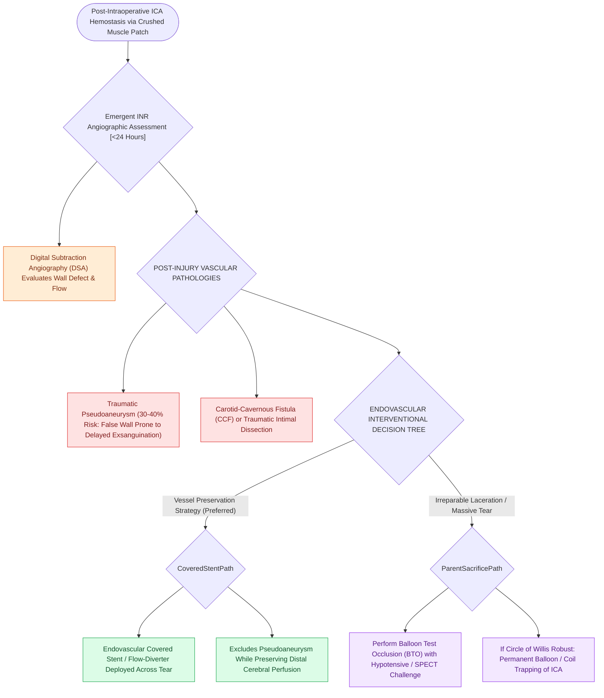

# Endovascular parent vessel balloon occlusion and covered stenting manage pseudoaneurysms after ICA injury

## Active Recall

> [!question]- Why is diagnostic catheter angiography mandatory within 24 hours of packing an intraoperative ICA laceration?
> *Answer / Clinical Rationale*: To detect and treat **traumatic pseudoaneurysms, arteriovenous fistulas (carotid-cavernous fistulas), or arterial dissections** that will rupture postoperatively without endovascular intervention.

> [!question]- What endovascular option allows definitive repair of an ICA laceration while preserving distal cerebral blood flow?
> *Answer / Clinical Rationale*: Placement of an **endovascular covered stent** across the arterial tear.

## Core Clinical & Mechanistic Principles
Following initial intraoperative [[Intraoperative ICA injury requires two-surgeon suction and crushed muscle patch hemostasis|hemostasis]] of an **Internal Carotid Artery (ICA) injury** with a crushed muscle patch, the patient is at extreme risk for **traumatic pseudoaneurysm formation ($>30\text{–}40\%$)**, delayed rupture, and stroke.

Immediate postoperative transfer to **Interventional Neuroradiology (INR)** for diagnostic digital subtraction angiography (DSA) and definitive endovascular management is mandatory.

### The Traumatic Pseudoaneurysm Danger
- A pseudoaneurysm is a hematoma contained only by adventitia or surrounding muscle/bone.
- Unrecognized pseudoaneurysms carry a **catastrophic delayed rupture rate ($>50\%$ mortality)** occurring days to weeks after surgery, presenting with sudden exsanguinating epistaxis.

## Connected Concepts & Graph Traversal
- **Intraoperative Crisis**: [[Intraoperative ICA injury requires two-surgeon suction and crushed muscle patch hemostasis|ICA Injury Crisis Protocol]]
- **Checklist Prevention**: [[The CLOSE checklist systematically evaluates critical radiological danger zones|CLOSE Checklist ("S" for Sphenoid)]]
- **Corridors**: [[Transclival EEA provides midline access to clival chordomas and chondrosarcomas|Transclival EEA]]
- **Anatomical Foundation**: [[Endoscopic endonasal anterior ethmoidal artery ligation requires skull base skeletonization to prevent orbital fat prolapse and vessel retraction|Endoscopic AEA Ligation]]
- **Surgical Craft**: [[The endoscopic cross-over flap technique reconstructs congenital choanal atresia by covering denuded bone without circumferential stenting|Stamm Cross-Over Flap Technique]]
