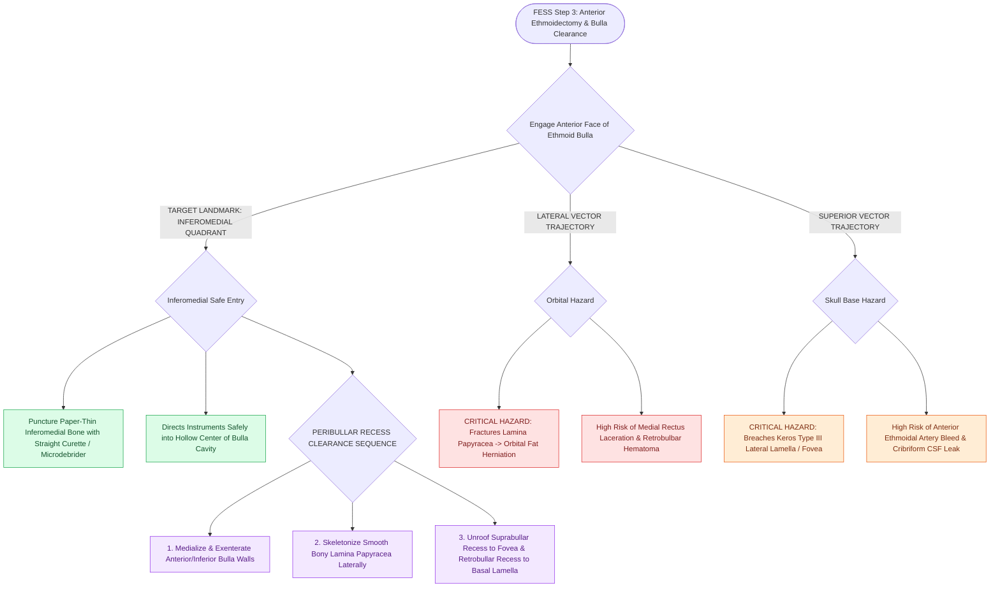

# Entering the ethmoid bulla inferomedially avoids orbital and skull base penetration

## Active Recall

> [!question]- Why is the inferomedial face of the ethmoid bulla the universal safe landmark for anterior ethmoid entry?
> *Answer / Clinical Rationale*: It contains the thinnest bone and directs surgical instruments away from the lamina papyracea laterally and the fovea ethmoidalis superiorly into the open center of the bulla cavity.

> [!question]- What anatomical structure forms the posterior boundary of the anterior ethmoidectomy?
> *Answer / Clinical Rationale*: The **basal lamella of the middle turbinate**.

## Core Clinical & Mechanistic Principles
**Anterior ethmoidectomy** (Step 3 of FESS) requires complete clearance of the ethmoid bulla, suprabullar recess, and retrobullar recess (sinus lateralis). The initial point of entry into the ethmoid bulla is the single most critical decision in preventing catastrophic orbital or intracranial penetration.

### Step-by-Step Anterior Ethmoidectomy Protocol
1. **Inferomedial Puncture**:
   - Engage the **inferomedial quadrant** of the anterior face of the ethmoid bulla using a straight Kuhn-Bolger curette, ostium seeker, or straight [[Powered microdebrider blade selection and suction irrigation maintain clean surgical optics|microdebrider blade]].
   - The bone here is paper-thin and directs instruments safely into the hollow central bulla cavity.
2. **Skeletonization of the Bulla**:
   - Fracture the anterior and inferior walls of the bulla medially into the middle meatus.
   - Dissect laterally until the smooth, firm **[[Draf IIb frontal sinusotomy extends from lamina papyracea to the nasal septum|lamina papyracea]]** is skeletonized.
3. **Unroofing Peribullar Recesses**:
   - Clear the **suprabullar recess** superiorly up to the ethmoid roof (fovea ethmoidalis).
   - Clear the **retrobullar recess (sinus lateralis)** posteriorly down to the basal lamella of the middle turbinate.

## Critical Failure Modes & Error Traps
- **Lateral Force (Orbital Penetration)**: Pushing laterally fractures the lamina papyracea, entering orbital fat (see [[Lamina papyracea dehiscence predisposes to orbital fat herniation and medial rectus injury|Lamina Papyracea Dehiscence]]).
- **Superior Force (Skull Base Fracture)**: Dissecting too high without establishing a medial landmark can breach a low-lying Keros Type III lateral lamella, causing a CSF leak.

## Connected Concepts & Graph Traversal
- **Anatomy**: [[The ethmoid bulla serves as the principal anatomical anchor for anterior ethmoidectomy|Ethmoid Bulla Anatomy]]
- **Next Step**: [[Perforating the basal lamella inferomedially provides safe entry to posterior ethmoids|Basal Lamella Fenestration]]
- **Orbital Risk**: [[Lamina papyracea dehiscence predisposes to orbital fat herniation and medial rectus injury|Lamina Papyracea Dehiscence]]
- **Radiological Checklist**: [[The CLOSE checklist systematically evaluates critical radiological danger zones|CLOSE Checklist]]
- **Surgical Craft**: [[Maxillary antrostomy requires incorporating accessory fontanelle ostia to prevent recirculation|Maxillary Antrostomy Technique]]
- **Anatomical Foundation**: [[Incisive uncinectomy exposes the ethmoid infundibulum while protecting the nasolacrimal duct|Incisive Uncinectomy Technique]]
