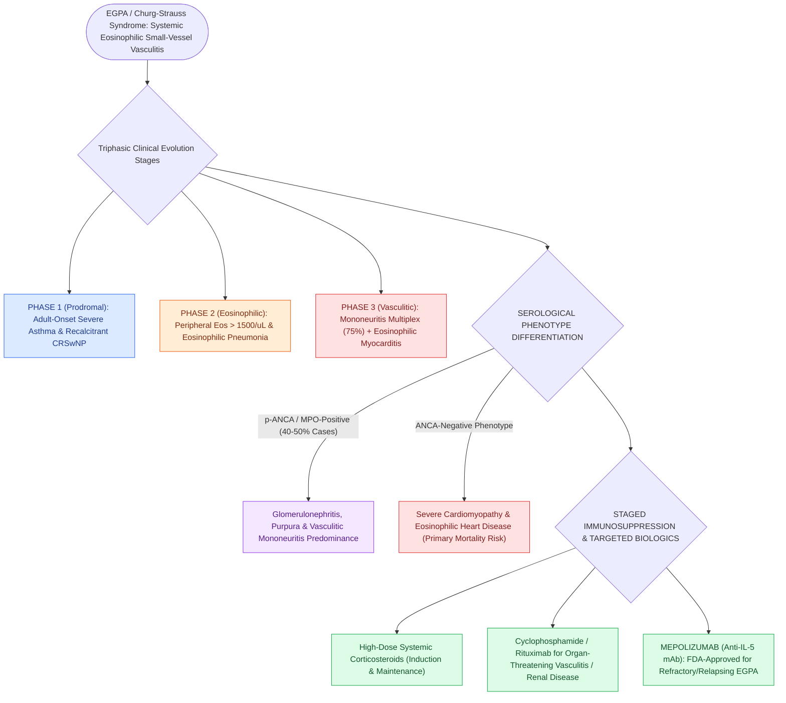

# Eosinophilic granulomatosis with polyangiitis causes asthma, peripheral eosinophilia, and necrotizing vasculitis

## Active Recall

> [!question]- What are the three clinical phases of Eosinophilic Granulomatosis with Polyangiitis (EGPA)?
> *Answer / Clinical Rationale*: The **allergic/prodromal phase** (asthma/polyps), the **eosinophilic phase** (blood/tissue eosinophilia), and the **vasculitic phase** (mononeuritis multiplex/myocarditis).

> [!question]- What targeted biologic agent is FDA-approved for refractory or relapsing EGPA?
> *Answer / Clinical Rationale*: **Mepolizumab** (monoclonal antibody targeting Interleukin-5 [IL-5]).

## Core Clinical & Mechanistic Principles
**Eosinophilic Granulomatosis with Polyangiitis (EGPA / Churg-Strauss Syndrome)** is a rare, systemic necrotizing small-to-medium vessel vasculitis characterized by severe asthma, tissue and peripheral eosinophilia, and extravascular necrotizing granulomas:
- **Triphasic Clinical Evolution**:
  1. **Prodromal (Allergic) Phase**: Severe, adult-onset asthma and chronic rhinosinusitis with aggressive nasal polyposis (CRSwNP).
  2. **Eosinophilic Phase**: Marked peripheral blood eosinophilia ($>1,500/\mu\text{L}$ or $>10\%$ of total WBC) and eosinophilic tissue infiltration (eosinophilic pneumonia, gastroenteritis).
  3. **Vasculitic Phase**: Life-threatening necrotizing vasculitis affecting the heart (eosinophilic myocarditis - leading cause of mortality), peripheral nervous system (**mononeuritis multiplex** / foot drop / wrist drop in $75\%$), kidneys, and skin (purpura/nodules).
- **Serology & Histopathology**:
  - **p-ANCA (MPO-ANCA)** is positive in **$40\text{–}50\%$ of patients** (specifically correlating with active glomerulonephritis and vasculitic features; ANCA-negative patients more frequently have cardiac involvement).
  - *Biopsy*: Necrotizing vasculitis, eosinophilic tissue infiltration, and extravascular necrotizing granulomas.

### Surgical Technique & Critical Safety Checks
- **Therapeutics**: High-dose systemic corticosteroids; cyclophosphamide for organ-threatening disease; **[[Biologic therapeutics in chronic rhinosinusitis target IgE, IL-4, IL-5, and IL-13 inflammatory pathways|Mepolizumab]] (anti-IL-5 monoclonal antibody)** is FDA-approved specifically for relapsing or refractory EGPA.

## Connected Concepts & Graph Traversal
- **GPA Vasculitic Differential**: [[Granulomatosis with polyangiitis presents with necrotizing sinonasal granulomas and saddle nose|GPA Vasculitis]]
- **Type 2 CRS Overlap**: [[Non-Type 2 CRS features neutrophilic inflammation associated with cystic fibrosis and ciliopathies|T2 Inflammation]]
- **Targeted Biologic Therapy**: [[Biologic therapeutics in chronic rhinosinusitis target IgE, IL-4, IL-5, and IL-13 inflammatory pathways|Mepolizumab & Biologics]]
- **Aspirin-Exacerbated Respiratory Disease**: [[AERD manifests with asthma, nasal polyps, and severe aspirin-induced respiratory reactions|AERD Clinical Triad]]
- **Destructive Infection Differential**: [[Rhinoscleroma is a chronic granulomatous Klebsiella infection characterized by Mikulicz cells and Russell bodies|Rhinoscleroma Differential]]
