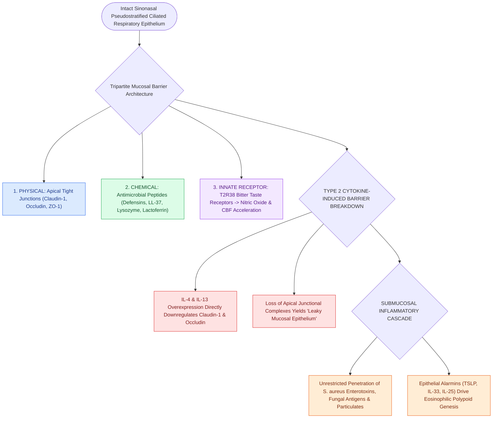

# Epithelial tight junctions and antimicrobial peptides form the primary sinonasal mucosal barrier

## Active Recall

> [!question]- What major tight junction proteins are downregulated by Type 2 cytokines (IL-4 and IL-13) in CRSwNP?
> *Answer / Clinical Rationale*: **Claudin-1, occludin, and ZO-1 (zonula occludens-1)**, leading to increased mucosal permeability and antigen penetration.

> [!question]- What role do bitter taste receptors (T2R38) on sinonasal ciliated cells play in innate defense?
> *Answer / Clinical Rationale*: When activated by bacterial quorum-sensing molecules (acyl-homoserine lactones), T2R38 triggers immediate **calcium-dependent nitric oxide release** and accelerates ciliary beat frequency to clear bacteria.

## Core Clinical & Mechanistic Principles
The sinonasal respiratory epithelium functions as an active physical, chemical, and immunological barrier against environmental pathogens, allergens, and particulate matter.

Disruption of **apical junctional complexes (tight junctions)** and deficiency in **antimicrobial peptides (AMPs)** are core pathophysiological drivers of chronic rhinosinusitis (CRS).

### The "Leaky Epithelium" Hypothesis in CRS
- In **Type 2 [[Type 2 CRS exhibits eosinophilic inflammation responsive to targeted biologics|CRSwNP]]**, elevated levels of **IL-4 and IL-13** directly downregulate claudin-1 and occludin, causing **epithelial barrier breakdown**.
- This enables unrestricted penetration of airborne antigens and *Staphylococcus aureus* enterotoxins into the submucosa, driving chronic eosinophilic inflammation.

## Connected Concepts & Graph Traversal
- **Type 2 Cascade**: [[Type 2 CRS exhibits eosinophilic inflammation responsive to targeted biologics|Type 2 CRS Endotype]]
- **Physiology**: [[Nitric oxide produced in the paranasal sinuses provides host defense and ciliary stimulation|Nitric Oxide Defense]]
- **Ciliary Motility**: [[Respiratory epithelium drives mucociliary clearance toward natural ostia|Mucociliary Clearance Mechanics]]
- **Structural / Flap Alternative**: [[Temporoparietal fascia free and pedicled flaps provide vascularized tissue when nasoseptal flaps fail|Temporoparietal Fascia Flap (TPFF)]]
- **Anatomical Foundation**: [[Complement activation cascades, MHC antigen presentation, and leukocyte adhesion molecules orchestrate mucosal innate and adaptive immunity|Complement Cascades]]
