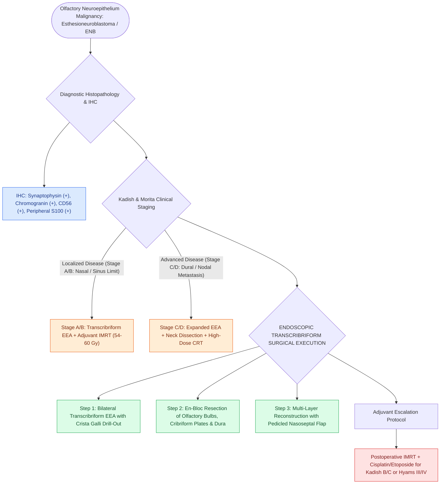

# Esthesioneuroblastoma Kadish and Hyams staging determines craniofacial resection and adjuvant therapy

## Active Recall

> [!question]- What cell of origin gives rise to esthesioneuroblastoma?
> *Answer / Clinical Rationale*: **Basal neural crest stem cells of the olfactory neuroepithelium** within the cribriform plate and superior nasal vault.

> [!question]- What immunohistochemical marker profile confirms the diagnosis of esthesioneuroblastoma?
> *Answer / Clinical Rationale*: Strongly positive for **Synaptophysin, Chromogranin, and CD56**, with **S100 positivity in sustentacular cells** at the periphery of tumor lobules.

> [!question]- How do the Modified Kadish clinical staging system (Stages A–D) and the Hyams histopathological grading system (Grades I–IV) stratify esthesioneuroblastoma?
> *Answer / Clinical Rationale*: **Modified Kadish Staging**: **Stage A** is strictly confined to the nasal cavity; **Stage B** involves the nasal cavity and one or more paranasal sinuses; **Stage C** extends beyond the sinonasal cavities into the orbit, cribriform plate/skull base, or intracranial cavity; **Stage D** (Morita modification) denotes cervical lymph node or distant metastasis. **Hyams Grading (I–IV)** stratifies tumors by architectural lobularity, mitotic activity, nuclear pleomorphism, fibrillary matrix, rosettes (**Homer Wright pseudorosettes** in Grades I–II vs **Flexner-Wintersteiner true rosettes** and necrosis in Grades III–IV), directly predicting metastatic risk and need for trimodality chemoradiation.

## Core Clinical & Mechanistic Principles
**Esthesioneuroblastoma (ENB / Olfactory Neuroblastoma)** is a rare malignant neuroectodermal neoplasm arising from basal neural crest stem cells of the **[[Olfactory neuroepithelium contains bipolar sensory neurons and basal stem cells|olfactory neuroepithelium]]** in the cribriform plate, superior septum, and superior turbinate.

### Modified Kadish Clinical Staging & Hyams Histopathological Grading
- **Modified Kadish Clinical Staging (Kadish / Morita)**:
  - **Stage A**: Tumor strictly confined to the **nasal cavity**.
  - **Stage B**: Tumor extending from the nasal cavity into one or more **paranasal sinuses**.
  - **Stage C**: Tumor extending beyond the nasal cavity and paranasal sinuses into the **lamina papyracea / orbit, cribriform plate, skull base, or intracranial compartment**.
  - **Stage D**: Tumor with **cervical lymph node metastasis ($N+$)** or **distant metastasis ($M+$)**.
- **Hyams Histopathological Grading System (Grades I–IV)**:
  - **Low Grade (Hyams I–II)**: Preserved lobular architecture, prominent neurofibrillary matrix, **Homer Wright pseudorosettes**, minimal mitotic activity, and absence of necrosis (5-year survival $>80\%$).
  - **High Grade (Hyams III–IV)**: Loss of lobular architecture, marked nuclear pleomorphism, high mitotic index, **Flexner-Wintersteiner true neural rosettes**, and geographic **tumor necrosis** (high propensity for cervical nodal/distant metastasis; 5-year survival $\approx 40\text{–}50\%$).

### Multimodal Treatment Paradigm
- **Surgical Gold Standard**: **Endoscopic Transcribriform Craniofacial Resection** with en-bloc resection of bilateral cribriform plates, crista galli, olfactory bulbs, and anterior cranial fossa dura to obtain microscopic negative margins.
- **Adjuvant Therapy**: Postoperative Intensity-Modulated Radiation Therapy (IMRT) $\pm$ Platinum-based Chemotherapy for Kadish B/C or Hyams III/IV.

## Connected Concepts & Graph Traversal
- **Surgical Corridor**: [[Transcribriform EEA provides access to olfactory groove meningiomas and esthesioneuroblastomas|Transcribriform EEA]]
- **Olfactory Anatomy**: [[Olfactory neuroepithelium contains bipolar sensory neurons and basal stem cells|Olfactory Neuroepithelium]]
- **Dural Reconstruction**: [[The Hadad-Bassagasteguy nasoseptal flap is pedicled on the posterior septal artery|Nasoseptal Flap Reconstruction]]
- **Pathological Mechanism**: [[Sinonasal inverting papilloma requires subperiosteal excision and hyperostotic bone drill-out|Inverting Papilloma Resection]]
- **Anatomical Foundation**: [[Sinonasal exophytic and oncocytic papillomas differ from inverting papilloma in malignant potential|Exophytic & Oncocytic Papillomas]]
- **Therapeutic Management**: [[Sinonasal undifferentiated carcinoma exhibits aggressive neuroendocrine features requiring multimodal therapy|Sinonasal Undifferentiated Carcinoma (SNUC)]]
- **Staging System**: [[Endoscopic craniofacial olfactory cleft resection achieves clear margins for anterior skull base malignancies while avoiding open craniotomy morbidity|Craniofacial Olfactory Cleft Resection]]
