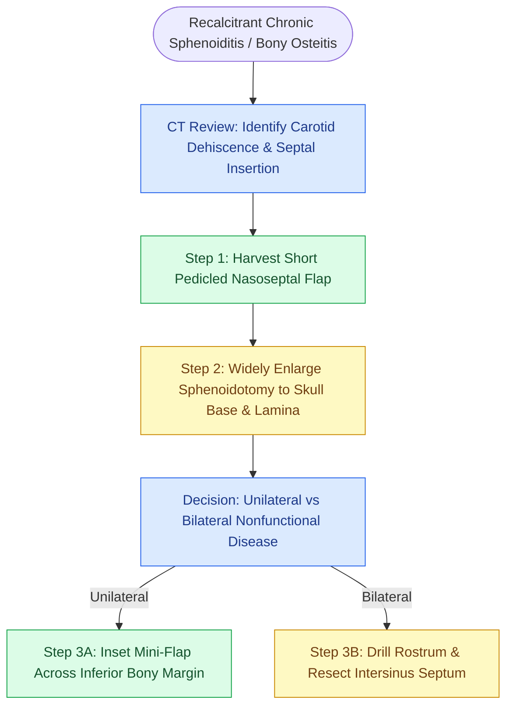

# Extended sphenoid antrostomy and drill-out resects the rostrum and intersinus septum with mini-nasoseptal flap lining to prevent osteitic restenosis

## Active Recall

> [!question]- Why does standard sphenoidotomy carry a high failure rate in isolated sphenoid mycetoma or severe chronic sphenoiditis?
> *Answer / Clinical Rationale*: Severe chronic sphenoiditis is driven by marked hyperostosis, bony osteitis, and neo-osteogenesis of the sphenoid face, rostrum, and floor. Standard punch sphenoidotomies create a small aperture with circumferentially denuded, devascularized bone edges. In the presence of hyperactive osteitic bone, circumferential mucosal healing fails, precipitating concentric scar contracture, synechiae, and complete ostial stenosis in 34% to 65% of revision cases.
>
> [!question]- How does a mini-pedicled nasoseptal flap prevent sphenoid antrostomy stenosis without compromising skull base reconstructive options?
> *Answer / Clinical Rationale*: A mini-nasoseptal flap is harvested strictly from the mucosa overlying the anterior sphenoid face and the posterior 5 to 10 mm of the septum, pedicled on the posterior septal artery. Laying this vascularized flap across the inferior osteotomy edge breaks the circle of exposed bone with healthy epithelium. Because it utilizes only the most posterior mucosal margin, the anterior and mid-septal mucosa remains fully preserved should a full Hadad-Bassagasteguy flap be needed in the future.

## Core Clinical & Mechanistic Principles

Chronic sphenoid rhinosinusitis refractory to standard endoscopic sinus surgery presents unique anatomical and biomechanical challenges. While isolated sphenoid disease successfully responds to conventional sphenoidotomy in over 90% of primary cases, patients with recalcitrant multi-sinus disease, invasive or allergic fungal sinusitis, and extensive bony osteitis experience revision rates as high as 65%. Three predominant failure mechanisms drive post-sphenoidotomy closure: (1) circumferentially denuded bone promoting concentric cicatrization, (2) inadequate antrostomy dimensions failing to clear dependent recesses, and (3) persistent neo-osteogenesis within osteitic sphenoid walls.

To overcome these failure mechanisms, extended sphenoid techniques escalate along a defined surgical hierarchy:
1. **Unilateral Extended Sphenoid Antrostomy with Mini-Nasoseptal Flap**: Indicated for unilateral recalcitrant osteitis or isolated mycetoma. The antrostomy is carried superiorly to the planum, laterally to the lamina, and inferiorly to the sinus floor, with a mini-pedicled mucosal flap lining the inferior bony margin.
2. **Bilateral Sphenoid Drill-Out (Unisphenoid Cavity)**: Indicated for bilateral severe disease with nonfunctional ciliary transport. The posterior 2 cm of the bony septum, the thick sphenoid rostrum ("keel of the ship"), and the intersinus septum are drilled flush with the planum and clivus, creating a wide common sphenoid aperture accessible via both nostrils.
3. **Radical Sphenoidectomy and Marsupialization (Donald Technique)**: Completely drops the sphenoid floor to the level of the clivus and insets an inferiorly based nasopharyngeal mucoperiosteal flap, totally eliminating reliance on mucosal ciliary transit.

Critical to all extended sphenoid procedures is early identification and preservation of the [[The Hadad-Bassagasteguy nasoseptal flap is pedicled on the posterior septal artery|nasoseptal artery]], which courses horizontally across the sphenoid face midway between the natural ostium and the choanal arch, and careful inspection of the [[The sphenoid sinus ostium lies medial to the superior turbinate above the choana|superior turbinate]] landmark.

### Step-by-Step Surgical Execution

1. **Preoperative Planning & Vascular Mapping**: High-resolution axial and coronal CT scans identify carotid artery canal dehiscence, optic canal protrusions, and the precise insertion of the intersinus septum.
2. **Harvest of the Mini-Pedicled Nasoseptal Flap**: Prior to inferior bone removal, two parallel horizontal incisions are placed across the sphenoid face using a No. 15 blade: one at the level of the natural ostium and one at the upper arch of the choana. A vertical incision 5–10 mm anterior on the septum connects them. The flap is elevated with a Freer elevator and tucked into the nasopharynx.
3. **Wide Sphenoidotomy Extension**: Straight and upbiting through-cutting instruments and Kerrison punches widen the opening superiorly to the skull base, laterally to the medial orbital wall, and inferiorly toward the sinus floor.
4. **Bilateral Sphenoid Drill-Out (If Indicated)**:
   - A 2-cm posterior septectomy is performed through-cutting instruments, allowing 4-handed bimanual binasal visualization.
   - The sphenoid rostrum ("keel") is taken down using a high-speed irrigating cutting burr, uniting the bilateral sphenoid cavities.
   - The sphenoid intersinus septum is drilled down flush with the posterior wall (planum, sella, and clival recess) using a diamond burr with continuous suction irrigation.
5. **Radical Sphenoid Floor Marsupialization**: An inferiorly based nasopharyngeal mucoperiosteal flap is mobilized from the sphenoid rostrum down onto the roof of the nasopharynx. The thick floor of the sphenoid sinus is plained flush with the clival floor, and the flap is inset into the marsupialized cavity.
6. **Mucosal Flap Inset & Stabilizing Dressings**: The preserved mini-nasoseptal flap is draped across the raw inferior bone edge of the neo-ostium. Absorbable gelatin sponge or fibrin glue stabilizes the flap in position.

### Danger Zones & Complication Avoidance

- **Intersinus Septum Carotid Avulsion**: In up to 25% of patients, the intersinus septum curves directly onto a dehiscent internal carotid artery. The septum must NEVER be twisted, wrenched, or bluntly outfractured with forceps; it must be shaved flush using a diamond drill with copious continuous irrigation.
- **Inadvertent Pedicle Transection**: Enlarging the sphenoidotomy inferiorly with rongeurs before flap elevation irreversibly severs the nasoseptal artery, precluding flap harvest and inducing vigorous arterial bleeding from the sphenopalatine branches.
- **Superior Turbinate Landmark Loss**: In revision cases where the superior turbinate is absent, surgeons must not dissect superiorly in search of the ostium; the sloping cribriform plate lies lower anteriorly, posing an extreme CSF leak hazard.

## Connected Concepts & Graph Traversal
- **Vascular Danger Zone**: [[Intersphenoid sinus septations frequently insert directly onto the internal carotid canal|Intersphenoid Septum Carotid Insertion]]
- **Pneumatization Variation**: [[Sphenoid sinus pneumatization patterns dictate carotid and optic canal exposure|Sphenoid Pneumatization & Canal Dehiscence]]
- **Bilateral Access**: [[Transseptal sphenoidotomy provides wide bilateral midline access to the sphenoid rostrum|Transseptal Midline Corridor]]
- **Corridor Traversal**: [[The lateral and medial opticocarotid recesses define critical anatomical corridors in endoscopic skull base surgery|Opticocarotid Recess Exposure]]
- **Pathologic Substrate**: [[Chronic non-invasive fungal ball presents with dense maxillary mycetoma without tissue invasion|Isolated Sphenoid Fungal Mycetoma]]
