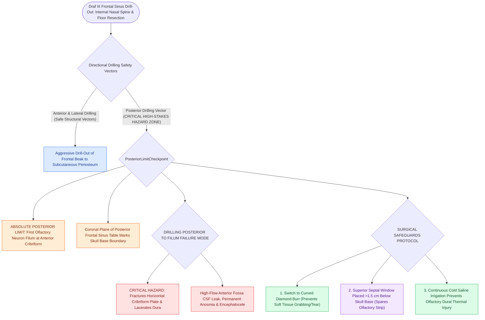

# First olfactory filum marks the posterior limit of frontal drill-out to avoid CSF leak

## Active Recall

> [!question]- What anatomical structure defines the absolute posterior limit of bone drilling during a Draf III procedure?
> *Answer / Clinical Rationale*: The **first olfactory neuron filum** exiting the anterior-most cribriform plate and the posterior table of the frontal sinus.

> [!question]- What catastrophic complication occurs if drilling extends posterior to the anterior attachment of the middle turbinate during frontal drill-out?
> *Answer / Clinical Rationale*: Fracture of the thin horizontal **cribriform plate**, laceration of the olfactory dura, and high-flow anterior cranial fossa **CSF leak** $\pm$ frontal lobe parenchymal injury.

## Core Clinical & Mechanistic Principles
During a Draf III ([[Nasal beak drill-out and mucosal grafting prevent neo-ostium restenosis in Draf III|Modified Lothrop]]) drill-out, aggressive bone removal is required anteriorly and laterally, but **drilling posteriorly is the single highest-risk maneuver for catastrophic skull base penetration and anterior cranial fossa CSF leak**.

The **first olfactory neuron filum** (olfactory nerve rootlet exiting the anterior-most cribriform plate) represents the **absolute posterior surgical boundary** of frontal bone drilling.

### Surgical Safety Protocol
1. **The Posterior Wall Guide**:
   - The posterior wall of the frontal sinus is continuous with the anterior cranial fossa dura.
   - Drill bits must stay **anterior to the coronal plane of the posterior wall** at all times.
2. **Preserving Olfactory Epithelium**:
   - The superior anterior septal window is placed $>1.5\text{ cm}$ below the cribriform plate to prevent avulsing olfactory bundles and causing post-operative anosmia or dural tears.
3. **Diamond Burr Use**:
   - Once the posterior limit is approached, switch from cutting burrs to a **diamond burr** with continuous irrigation to prevent grabbing or thermal injury to the olfactory dura.

## Connected Concepts & Graph Traversal
- **Master Procedure**: [[Draf III modified Lothrop unites both frontal sinuses into a common cavity|Draf III Modified Lothrop]]
- **Anatomy**: [[The Keros classification stages olfactory fossa depth and lateral lamella vulnerability|Keros Classification]]
- **CSF Repair**: [[Multi-layer skull base reconstruction combines underlay, inlay, and overlay barriers|Skull Base Reconstruction]]
- **Complication Matrix**: [[High-stakes sinonasal complications require proactive landmarking and emergency rescue protocols|High-Stakes Sinonasal Complications]]
- **Diagnostic Evaluation**: [[Draf I frontal sinusotomy clears obstructing ethmoid cells without instrumenting the ostium|Draf I Frontal Sinusotomy]]
- **Structural / Flap Alternative**: [[Temporoparietal fascia free and pedicled flaps provide vascularized tissue when nasoseptal flaps fail|Temporoparietal Fascia Flap (TPFF)]]
- **Critical Safety / Complication**: [[Esthesioneuroblastoma Kadish and Hyams staging determines craniofacial resection and adjuvant therapy|Esthesioneuroblastoma (ENB)]]
