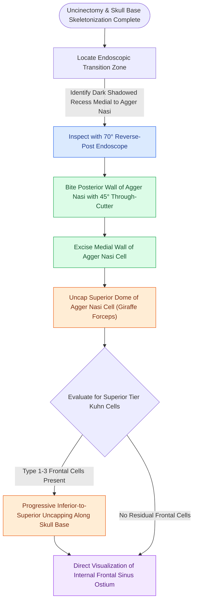

# Frontal recess cell dissection requires systematic uncapping of agger nasi and Kuhn cells along mucosal transition zones to preserve drainage patency

## Active Recall

> [!question]- What constitutes an endoscopic "transition zone" in frontal recess surgery, and how does it direct instrument progression?
> *Answer / Clinical Rationale*: Endoscopically, transition zones appear as shadowed, darker mucosal recesses representing the natural mucociliary drainage tract. Navigating along these shadowed clefts allows the surgeon to advance instruments safely from "known to unknown" around bony ethmoidal partitions without blind skull base probing.

> [!question]- In what specific sequence should an obstructing agger nasi cell be dissected during frontal sinusotomy?
> *Answer / Clinical Rationale*: Dissection proceeds in three steps: (1) removal of the posterior wall using $45^\circ$ front-to-back through-cutting instruments; (2) takedown of the medial wall with front-to-back cutting forceps; and (3) systematic uncapping of the superior dome (cap) to exteriorize the frontal outflow pathway into the nasal cavity.

> [!question]- Why are reverse-post or offset 70-degree endoscopes crucial during frontal recess clearance?
> *Answer / Clinical Rationale*: The reverse or offset light post displaces the bulky fiberoptic light cable away from the nasal aperture, preventing instrument collisions with heavily angled giraffe forceps and avoiding line-of-sight blockage of optical image-guidance tracking arrays.

## Core Clinical & Mechanistic Principles
Dissection of the frontal recess represents the most challenging phase of primary functional endoscopic sinus surgery due to dense pneumatization variants, proximity to the anterior ethmoidal artery and cribriform plate, and high propensity for cicatricial stenosis. The clinical taxonomy established by [[The Kuhn classification stages frontal recess and frontal sinus air cells]] guides the surgeon in identifying obstructing cellular tiers, beginning with the anterior landmark formed by [[Agger nasi cells form the anterior boundary of the frontal recess]]. 

Because the three-dimensional boundaries described in [[The frontal recess is bounded by the agger nasi, middle turbinate, and skull base]] resemble an hourglass with its narrowest waist at the internal frontal ostium, the drainage pathway is dictated by [[The uncinate process superior attachment dictates the frontal sinus drainage pathway]].

### Surgical Protocol for Frontal Recess Uncapping
1. **Visualization and Optics**:
   - Dissection begins with zero- or $30^\circ$ endoscopes during anterior ethmoid clearance, transitioning to $45^\circ$ and offset/reverse $70^\circ$ endoscopes once working above the level of the axilla of the middle turbinate.
   - Reverse-post optics clear the surgical field for angled frontal instruments (e.g., $45^\circ$ and $90^\circ$ vertical and horizontal through-cutting giraffe forceps).
2. **Sequential Agger Nasi Clearance**:
   - The agger nasi cell forms a distinct bulge anterior and superior to the middle turbinate insertion.
   - *Posterior Wall Removal*: Using a $45^\circ$ front-to-back through-cutter, the posterior partition is resected to open the interior of the agger cell.
   - *Medial Wall Takedown*: The medial mucosal wall is excised, exposing the drainage channel along the middle turbinate axilla.
   - *Cap Resection*: The superior roof (cap) of the agger cell is gently fractured forward and downward using a curved curette or giraffe punch, opening the floor of the frontal sinus.
3. **Kuhn Cell Hierarchy and Frontal Bullar Cells**:
   - *Type 1 (Single cell above agger nasi)* and *Type 2 (Tiered cells)*: Uncapped sequentially from inferior to superior.
   - *Type 3 (Single massive cell pneumatizing into frontal sinus)*: The anterior/posterior walls are shared with the frontal sinus; dissection requires unroofing the cell into the sinus cavity under direct endoscopic and image-guided navigation.
   - *Frontal Bullar & Suprabullar Cells*: Dissected from anterior-inferior to posterior-superior, skeletonizing the skull base anterior to the anterior ethmoidal artery without stripping mucosal margins.

## Connected Concepts & Graph Traversal
- **Posterior Bounding Landmark**: [[The ethmoid bulla serves as the principal anatomical anchor for anterior ethmoidectomy|Ethmoid Bulla Anchor]]
- **Skull Base Vascular Hazard**: [[Supraorbital ethmoid cells suspend the anterior ethmoidal artery below the skull base|Supraorbital Ethmoid Cells]]
- **Conservative Procedural Tier**: [[Draf I frontal sinusotomy clears obstructing ethmoid cells without instrumenting the ostium|Draf I Frontal Sinusotomy]]
- **Unilateral Enlargement Protocol**: [[Draf IIa frontal sinusotomy resects the sinus floor between middle turbinate and lamina|Draf IIa Frontal Sinusotomy]]
- **Instrument Selection Nuance**: [[Powered microdebrider blade selection and suction irrigation maintain clean surgical optics|Microdebrider Blade Selection]]
