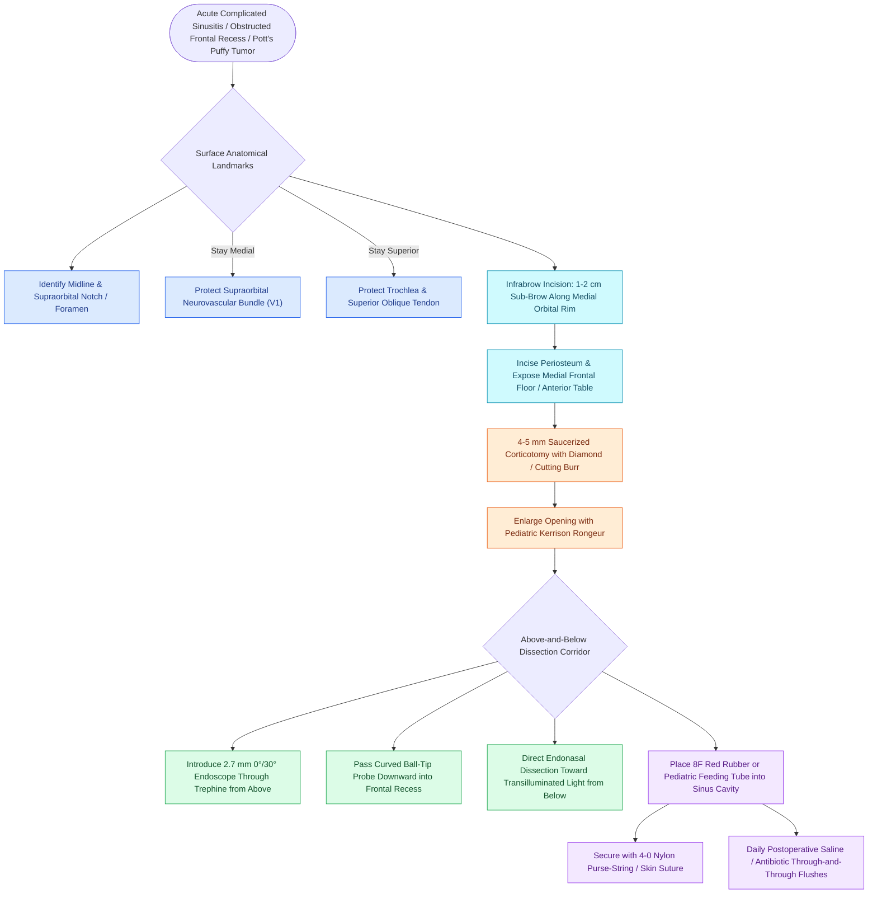

# Frontal sinus mini-trephination provides above-and-below endoscopic visualization and catheter irrigation for refractory frontal disease

## Active Recall

> [!question]- What are the precise surface anatomical landmarks that define the safe entry zone for frontal sinus trephination?
> *Answer / Clinical Rationale*: Entry must be positioned **1 cm superior to the supraorbital rim** and **1 cm lateral to the midline** (or at the medial floor of the sinus); it must remain **strictly medial to the supraorbital notch/foramen** (to avoid V1 injury) and **strictly superior to the trochlear fovea** (to prevent superior oblique tendon damage and vertical diplopia).

> [!question]- What are the comparative advantages and disadvantages of an infrabrow incision compared to suprabrow and intrabrow approaches?
> *Answer / Clinical Rationale*: The **infrabrow incision** is the preferred standard because it heals within the natural shadow of the supraorbital rim with minimal scarring, zero risk of brow alopecia, and minimal risk of V1 anesthesia; suprabrow incisions leave visible forehead scars and carry high numbness risks, while intrabrow incisions risk transecting hair follicles and causing permanent brow alopecia.

> [!question]- How does the 'above-and-below' hybrid technique resolve complete frontal recess scarring during revision surgery?
> *Answer / Clinical Rationale*: Introducing a 2.7 mm 0° or 30° endoscope or curved ball-tip probe from above through the trephine directly transilluminates and identifies the true anatomical ostium, guiding endonasal instruments dissecting through dense scar from below without straying into the orbit or skull base.

## Core Clinical & Mechanistic Principles
Originally described by Ogston in 1884, frontal sinus trephination remains an indispensable minimally invasive technique in modern sinus surgery. While advanced endoscopic procedures (such as Draf IIa and Draf III) address most pathology endonasally, frontal mini-trephination serves as an essential hybrid port for emergent drainage, through-and-through irrigation, and visual guidance in complex revision procedures, particularly for lateral [[Frontal sinus mucoceles cause bony erosion, proptosis, and intracranial extension|frontal sinus mucoceles]] or outflow tract stenosis secondary to [[Middle turbinate lateralization causes secondary ostiomeatal obstruction and frontal sinus stenosis|middle turbinate lateralization]].

### Indications for Frontal Trephination
1. **Acute Complicated Frontal Sinusitis**: Immediate decompression of empyema causing orbital cellulitis, subperiosteal abscess, or intracranial sepsis when endonasal instrumentation is unsafe.
2. **Pott's Puffy Tumor**: Direct purulent drainage and culture sampling in frontal bone osteomyelitis.
3. **Severe Frontal Recess Neo-osteogenesis**: Resolves anatomical disorientation in revision surgery using the "above-and-below" technique.
4. **Far-Lateral Frontal Pathology**: Accessing mucoceles, inverted papillomas, or osteomas beyond the lateral reach of 70° angled endonasal instruments.

### Surgical Technique & Cannulation Protocol
1. **Incision Selection**: An **infrabrow incision** is placed along the superomedial orbital rim just below the medial eyebrow hairs.
2. **Bony Trephination**: A 4-mm to 5-mm circular corticotomy is drilled using a cutting or diamond burr under continuous irrigation. The bone edges are saucerized, and a pediatric Kerrison rongeur is used to expand the opening to 6–8 mm, avoiding bony splintering.
3. **Above-and-Below Hybrid Maneuver**: A 2.7-mm 0° or 30° endoscope is inserted into the frontal sinus from above, providing panoramic visualization of the sinus floor, posterior table, and frontal ostium. A curved probe passed from above through the frontal recess transilluminates mucosal barriers, enabling safe endonasal clearance from below.
4. **Postoperative Irrigation Stent**: An 8F red rubber catheter or pediatric feeding tube is advanced through the trephine into the frontal sinus cavity. It is anchored to the skin with 4-0 nylon sutures and connected to an irrigation system, providing daily through-and-through saline and topical antibiotic flushes for 7 to 14 days until mucosal inflammation resolves and outflow patency is restored.

## Connected Concepts & Graph Traversal
- **Foundational Procedure**: [[Frontal sinus trephination provides combined endoscopic and percutaneous visualization and irrigation|Frontal Trephination Overview]]
- **Complicated Infection**: [[Pott's puffy tumor represents subperiosteal abscess and frontal bone osteomyelitis from sinusitis|Pott's Puffy Tumor]]
- **Outflow Tract Anatomy**: [[The frontal recess is bounded by the agger nasi, middle turbinate, and skull base|Frontal Recess Boundaries]]
- **Endoscopic Ostial Resection**: [[Draf IIa frontal sinusotomy resects the sinus floor between middle turbinate and lamina|Draf IIa Sinusotomy]]
- **Complete Frontal Drill-Out**: [[Draf III modified Lothrop unites both frontal sinuses into a common cavity|Draf III Modified Lothrop]]
- **Thermal Safety**: [[Curved diamond and cutting burrs with continuous irrigation prevent frontal beak thermal osteonecrosis|Frontal Beak Drill Safety]]
