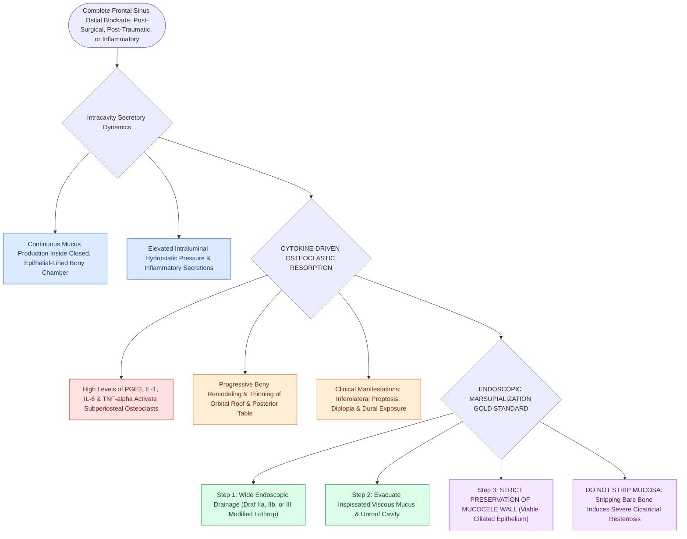

# Frontal sinus mucoceles cause bony erosion, proptosis, and intracranial extension

## Active Recall

> [!question]- Why is complete stripping of the mucosal lining of a frontal mucocele strictly avoided during endoscopic surgery?
> *Answer / Clinical Rationale*: The mucocele wall is composed of **viable respiratory epithelium**. Wide marsupialization allows this mucosa to function normally; stripping it exposes bare cortical bone, leading to severe osteoneogenesis and ostial stenosis.

> [!question]- What inflammatory mediators in mucocele fluid stimulate progressive osteoclast-mediated bone erosion?
> *Answer / Clinical Rationale*: Elevated levels of **Prostaglandin E2 (PGE2), Interleukin-1 (IL-1), Interleukin-6 (IL-6), and TNF-$\alpha$**.

## Core Clinical & Mechanistic Principles
A **mucocele** is an expansile, mucus-filled, epithelial-lined cyst resulting from complete obstruction of a sinus ostium. The **frontal and frontoethmoidal sinuses** are the most common sites ($>60\text{–}70\%$ of all paranasal sinus mucoceles).

### Endoscopic Marsupialization Gold Standard
- **Wide Marsupialization**: Endoscopic Draf IIa, IIb, or III procedure to widely unroof the mucocele and integrate it into the nasal cavity.
- **Lining Preservation**: The mucosal lining of the mucocele is **normal [[Respiratory epithelium drives mucociliary clearance toward natural ostia|respiratory epithelium]]** and should **NOT be stripped**, as stripping bare bone induces severe circumferential scarring and restenosis.

## Connected Concepts & Graph Traversal
- **Surgical Platform**: [[Draf IIa frontal sinusotomy resects the sinus floor between middle turbinate and lamina|Draf IIa Sinusotomy]]
- **Differential Pathology**: [[Pott's puffy tumor represents subperiosteal abscess and frontal bone osteomyelitis from sinusitis|Pott's Puffy Tumor]]
- **Restenosis Prevention**: [[Nasal beak drill-out and mucosal grafting prevent neo-ostium restenosis in Draf III|Mucosal Grafting]]
- **Diagnostic Evaluation**: [[Draf I frontal sinusotomy clears obstructing ethmoid cells without instrumenting the ostium|Draf I Frontal Sinusotomy]]
- **Surgical Craft**: [[Abdominal fat obliteration of the frontal sinus requires meticulous complete mucosal de-epithelialization|Frontal Fat Obliteration]]
- **Anatomical Foundation**: [[Draf IIb frontal sinusotomy extends from lamina papyracea to the nasal septum|Draf IIb Frontal Sinusotomy]]
- **Precipitating Condition**: [[Frontal sinus mini-trephination provides above-and-below endoscopic visualization and catheter irrigation for refractory frontal disease|Frontal Sinus Mini-Trephination]]
