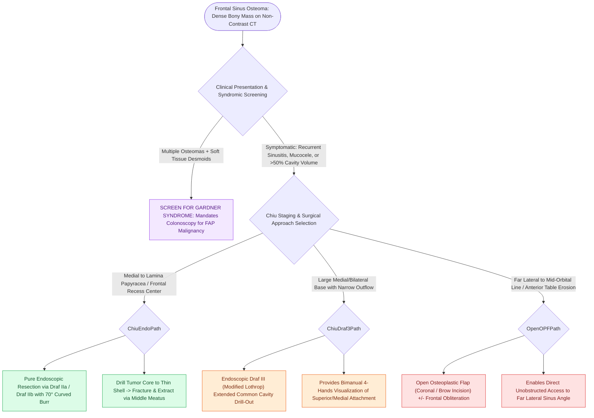

# Frontal sinus osteomas require endoscopic Draf or open osteoplastic resection when obstructing outflow

## Active Recall

> [!question]- What genetic syndrome must be evaluated when a patient presents with multiple sinonasal osteomas?
> *Answer / Clinical Rationale*: **Gardner syndrome** (an autosomal dominant variant of Familial Adenomatous Polyposis / FAP), which carries a near-100% risk of colorectal carcinoma without prophylactic colectomy.

> [!question]- What radiological feature determines whether a frontal osteoma can be resected purely endoscopically?
> *Answer / Clinical Rationale*: The **lateral extent relative to the [[Draf IIb frontal sinusotomy extends from lamina papyracea to the nasal septum|lamina papyracea]] / mid-orbital line** and the relationship to the frontal outflow tract (medial tumors are resectable via Draf II/III; far lateral tumors require open osteoplastic flap).

## Core Clinical & Mechanistic Principles
**Osteomas** are the most common benign mesenchymal neoplasms of the paranasal sinuses, occurring most frequently in the **frontal sinus ($>60\%$)** and ethmoids. They are slow-growing, composed of mature lamellar (compact) or cancellous bone.

### Endoscopic vs Open Approach Selection (Chiu Grading)
- **Endoscopic Draf IIa / IIb / III**: Indicated for tumors medial to the [[Lamina papyracea dehiscence predisposes to orbital fat herniation and medial rectus injury|lamina papyracea]], centered in the frontal recess or medial frontal sinus.
- **Osteoplastic Flap (OPF)**: Indicated for osteomas situated far lateral to the mid-orbital line or involving the anterior table requiring cosmetic reconstruction.

## Connected Concepts & Graph Traversal
- **Surgical Access**: [[Draf III modified Lothrop unites both frontal sinuses into a common cavity|Draf III Lothrop]]
- **Open Access**: [[Osteoplastic flap with frontal sinus obliteration manages lateral frontal disease and osteomyelitis|Osteoplastic Flap]]
- **Mucocele Result**: [[Frontal sinus mucoceles cause bony erosion, proptosis, and intracranial extension|Frontal Mucoceles]]
- **Diagnostic Evaluation**: [[Draf I frontal sinusotomy clears obstructing ethmoid cells without instrumenting the ostium|Draf I Frontal Sinusotomy]]
- **Surgical Craft**: [[Abdominal fat obliteration of the frontal sinus requires meticulous complete mucosal de-epithelialization|Frontal Fat Obliteration]]
- **Staging System**: [[The Chiu classification stages frontal sinus osteomas to dictate endoscopic endonasal resection versus open osteoplastic flap approaches based on tumor dimensions and attachment|Chiu Classification of Frontal Sinus Osteomas]]
