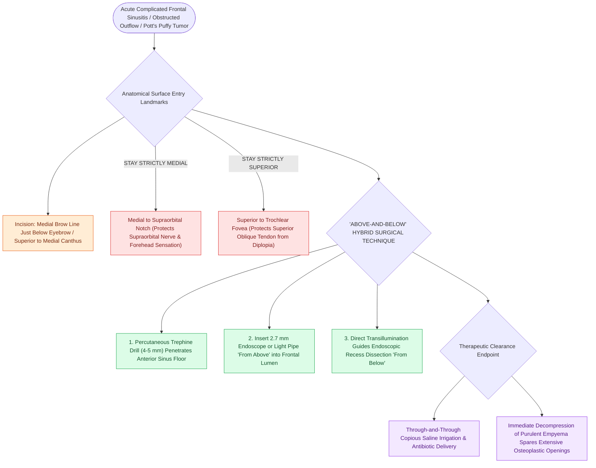

# Frontal sinus trephination provides combined endoscopic and percutaneous visualization and irrigation

## Active Recall

> [!question]- What is the 'above-and-below' hybrid technique in complex frontal sinus surgery?
> *Answer / Clinical Rationale*: Introducing an endoscope or light pipe percutaneously through a **frontal trephine from above** to illuminate and guide endoscopic instruments dissecting through the frontal recess **from below**.

> [!question]- What neurovascular structure must be safeguarded lateral to the frontal trephination site?
> *Answer / Clinical Rationale*: The **supraorbital nerve and artery** emerging from the supraorbital notch.

## Core Clinical & Mechanistic Principles
**Frontal Sinus Trephination** is a minimally invasive percutaneous procedure providing direct access to the frontal sinus lumen through its anterior-inferior floor.

It is utilized as an **emergent drainage maneuver for acute complicated frontal sinusitis (orbital cellulitis, intracranial abscess)** or as a **hybrid surgical adjunct** during complex [[Diagnostic rigid nasal endoscopy utilizes a standardized three-pass examination sequence|endoscopic]] frontal surgery.

### Avoiding Neurovascular Injury
- Entry must stay **medial to the supraorbital notch/foramen** to avoid injuring the **supraorbital neurovascular bundle**, and **superior to the trochlea** to prevent diplopia from superior oblique injury.

## Connected Concepts & Graph Traversal
- **Frontal Recess**: [[The frontal recess is bounded by the agger nasi, middle turbinate, and skull base|Frontal Recess Boundaries]]
- **Draf IIa Execution**: [[Draf IIa frontal sinusotomy resects the sinus floor between middle turbinate and lamina|Draf IIa Sinusotomy]]
- **Emergency Infection**: [[Pott's puffy tumor represents subperiosteal abscess and frontal bone osteomyelitis from sinusitis|Pott's Puffy Tumor]]
- **Critical Safety / Complication**: [[Esthesioneuroblastoma Kadish and Hyams staging determines craniofacial resection and adjuvant therapy|Esthesioneuroblastoma (ENB)]]
- **Surgical Technique**: [[Frontal sinus mini-trephination provides above-and-below endoscopic visualization and catheter irrigation for refractory frontal disease|Frontal Sinus Mini-Trephination]]
