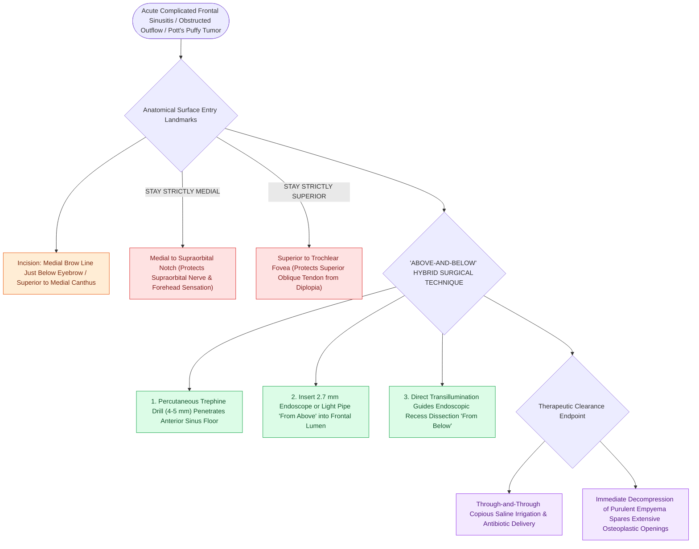

# Frontal sinus trephination provides combined endoscopic and percutaneous visualization and irrigation

## Active Recall

> [!question]- What is the 'above-and-below' hybrid technique in complex frontal sinus surgery?
> *Answer / Clinical Rationale*: Introducing an endoscope or light pipe percutaneously through a **frontal trephine from above** to illuminate and guide endoscopic instruments dissecting through the frontal recess **from below**.

> [!question]- What neurovascular structure must be safeguarded lateral to the frontal trephination site?
> *Answer / Clinical Rationale*: The **supraorbital nerve and artery** emerging from the supraorbital notch.

> [!question]- What exact surface anatomical landmarks define the safe entry zone and preferred skin incision for frontal sinus mini-trephination?
> *Answer / Clinical Rationale*: Trephination entry is positioned **$1\text{ cm}$ superior to the supraorbital rim** and **$1\text{ cm}$ lateral to the midline** (medial frontal floor), staying **strictly medial to the supraorbital notch/foramen** (protecting $V_1$) and **strictly superior to the trochlear fovea** (protecting the superior oblique tendon from vertical diplopia). An **infrabrow incision** along the natural rim shadow is preferred over suprabrow (visible scar/numbness) and intrabrow (follicular transection and permanent brow alopecia) incisions.

## Core Clinical & Mechanistic Principles
Originally described by Ogston in 1884, **Frontal Sinus Trephination (Mini-Trephination)** is a minimally invasive percutaneous procedure providing direct access to the frontal sinus lumen through its anterior-inferior floor.

It serves four core roles alongside [[Diagnostic rigid nasal endoscopy utilizes a standardized three-pass examination sequence|endoscopic]] sinus surgery:
1. **Acute Complicated Frontal Sinusitis**: Emergent drainage for empyema causing orbital cellulitis, subperiosteal abscess, or intracranial sepsis when endonasal instrumentation is unsafe.
2. **Pott's Puffy Tumor**: Direct purulent decompression and culture sampling in frontal bone osteomyelitis.
3. **Severe Frontal Recess Neo-Osteogenesis**: Resolving complete scarring (e.g., from [[Middle turbinate lateralization causes secondary ostiomeatal obstruction and frontal sinus stenosis|middle turbinate lateralization]]) via the **"above-and-below"** hybrid technique, passing a $2.7\text{ mm}$ ($0^\circ/30^\circ$) endoscope or curved ball-tip probe from above to transilluminate the true ostium and guide endonasal dissection from below.
4. **Far-Lateral Frontal Pathology**: Accessing lateral [[Frontal sinus mucoceles cause bony erosion, proptosis, and intracranial extension|frontal sinus mucoceles]], inverted papillomas, or osteomas beyond the reach of $70^\circ$ endonasal instruments.

### Avoiding Neurovascular Injury & Cannulation Protocol
- **Incision & Landmarks**: Place a $1\text{–}2\text{ cm}$ **infrabrow incision** along the superomedial orbital rim ($1\text{ cm}$ superior to the rim, $1\text{ cm}$ lateral to midline), staying **strictly medial to the supraorbital notch/foramen** (protecting the supraorbital neurovascular bundle) and **strictly superior to the trochlear fovea** (preventing diplopia from superior oblique injury).
- **Bony Trephination & Hybrid Dissection**: Drill a $4\text{–}5\text{ mm}$ saucerized corticotomy with a cutting or diamond burr under continuous irrigation and expand to $6\text{–}8\text{ mm}$ with a pediatric Kerrison rongeur without splintering. Introduce a $2.7\text{ mm}$ $0^\circ/30^\circ$ endoscope or curved probe from above to transilluminate the frontal recess for safe endonasal dissection from below.
- **Postoperative Irrigation Stent**: Advance an **8F red rubber catheter** or pediatric feeding tube into the sinus, secure with 4-0 nylon sutures, and perform daily through-and-through saline and topical antibiotic flushes for **7 to 14 days** until outflow patency is restored.

## Connected Concepts & Graph Traversal
- **Frontal Recess**: [[The frontal recess is bounded by the agger nasi, middle turbinate, and skull base|Frontal Recess Boundaries]]
- **Draf IIa Execution**: [[Draf IIa frontal sinusotomy resects the sinus floor between middle turbinate and lamina|Draf IIa Sinusotomy]]
- **Complete Frontal Drill-Out**: [[Draf III modified Lothrop unites both frontal sinuses into a common cavity|Draf III Modified Lothrop]]
- **Emergency Infection**: [[Pott's puffy tumor represents subperiosteal abscess and frontal bone osteomyelitis from sinusitis|Pott's Puffy Tumor]]
- **Thermal Safety**: [[Curved diamond and cutting burrs with continuous irrigation prevent frontal beak thermal osteonecrosis|Frontal Beak Drill Safety]]
