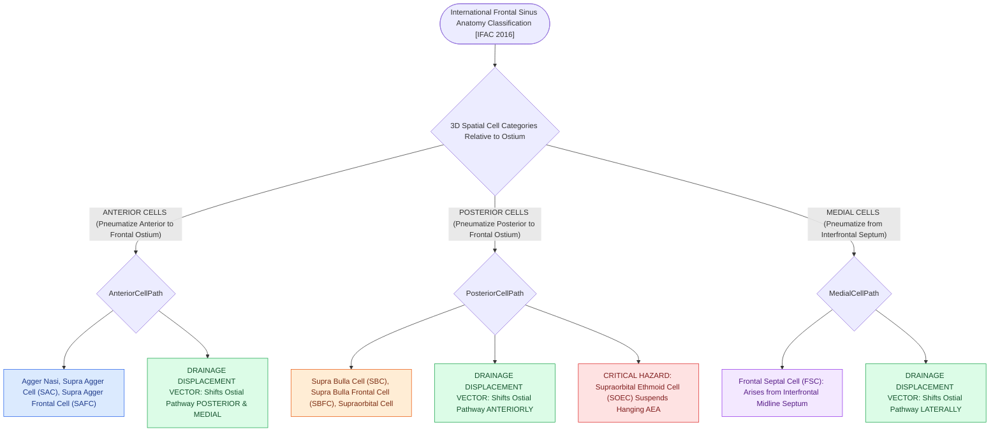

# Frontoethmoidal cell classification by IFAC standardizes anterior and posterior frontal cells

## Active Recall

> [!question]- How do anterior frontal recess cells (e.g., [[Agger nasi cells form the anterior boundary of the frontal recess|Agger Nasi]], Supra Agger) displace the frontal sinus drainage pathway?
> *Answer / Clinical Rationale*: Anterior cells displace the drainage pathway **posteriorly and medially**.

> [!question]- What defines a Supraorbital Ethmoid Cell (SOEC) in the IFAC system?
> *Answer / Clinical Rationale*: An ethmoid cell that pneumatizes **laterally and superiorly over the orbital roof posterior to the frontal sinus**, frequently carrying the anterior ethmoidal artery in a hanging mesentery.

## Core Clinical & Mechanistic Principles
In 2016, the **International [[The uncinate process superior attachment dictates the frontal sinus drainage pathway|Frontal Sinus]] Anatomy Classification (IFAC)** was developed to provide a standardized, three-dimensional classification of frontal recess air cells based on their **anatomical relationship to the frontal sinus ostium (Anterior, Posterior, or Medial)**.

### Clinical Utility vs Kuhn Classification
- While the older Kuhn system focused primarily on cell height (Types 1–4), IFAC dictates the **exact spatial displacement of the frontal drainage pathway**, guiding which angle endoscope and curved instruments to use.

## Connected Concepts & Graph Traversal
- **Kuhn System**: [[The Kuhn classification stages frontal recess and frontal sinus air cells|Kuhn Classification]]
- **AEA Relation**: [[Supraorbital ethmoid cells suspend the anterior ethmoidal artery below the skull base|Supraorbital Ethmoid Cells]]
- **Frontal Boundaries**: [[The frontal recess is bounded by the agger nasi, middle turbinate, and skull base|Frontal Recess 3D Boundaries]]
- **High-Stakes Safety**: [[Separate inferior antrostomies cause recirculating mucus and recalcitrant sinusitis|Mucus Recirculation Phenomenon]]
- **Anatomical Foundation**: [[Agger nasi cells form the anterior boundary of the frontal recess|Agger Nasi Cell Anatomy]]
