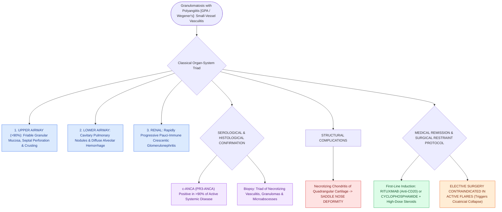

# Granulomatosis with polyangiitis presents with necrotizing sinonasal granulomas and saddle nose

## Active Recall

> [!question]- What serological marker is highly sensitive and specific for Granulomatosis with Polyangiitis?
> *Answer / Clinical Rationale*: **c-ANCA (cytoplasmic antineutrophil cytoplasmic antibodies) targeting Proteinase 3 (PR3-ANCA)**, positive in $>90\%$ of active systemic disease.

> [!question]- What structural nasal deformity classically results from untreated sinonasal GPA?
> *Answer / Clinical Rationale*: A **saddle nose deformity** caused by destructive necrotizing chondritis of the cartilaginous nasal septum and loss of dorsal L-strut support.

## Core Clinical & Mechanistic Principles
**Granulomatosis with Polyangiitis (GPA / formerly Wegener’s)** is an autoimmune necrotizing small-to-medium vessel vasculitis characterized by a classic **triad of upper airway, lower respiratory tract (pulmonary nodules/cavitations), and renal (pauci-immune crescentic glomerulonephritis)** involvement.

The sinonasal tract is involved in **$>90\%$ of patients** and is frequently the presenting site.

### Medical First-Line vs Surgical Restraint
- **Medical Remission**: Induction with **Rituximab (anti-CD20)** or Cyclophosphamide + high-dose [[The Lund-Kennedy endoscopic staging system tracks mucosal edema, polyps, and discharge|systemic]] Corticosteroids.
- **Surgical Restraint**: Elective FESS and septorhinoplasty are **contraindicated during active inflammatory flares** (leads to aggressive mucosal scarring and structural collapse). Surgery is limited to emergent drainage of obstructed infections or subglottic dilation.

## Connected Concepts & Graph Traversal
- **Systemic Granuloma**: [[Sarcoidosis of the upper respiratory tract causes non-caseating granulomas and mucosal cobblestoning|Sinonasal Sarcoidosis]]
- **Non-T2 Endotype**: [[Non-Type 2 CRS features neutrophilic inflammation associated with cystic fibrosis and ciliopathies|Non-Type 2 CRS]]
- **Endoscopic Tracking**: [[The Lund-Kennedy endoscopic staging system tracks mucosal edema, polyps, and discharge|Lund-Kennedy Score]]
- **Disease Mechanism**: [[The Gell and Coombs classification delineates four distinct immunologic hypersensitivity mechanisms underlying otolaryngic disease|Type III Immune Complex Vasculitis]]
- **Anatomical Foundation**: [[Eosinophilic granulomatosis with polyangiitis causes asthma, peripheral eosinophilia, and necrotizing vasculitis|Eosinophilic Granulomatosis with Polyangiitis]]
