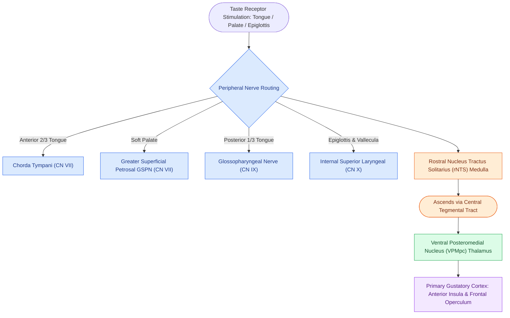

# Gustatory sensation is transmitted via the chorda tympani, greater superficial petrosal, glossopharyngeal, and superior laryngeal nerves

## Active Recall

> [!question]- What four peripheral cranial nerve branches transmit special sensory gustatory (taste) information from specific regions of the oral cavity, palate, and pharynx?
> *Answer / Clinical Rationale*: - (1) **Chorda Tympani Nerve ($CN\ VII$)**: Innervates fungiform papillae across the **anterior two-thirds of the tongue** (traveling via the lingual nerve $V_3$, middle ear cleft, and nervus intermedius). - (2) **Greater Superficial Petrosal Nerve (GSPN, $CN\ VII$)**: Innervates taste buds located on the **soft palate and palatal mucosa**. - (3) **Glossopharyngeal Nerve ($CN\ IX$)**: Innervates circumvallate and foliate papillae across the **posterior one-third of the tongue**, and adjacent tonsillar pillars. - (4) **Superior Laryngeal Nerve (Internal Branch, $CN\ X$)**: Innervates taste buds located on the **epiglottis, vallecula, and posterior pharyngeal wall**.

> [!question]- What are the five basic taste modalities and their specific transduction receptor mechanisms?
> *Answer / Clinical Rationale*: - **Sweet**: G-protein coupled heterodimer receptor **$T1R2 + T1R3$** (activates gustducin / PLC$\beta 2$ / TRPM5). - **Umami (Savory)**: G-protein coupled heterodimer receptor **$T1R1 + T1R3$** (responds to L-glutamate). - **Bitter**: G-protein coupled monomer receptors **$T2Rs$** ($>30$ distinct subtypes detecting alkaloids and toxins). - **Salty**: Ionotropic **epithelial sodium channels (ENaC)** allowing direct $Na^+$ entry and depolarization. - **Sour (Acidic)**: Ionotropic proton channel **OTOP1 (Otopetrin-1)** permitting direct $H^+$ influx, blocking inward-rectifying $K^+$ channels ($Kir2.1$).

> [!question]- What is the central ascending neuroanatomical pathway for taste from the brainstem to the primary gustatory cortex?
> *Answer / Clinical Rationale*: Peripheral taste fibers synapse in the **rostral (gustatory) division of the Nucleus Tractus Solitarius (rNTS)** in the medulla $\rightarrow$ second-order neurons ascend uncrossed via the **central tegmental tract** to the **ventral posteromedial (VPM) nucleus of the thalamus (parvocellular part, VPMpc)** $\rightarrow$ third-order neurons project to the **primary gustatory cortex** located in the **anterior insula and adjacent frontal operculum**.

## Core Clinical & Mechanistic Principles

Gustatory sensation operates through specialized **taste buds** (aggregations of 50–100 neuroepithelial cells) embedded within lingual papillae (fungiform, foliate, and circumvallate) and extralingual mucosa, transmitted by four cranial nerve pathways including the [[The facial recess is bounded by the facial nerve, chorda tympani, and fossa incudis|chorda tympani]] ($CN\ VII$), GSPN ($CN\ VII$), glossopharyngeal nerve ($CN\ IX$), and the internal branch of the [[The superior laryngeal nerve provides supraglottic sensation and cricothyroid motor control|superior laryngeal nerve]] ($CN\ X$):

### Clinical Chemosensory Pearls & Flavor Perception
- **Flavor vs Taste**: Most patient complaints of "loss of taste" are actually deficits in **retronasal olfaction** (volatile food odorants traveling from the oropharynx to the olfactory cleft during mastication and deglutition, quantified on [[UPSIT and CCCRC tests quantify olfactory thresholds and odor identification in chemosensory disorders|UPSIT testing]]). True agueusia (complete loss of basic taste sensations) is exceedingly rare due to bilateral multi-nerve redundancy.
- **Burning Mouth Syndrome (Glossodynia)**: Neuropathic dysesthesia frequently associated with chorda tympani hypofunction or injury leading to central disinhibition of trigeminal lingual nerve nociceptive pathways.

## Connected Concepts & Graph Traversal
- **Olfactory Evaluation**: [[UPSIT and CCCRC tests quantify olfactory thresholds and odor identification in chemosensory disorders|UPSIT & Chemosensory Workup]]
- **Olfactory Neuroepithelium**: [[Olfactory neuroepithelium contains bipolar sensory neurons and basal stem cells|Olfactory vs Gustatory Transduction]]
- **🔗 Chorda Tympani Course (Otology)**: [[The facial recess is bounded by the facial nerve, chorda tympani, and fossa incudis|Chorda Tympani Surgical Anatomy]]
- **🔗 Topodiagnostic Testing (Otology)**: [[Topodiagnostic testing localizes facial nerve injury through Schirmer testing, stapedius reflexometry, and electrogustometry|Electrogustometry in Facial Palsy]]
- **🔗 GSPN Autonomic Couriers (Otology)**: [[The greater and lesser petrosal nerves function as parasympathetic couriers connecting middle ear nerves to the lacrimal and parotid glands|GSPN Parasympathetic & Taste Pathways]]
- **🔗 Cranial Nerve Reflexes (Otology)**: [[The twelve cranial nerves are evaluated by functional components, skull base exits, and clinical reflexes|Cranial Nerve Nuclei & NTS]]
